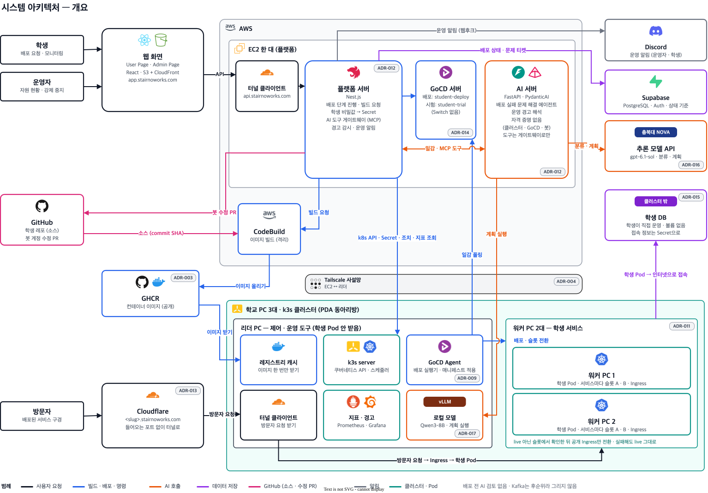

# WCP (Wang's Cloud Platform)

> 학교 PC 3대로 만든 클러스터에 학생이 GitHub 레포를 배포하고, 배포 과정을 AI 동료가 도와주는 플랫폼

2026 AI 우왕톤 18팀 왕가네식구들

| | 링크 |
| --- | --- |
| 서비스 | [app.stairnoworks.com](https://app.stairnoworks.com) |
| 시연 영상 | TBD (YouTube) |
| 발표 자료 | TBD (PDF) |
| Notion | [팀 대표 페이지](https://wangganae.notion.site/) |

# Summary

- **누가**: 처음 배포해 보는 학생, 그리고 배포한 서비스를 유지하며 모니터링하고 사용자 의견을 듣고 싶지만 비용이 걱정되는 학생.
- **어떤 문제**: 개발 직군도 채용 공고의 우대사항 · 지원자격에 배포 경험이 들어가고(인프라 직군은 필수), 해커톤도 배포물을 요구하는 경우가 있어서 배포는 피할 수 없는 단계가 됐다. 그런데 학생에게는 세 가지가 걸린다.
  1. **처음 배포가 어렵다.** [설문](docs/survey.md) 응답 37명 중 15명(41%)이 배포 경험이 없다. 방법은 검색이나 AI로 알 수 있어도 내 빌드 로그와 환경을 보고 원인을 짚어 주는 곳은 없어서, 막히면 혼자 원인을 찾아야 한다.
  2. **배포한 뒤가 더 어렵다.** [설문](docs/survey.md)에서 "지속적인 유지보수 · 관리가 부담"이 25명(68%)이었고, 배포해 본 22명 중 지금도 운영 중인 사람은 7명(32%)뿐이다. CloudWatch 같은 도구가 있어도 메모리 · 디스크는 에이전트를 따로 설정해야 하고, 알람이 울려도 원인은 직접 찾아야 한다.
  3. **계속 운영하려면 비용이 든다.** [설문](docs/survey.md)에서 29명(78%)이 비용을 걱정했다. 서울 리전 AWS 온디맨드 기준으로 서비스 1개와 DB 1개를 항상 켜 두면 월 약 $57(스토리지 · 전송 제외)이고, 무료 플랜 크레딧 $200은 약 3.5개월이면 소진된다. 그래서 많은 프로젝트가 배포 직후나 과목 종료와 함께 내려간다.
- **기존 서비스**: 문제마다 한쪽이 부족하다.
  1. Vercel은 배포가 쉽지만 무료(Hobby)는 비상업 용도에 한정되고 함수 실행 시간(최대 300초) 같은 정해진 한도와 방식에 맞춰야 한다. 서버를 직접 띄울 수 있는 AWS · Azure · GCP는 네트워크 · 권한 · 요금을 직접 구성해야 해서 처음 쓰기에 어렵다.
  2. 모니터링과 이상 분석은 직접 설정해야 한다. AI 보조(Vercel Agent, AWS DevOps Agent)는 사용량 기준으로 과금된다(AWS는 에이전트가 일한 시간당, Vercel은 모델 토큰 기준).
  3. 무료 범위에는 기간 · 한도가 있다. AWS 무료 플랜은 6개월이 지나거나 크레딧이 떨어지면 끝나고, Azure는 30일, GCP는 90일 체험이며, Vercel Hobby는 월 사용량 한도를 넘으면 기다리거나 배포가 일시 중지될 수 있다.
- **어떻게**: Vercel처럼 쉽게 배포하면서 서버 코드(Dockerfile 기반)를 그대로 올리는 플랫폼이다. 위 세 문제를 하나씩 푼다.
  1. 공개 GitHub 레포 주소만 넣으면 빌드 · 배포 · 동작 확인 · 공개 주소 연결(`<slug>.stairnoworks.com`)까지 플랫폼이 정해진 단계로 진행한다. 배포가 막히면 AI 에이전트가 원인을 찾아 고친다.
  2. 서비스 상태와 지표를 화면에서 보고, 이상 경고가 울리면 AI가 원인과 다음 행동을 제안한다.
  3. 비용은 교내 유휴 PC를 클러스터로 묶어 쓰는 방식을 제안한다. PC가 있는 강의실 4곳은 수업에 쓰이는 시간이 주당 46시간뿐이라 평일 24시간 기준 약 90%가 비어 있다([상세](docs/classroom-usage.md)). 기자재 신청으로 빌린 PC 3대로 MVP를 완성했고, 학교의 유휴 자원을 재활용하면 학생이 클라우드 비용 없이 배포하고 운영할 수 있다고 본다. 학교 도입은 확정이 아니라 제안 단계다. 비용 부담 없이 서비스를 계속 열어 두면 학생은 실제 사용자의 의견을 듣고 운영과 유지보수를 이어 갈 수 있다.
- **AI 동료가 하는 일**: 배포가 실패하면 AI 에이전트가 문제 티켓을 받아 원인을 찾고, 플랫폼이 허락한 도구로만 공개되지 않은 슬롯에서 고쳐 다시 확인한다. 레포 파일을 고쳐야 하면 봇 계정으로 수정 PR을 낸다. 운영 중 경고가 울리면 원인과 다음 행동을 제안한다.
- **사람이 결정하는 일**: 수정 PR 머지는 학생이, 경고 뒤 중지 · 무시는 운영자와 학생이 정한다. AI는 공개 주소를 바꾸지 않고, 비밀값을 읽지 않는다.

AI가 쓰이는 곳, 모킹 · 샘플, 검증하지 못한 것은 [`docs/ai-scope.md`](docs/ai-scope.md)에 작성되어 있습니다.

# Features

| 기능 | 내용 |
| --- | --- |
| 배포 | 이메일 로그인 + GitHub 연동, 레포 소유 확인과 commit 확정, 설정 파일로 배포 설정 초안 채우기(규칙 코드), 비밀값 입력, 빌드 → 배포 → 동작 확인 → 공개 주소 연결, 진행 상태 · 결과 주소 |
| 무중단 전환 | 서비스마다 슬롯 A · B를 두고 live가 아닌 슬롯에 배포해 확인한 뒤 공개 연결만 바꾼다. 실패해도 지금 서비스는 그대로다 ([ADR-011](docs/adr/011-deploy-slots-a-b.md)) |
| 보안 검사 | 확정한 commit을 [gitleaks](https://github.com/gitleaks/gitleaks) · [Trivy](https://github.com/aquasecurity/trivy)로 검사해 경고한다. |
| AI 문제 해결 | 실패를 문제 티켓으로 넘기면 추론 모델이 분류 · 계획하고 로컬 모델이 실행한다. 시험 전용 파이프라인에서 고쳐 본 뒤 배포를 처음부터 다시 실행한다 ([ADR-014](docs/adr/014-agent-trial-pipeline-and-rerun.md) · [ADR-017](docs/adr/017-planner-plans-local-executes.md)) |
| 운영 알림 | 재시작 반복은 규칙 코드가 바로 멈추고, 그 밖의 경고는 AI가 위험 · 권고 · 원인을 붙여 화면과 Discord로 알린다 (판단 정확도는 미검증) |
| 모니터링 · 제어 | 학생: 서비스 상태 · 지표 그래프 · 재시작 · 중지/재개 · 삭제. 운영자: 노드 자원 · 실행 중인 서비스 · 강제 중지 |

# Architecture

| 다이어그램 | 무엇을 보여 주나 |
| --- | --- |
| [개요](docs/architecture/overview.drawio.svg) | 구성요소 전체와 연결 |
| [배포 워크플로우](docs/architecture/deploy-workflow.drawio.svg) | W0~W7 단계, 파이프라인 스테이지, 슬롯 A · B, 실패 처리 |
| [AI 에이전트 흐름](docs/architecture/agent-flow.drawio.svg) | 문제 티켓 → 분류 · 계획 · 실행 → 해결 결과 |
| [학생 배포 흐름](docs/architecture/user1-deployer.drawio.svg) | 학생이 보는 배포 과정 |
| [학생 모니터링 흐름](docs/architecture/user1-monitoring.drawio.svg) | 경고 · AI 판단 · 학생 제어 |
| [운영자 흐름](docs/architecture/user2-operator.drawio.svg) | 운영자 화면과 강제 중지 |
| [방문자 흐름](docs/architecture/user3-visitor.drawio.svg) | 공개 주소로 들어오는 길 |
| [클러스터](docs/architecture/cluster.drawio.svg) | 학교 PC 3대의 물리 · 클러스터 구성과 바깥 연결 |

# Tech Stack

| 영역 | 기술 | 결정 |
| --- | --- | --- |
| Frontend | React 19.3 + TypeScript 6.0 (Vite 8.3, Tailwind CSS 4.3), S3 + CloudFront | [ADR-001](docs/adr/001-stack-and-deployment.md) |
| Backend (플랫폼 서버) | Nest.js 12.3 (Node.js 22, TypeScript 6.0) on EC2 — 배포 단계 진행, 보안 검사, AI 도구 게이트웨이(MCP) | [ADR-001](docs/adr/001-stack-and-deployment.md) · [ADR-010](docs/adr/010-repo-analysis-and-security-scan-in-platform-server.md) · [ADR-012](docs/adr/012-agent-acts-through-platform-gateway.md) |
| AI 서버 | FastAPI 0.162 + PydanticAI 2.66 (Python 3.12) on EC2 | [ADR-001](docs/adr/001-stack-and-deployment.md) |
| AI 모델 | 추론 모델 `gpt-6.1-sol`(충북대 NOVA API Gateway, 분류 · 계획), 로컬 Qwen3-8B-AWQ(리더 vLLM v0.32.0, 실행) | [ADR-016](docs/adr/016-planner-model-nova-gateway.md) · [ADR-017](docs/adr/017-planner-plans-local-executes.md) |
| Database · Auth | Supabase (PostgreSQL · Auth) | [ADR-007](docs/adr/007-login-email-password-github-link.md) |
| 빌드 · 레지스트리 | AWS CodeBuild, GHCR(공개 이미지) | [ADR-001](docs/adr/001-stack-and-deployment.md) · [ADR-003](docs/adr/003-registry-ghcr.md) |
| 배포 파이프라인 | GoCD 26.1.0 (서버는 EC2, 실행기는 리더), 슬롯 A · B | [ADR-009](docs/adr/009-deploy-runs-on-leader-gocd-agent.md) · [ADR-011](docs/adr/011-deploy-slots-a-b.md) · [ADR-014](docs/adr/014-agent-trial-pipeline-and-rerun.md) |
| 클러스터 | k3s v1.37.2, 학교 PC 3대(리더 1 + 워커 2), 유선 스위치 | [ADR-005](docs/adr/005-k3s-cluster-on-school-pcs.md) · [ADR-008](docs/adr/008-node-network-on-school-wired-lan.md) |
| 네트워크 | Tailscale(서버 ↔ 클러스터 사설망), Cloudflare Tunnel(cloudflared 2026.10.7, 방문자 진입, `stairnoworks.com`) | [ADR-004](docs/adr/004-server-cluster-link-tailscale.md) · [ADR-013](docs/adr/013-visitor-entry-cloudflare-tunnel.md) |
| 모니터링 · 알림 | Prometheus · Grafana 13.3.0(kube-prometheus-stack 93.1.1, 리더), Discord 웹후크 | [ADR-006](docs/adr/006-metrics-on-leader-prometheus.md) |
| 학생 데이터 | 학생이 가져온 자기 DB (플랫폼은 DB · 볼륨을 띄우지 않는다) | [ADR-015](docs/adr/015-student-data-in-student-db.md) |
| 수정 PR | 봇 GitHub 계정의 fork → PR | [ADR-002](docs/adr/002-bot-account-for-fix-prs.md) |

# Open Source & External Sources

> 확인일 2026-11-15. 실제로 쓴 항목만 적었다. 버전은 `package.json` · 락 파일(`pnpm-lock.yaml` · `uv.lock`) · `Infra/` 매니페스트에 고정된 값이고, 앱 라이브러리는 minor까지만 적었다. 버전이 고정되지 않는 서비스는 `—`로 두고 확인일을 기준으로 한다.
> 어디까지 직접 만들었고, 어디에 AI를 썼고, 무엇을 검증하지 못했는지는 [`docs/ai-scope.md`](docs/ai-scope.md)에 있다. 이 장의 "쓴 범위"는 그 문서와 같다.

## 앱 라이브러리 · 프레임워크

| 이름 | 버전 | 라이선스 | 출처 | 쓴 범위 |
| --- | --- | --- | --- | --- |
| React · React DOM | 19.3 | MIT | [facebook/react](https://github.com/facebook/react) | FE 화면 |
| TypeScript | 6.0 | Apache-2.0 | [microsoft/TypeScript](https://github.com/microsoft/TypeScript) | FE · BE 언어 |
| Vite · Vitest | 8.3 · 5.0 | MIT | [vitejs/vite](https://github.com/vitejs/vite) · [vitest-dev/vitest](https://github.com/vitest-dev/vitest) | FE 빌드 · FE · BE 테스트 |
| Tailwind CSS | 4.3 | MIT | [tailwindlabs/tailwindcss](https://github.com/tailwindlabs/tailwindcss) | FE 스타일. 기성 컴포넌트 키트는 쓰지 않고 컴포넌트는 직접 구현 |
| react-router | 8.5 | MIT | [remix-run/react-router](https://github.com/remix-run/react-router) | FE 라우팅 |
| @tanstack/react-query | 5.107 | MIT | [TanStack/query](https://github.com/TanStack/query) | FE 데이터 읽기 · 캐시 |
| @supabase/supabase-js | 2.119 | MIT | [supabase/supabase-js](https://github.com/supabase/supabase-js) | 브라우저에서 Supabase Auth 호출 |
| ESLint · typescript-eslint · jsx-a11y · eslint-plugin-better-tailwindcss | 9.39 (FE) · 10.14 (BE) · 8.72 · 6.10 · 4.10 | MIT | [eslint/eslint](https://github.com/eslint/eslint) · [typescript-eslint](https://github.com/typescript-eslint/typescript-eslint) | 개발 도구. 앱 번들에 들어가지 않음 |
| Nest.js | 12.3 | MIT | [nestjs/nest](https://github.com/nestjs/nest) | 플랫폼 서버 |
| jose | 6.2 | MIT | [panva/jose](https://github.com/panva/jose) | BE의 Supabase 로그인 토큰 서명 검증 |
| @modelcontextprotocol/sdk | 1.32 | MIT | [modelcontextprotocol/typescript-sdk](https://github.com/modelcontextprotocol/typescript-sdk) | 플랫폼 서버의 MCP 게이트웨이(서버 쪽) |
| FastAPI · uvicorn | 0.162 · 0.54 | MIT · BSD-3-Clause | [fastapi/fastapi](https://github.com/fastapi/fastapi) · [encode/uvicorn](https://github.com/encode/uvicorn) | AI 서버 |
| PydanticAI (`pydantic-ai-slim[openai,mcp]`) | 2.66 | MIT | [pydantic/pydantic-ai](https://github.com/pydantic/pydantic-ai) | AI 서버의 에이전트 프레임워크(도구 호출 · 출력 검증 · MCP 클라이언트) |
| Node.js · Python | 22 · 3.12 | MIT · PSF | [nodejs/node](https://github.com/nodejs/node) · [python.org](https://www.python.org) | 실행 환경(Docker 이미지 `node:22-bookworm-slim` · `python:3.12-slim-bookworm`) |
| nginx | 1.27 | BSD-2-Clause | [nginx/nginx](https://github.com/nginx/nginx) | FE 로컬 컨테이너 개발용 정적 서빙, 학생 앱 기본 Dockerfile |

## 인프라 · 도구 오픈소스

| 이름 | 버전 | 라이선스 | 출처 | 쓴 범위 |
| --- | --- | --- | --- | --- |
| k3s | v1.37.2 | Apache-2.0 | [k3s-io/k3s](https://github.com/k3s-io/k3s) | 학교 PC 3대 클러스터 |
| GoCD (서버 · Agent) | 26.1.0 | Apache-2.0 | [gocd/gocd](https://github.com/gocd/gocd) | 배포 파이프라인. 서버는 EC2, 실행기는 리더 |
| Helm | 3.22.1 | Apache-2.0 | [helm/helm](https://github.com/helm/helm) | `helm template`으로 학생 앱 차트를 렌더링만 한다(클러스터에 설치하지 않음) |
| vLLM | v0.32.0 | Apache-2.0 | [vllm-project/vllm](https://github.com/vllm-project/vllm) | 리더 GPU에서 로컬 모델 서빙 |
| NVIDIA k8s-device-plugin | v0.20.1 | Apache-2.0 | [NVIDIA/k8s-device-plugin](https://github.com/NVIDIA/k8s-device-plugin) | 클러스터에서 GPU 사용 |
| Prometheus · kube-prometheus-stack | 차트 93.1.1 (Operator v0.95.1) | Apache-2.0 | [prometheus/prometheus](https://github.com/prometheus/prometheus) · [prometheus-community/helm-charts](https://github.com/prometheus-community/helm-charts) | 지표 수집 · 경고 |
| Grafana | 13.3.0 | AGPL-3.0 | [grafana/grafana](https://github.com/grafana/grafana) | 운영자용 지표 화면. 소스를 고치지 않고 설치만 했다 |
| cloudflared | 2026.10.7 | Apache-2.0 | [cloudflare/cloudflared](https://github.com/cloudflare/cloudflared) | 방문자 진입 터널(리더), 플랫폼 서버 주소 터널(EC2, 띄우는 스크립트는 미검증) |
| Distribution (`registry`) | 3.1.2 | Apache-2.0 | [distribution/distribution](https://github.com/distribution/distribution) | 리더의 GHCR 끌어오기 캐시 |
| gitleaks | v8.30.1 | MIT | [gitleaks/gitleaks](https://github.com/gitleaks/gitleaks) | 배포 입력의 commit에서 비밀값 검사(규칙 기반, AI 아님) |
| Trivy · Trivy DB | v0.76.1 · `trivy-db:2` | Apache-2.0 | [aquasecurity/trivy](https://github.com/aquasecurity/trivy) · [aquasecurity/trivy-db](https://github.com/aquasecurity/trivy-db) | 의존성 취약점 검사(규칙 기반, AI 아님). DB는 배포 때 받아 읽기 전용으로 붙인다 |
| Tailscale | — | 클라이언트 BSD-3-Clause, 서비스는 [약관](https://tailscale.com/terms) | [tailscale.com](https://tailscale.com) · [tailscale/tailscale](https://github.com/tailscale/tailscale) | 플랫폼 서버 ↔ 리더 사설망, 운영자 원격 접속 |

## AI 모델

| 이름 | 버전 · 확인일 | 라이선스 · 이용 조건 | 출처 | 쓴 범위 |
| --- | --- | --- | --- | --- |
| Qwen3-8B-AWQ (로컬, 리더 vLLM) | Hugging Face 커밋 `4da05a8` | Apache-2.0 | [Qwen/Qwen3-8B-AWQ](https://huggingface.co/Qwen/Qwen3-8B-AWQ) | 배포 실패 에이전트의 계획 실행(도구 호출 · 인자 채우기), 운영 알림의 AI 판단 1차. 학습 · 미세조정은 하지 않았다 |
| `gpt-6.1-sol` (충북대 NOVA API Gateway) | 2026-11-15 | NOVA 이용 안내 · 결과물 이용 안내 · 데이터 보안 정책을 따른다(아래 표) | [NOVA](https://aigpt.cbnu.ac.kr) · 게이트웨이 `https://factchat-cloud.mindlogic.ai/v1/gateway` | 배포 실패의 분류 · 계획, 운영 알림 판단(로컬 실패 시), 학생용 배포 설명. 실제 티켓에서의 호출 · 정확도는 **미검증** |

NOVA API Gateway 이용 조건과 우리가 지킨 방식:

| NOVA의 조건 | 우리의 대응 |
| --- | --- |
| 이용 대상은 충북대 재학생 · 교직원 | 게이트웨이 키는 서버 환경 변수(AWS SSM)로만 쓰고 레포에는 넣지 않는다 |
| 이름 · 주민등록번호 · 학번 · 연락처 등 개인정보와 기밀 자료 입력 금지 | 모델로 보내기 직전에 비밀값 가림 필터를 건다(정규식 · 이름 규칙이라 놓치는 모양이 있을 수 있다). 학생 레포의 로그 · 설정이 들어가므로 완전하지 않다. 이 한계는 [`docs/ai-scope.md`](docs/ai-scope.md) §5에 적었다 |
| 입력 · 업로드 데이터는 정책 범위 안에서 서비스 품질 개선에 쓰일 수 있고, 모델 제공사는 API 입출력을 학습에 쓰지 않는다 | 보내는 내용은 배포 실패 티켓의 로그 · 설정 발췌다. 가림 필터를 거친 글만 나간다 |
| 결과물의 이용 권한은 이용자에게 있고 출처 표기 의무는 없다. 제3자 권리 침해 여부와 모델 제공사 정책은 이용자가 확인한다 | 모델 출력은 코드 조치가 아니라 제안으로만 쓰고, 수정 PR 머지는 학생이 정한다 |
| 크레딧 소진 · 과도한 부하는 이용이 제한될 수 있다 | 추론 모델은 분류 · 계획 · 설명에만 쓰고 실행은 로컬 모델이 한다 |

## 외부 서비스 · API

| 이름 | 버전 · 확인일 | 이용 조건 | 출처 | 쓴 범위 |
| --- | --- | --- | --- | --- |
| Supabase (PostgreSQL · Auth) | — · 2026-11-15 | [약관](https://supabase.com/terms). 내장 메일 서버는 팀원 주소로만, 시간당 2통 | [supabase.com](https://supabase.com) | 로그인 · 가입 · GitHub 연동, 프로젝트 · 배포 기록 DB |
| AWS (CodeBuild · S3 · CloudFront · EC2 · SSM) | — · 2026-11-15 | On-demand, [AWS 약관](https://aws.amazon.com/service-terms/) | [aws.amazon.com](https://aws.amazon.com) | 이미지 빌드, 웹 정적 서빙, 플랫폼 서버 · AI 서버 · GoCD 서버 호스팅 |
| GHCR | — · 2026-11-15 | 공개 이미지 | [GitHub Packages](https://docs.github.com/packages/working-with-a-github-packages-registry/working-with-the-container-registry) | 학생 앱 이미지 레지스트리 |
| GitHub REST API · OAuth | — · 2026-11-15 | [GitHub 약관](https://docs.github.com/site-policy/github-terms/github-terms-of-service) | [docs.github.com/rest](https://docs.github.com/rest) | 레포 소유자 조회, commit 확정, 봇 계정의 fork · PR 생성, 계정 연동 |
| Cloudflare (Tunnel · DNS · 무료 인증서) | — · 2026-11-15 | [Cloudflare 약관](https://www.cloudflare.com/terms/) | [developers.cloudflare.com](https://developers.cloudflare.com/cloudflare-one/connections/connect-networks/) | `*.stairnoworks.com` 방문자 진입, `api.stairnoworks.com` |
| Discord 웹후크 | — · 2026-11-15 | [Discord 약관](https://discord.com/terms) | [개발자 문서](https://discord.com/developers/docs/resources/webhook) | 운영 알림 · 배포 결과 전달(AI 아님) |

## 글꼴 · 이미지

| 이름 | 라이선스 · 이용 조건 | 출처 | 쓴 범위 |
| --- | --- | --- | --- |
| 나눔스퀘어 네오 | 네이버가 무료로 배포하는 오픈 라이선스 글꼴이다. 개인 · 기업 모두 영리 · 비영리 목적으로 자유롭게 쓸 수 있고, 지식재산권은 (주)네이버에 있으며 글꼴 파일은 유료로 판매할 수 없다 | [네이버 한글한글아름답게](https://hangeul.naver.com/font) | 본문 · 제목. 네이버 CDN에서 불러오고 저장소에는 파일을 넣지 않았다 |
| 나눔고딕코딩 | SIL OFL 1.1 | [Google Fonts](https://fonts.google.com/specimen/Nanum+Gothic+Coding) | 로그 · 코드 블록. Google Fonts CDN |
| 서비스 로고 (`FE/public/logo.*`) | 팀이 직접 만든 이미지. ChatGPT로 이미지를 생성한 뒤 팀원이 최종 수정했다 | 레포 `FE/public/` | 화면 로고 |
| 랜딩 예시 화면 | 팀이 만든 샘플 데이터(`SAMPLE(landing-preview)`, 화면에 `샘플` 표시) | `FE/src/landing/sample.ts` | 랜딩 기능 소개 |

## 데이터 · 참고 자료

| 이름 | 확인일 | 출처 | 쓴 범위 |
| --- | --- | --- | --- |
| 소프트웨어학부 대상 설문 (구글폼, 응답 37명) | 2026-10-28 ~ 11-01 | 집계 결과는 [`docs/survey.md`](docs/survey.md). 원본 응답 CSV는 팀이 보관(개인을 알아볼 정보 없이 응답 시각만 남김, 레포에는 올리지 않음) | 문제 근거(비용 부담 · 배포 뒤 운영 종료). [`docs/SRS.md`](docs/SRS.md) §1.1 |
| 실습실 PC 수업 사용 시간 (PC가 있는 강의실 1470006 ~ 09, 2026-1 · 2학기) | 2026-11-15 | 팀이 확인한 강의실 사용 시간. 정리는 [`docs/classroom-usage.md`](docs/classroom-usage.md) | 유휴 자원의 근거. 주당 수업 46시간, 평일 24시간 기준 유휴 약 90%(수업 시간표만 센 이론치) |
| AWS 서울 리전 온디맨드 단가 — EC2 t3.small $0.026/시간, 공인 IPv4 $0.005/시간, ALB $0.0225/시간, RDS db.t4g.micro PostgreSQL $0.025/시간. 한 달 730시간 기준 합계 약 $57.3(스토리지 · 데이터 전송 · LCU 제외) | 2026-11-15 | [EC2](https://b0.p.awsstatic.com/pricing/2.0/meteredUnitMaps/ec2/USD/current/ec2-ondemand-without-sec-sel/Asia%20Pacific%20(Seoul)/Linux/index.json) · [ELB](https://pricing.us-east-1.amazonaws.com/offers/v1.0/aws/AWSELB/current/ap-northeast-2/index.json) · [VPC](https://pricing.us-east-1.amazonaws.com/offers/v1.0/aws/AmazonVPC/current/ap-northeast-2/index.json) · [RDS](https://pricing.us-east-1.amazonaws.com/offers/v1.0/aws/AmazonRDS/current/ap-northeast-2/index.json) | Summary "계속 운영하려면 비용이 든다"의 근거. 서비스 1개와 DB 1개를 항상 켜 두는 일반적인 구성을 가정한 단순 계산이다(우리 서비스의 실제 구성이 아니다) |
| 상용 클라우드 공식 문서 — Vercel Hobby 한도 · Functions 한도 · Agent 요금, AWS 무료 플랜 · DevOps Agent 요금, Azure 무료 계정, GCP 무료 체험 | 2026-11-15 | [Vercel Fair Use](https://vercel.com/docs/limits/fair-use-guidelines) · [Functions 한도](https://vercel.com/docs/functions/limitations) · [Agent 요금](https://vercel.com/docs/agent/pricing) · [AWS 무료 플랜](https://docs.aws.amazon.com/awsaccountbilling/latest/aboutv2/free-tier-plans.html) · [AWS DevOps Agent 요금](https://aws.amazon.com/devops-agent/pricing/) · [Azure 무료 계정](https://learn.microsoft.com/en-us/azure/cost-management-billing/manage/upgrade-azure-subscription) · [GCP 무료 체험](https://docs.cloud.google.com/free/docs/free-cloud-features) | 기존 서비스의 한계(Summary "기존 서비스"). 한도 · 요금은 바뀔 수 있어 확인일 기준 |
| 부산대 2024 졸업과제 기술보고서 | 2024-10 보고서 | [snbl.pusan.ac.kr](https://snbl.pusan.ac.kr/bbs/cse/12607/916565/download.do) | 선행 사례 비교. 아이디어만 비교하고 코드 · 문구는 가져오지 않았다 |
| 기존 서비스 비교 조사 (Cloudtype, Coolify 등) | 2026-10-31 | [Coolify CVE-2026-34057](https://nvd.nist.gov/vuln/detail/CVE-2026-34057) 외 각 제품 문서 | 기존 서비스와의 차이. [`docs/SRS.md`](docs/SRS.md) §1.4 |
| Heroku 무료 플랜 폐지 보도 | 2022-08-25 기사 | [TechCrunch](https://techcrunch.com/2022/08/25/heroku-announces-plans-to-eliminate-free-plans-blaming-fraud-and-abuse) | 무료 실행 환경 남용 우려의 근거 |
| 모델 학습 · 평가용 공개 데이터셋 | — | 해당 없음 | 모델은 사전 학습된 것을 그대로 쓰고 학습 · 미세조정 · 평가용 데이터셋을 쓰지 않았다 |

항목별 라이선스 전문과 데이터 출처 전체는 [`docs/ai-scope.md`](docs/ai-scope.md) §4에 있다.

# Documentation

| 문서 | 내용 |
| --- | --- |
| [`docs/SRS.md`](docs/SRS.md) | 요구사항 명세: 문제, 유즈케이스, 기능 · 비기능 요구사항, 데모 시나리오 |
| [`docs/system-definition.md`](docs/system-definition.md) | 시스템 정의서: 구성요소, 사용자별 흐름, 인프라 |
| [`docs/survey.md`](docs/survey.md) | 소프트웨어학부 대상 설문 결과 (문제의 근거) |
| [`docs/classroom-usage.md`](docs/classroom-usage.md) | 실습실 PC 수업 사용 시간과 유휴 비율 (유휴 자원의 근거) |
| [`docs/design/`](docs/design/README.md) | 모듈 설계와 FE · BE · AI API 계약 |
| [`docs/adr/`](docs/adr/README.md) | 기술 결정 기록 (ADR-001 ~) |
| [`docs/ai-scope.md`](docs/ai-scope.md) | AI · 외부 기술 · 모킹 · 미검증 범위 |
| [`CONTRIBUTING.md`](CONTRIBUTING.md) | 작업 방식 · git · PR 규칙 |
| [Notion](https://wangganae.notion.site/) | 회의록 · 칸반 · 개발 일지 |

# Getting Started

우왕톤 운영진 분들께서는 구글폼에 입력해드린 계정으로 접속하시면 됩니다.

(우왕톤 운영진이 아니신 분들도 회원가입을 통해 서비스 이용이 가능합니다.)