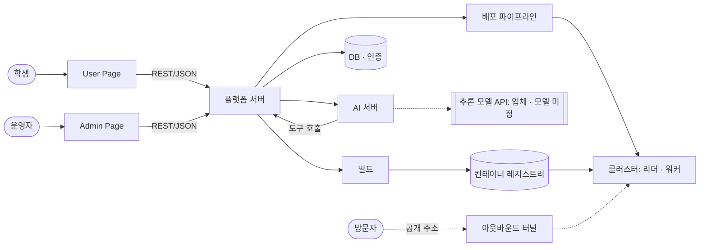

# 요구사항 명세 (SRS)

> 팀이 합의한 "무엇을 만드는가"이자 개발의 기준선. 유즈케이스(UC)에서 기능 요구사항(FR)을 뽑고, FR에서 데모 시나리오와 task를 뽑아 개발을 진행한다.
> ID는 커밋·PR·task 파일이 참조하므로 한 번 붙이면 바꾸지 않는다 (삭제는 ~~취소선~~ + 사유). 번호가 비는 것은 삭제의 흔적이지 누락이 아니다.
> 대회 규칙과 배점은 [`hackathon.md`](hackathon.md), 모듈별 상세 설계는 [`design/`](design/README.md). 이 문서는 팀 합의 후에만 바꾼다.

- **상태**: 합의됨 (2026-11-11. 배포 워크플로우에 맞춘 P0 변경(UC-05 삭제, UC-14 P0)까지 팀이 확인했다). 2026-11-13에 운영자 화면(UC-17)을 P0로 올렸다
- **프로젝트명**: WCP
- **한 줄 소개**: 클라우드 비용과 운영 부담 때문에 프로젝트를 내려 두던 학생이, 학교 PC에 GitHub 레포를 무료로 배포하고 배포가 막히면 AI 동료가 고쳐 줘서 과목이 끝난 뒤에도 서비스를 계속 운영한다.

| 종류 | 형식 | 예 |
| --- | --- | --- |
| 유즈케이스 | `UC-NN` | `UC-01` |
| 기능 요구사항 | `FR-NNN` | `FR-002` (UC와 무관한 연번. 소속 UC는 §4의 UC 제목으로 나타낸다) |
| 비기능 요구사항 | `NFR-<분류>-<순번>` | `NFR-PER-01` |

NFR 분류: `PER` 성능 · `SEC` 보안 · `REL` 신뢰성 · `USA` 사용성 · `OPS` 배포·운영

## 1. 개요

### 1.1 문제와 대상 사용자

- **누구**: 클라우드 비용을 내지 않고 프로젝트를 배포하고 싶은 학생, 프로젝트 과목이 끝난 뒤에도 서비스를 계속 운영하고 싶은 학생
- **지금 하는 방식**: Vercel, AWS, Cloudflare 등 상용 클라우드에 직접 배포하고, 무료 한도를 넘으면 비용을 직접 낸다.

| 문제 | 근거 (숫자 · 인터뷰 · 기사 · 직접 관찰) | 출처 |
| --- | --- | --- |
| 클라우드 비용과 크레딧이 부담된다 | 응답 37명 중 29명(78%)이 비용을 걱정한다(복수 선택: "요금이 예상보다 많이 나올까 봐" 23명, "무료 플랜의 한도 · 기간이 끝나면 비용을 내야 해서" 18명). 바라는 도움 1위는 "클라우드 비용 관리 및 무료 배포 방법" 28명(76%) | 구글폼 설문조사(학과 대상, 2026-10-28~31, 응답 37명) |
| 학교 컴퓨팅 자원이 남는다 | 실습실 PC는 하루 24시간 중 수업 시간(TBD시간)에만 쓰인다. 수업 중에도 개인 노트북 대신 실습실 PC를 쓰는 학생은 TBD%뿐이다. | 직접 체크 |
| 프로젝트 과목은 배포에서 끝난다 | 결과물을 배포하는 데서 끝나고, 배포 이후의 운영은 다루지 않는다. 배포해 본 22명 중 지금도 운영 중인 사람은 7명(32%)이고, 9명은 "프로젝트 과목에서 배포 후 운영 종료"다. 걱정되는 점 1위는 "지속적인 유지보수 및 관리가 부담" 25명(68%) | 구글폼 설문조사(학과 대상, 2026-10-28~31, 응답 37명) |

근거 출처는 [`ai-scope.md`](ai-scope.md) §4에도 올린다 (발표 부록).

### 1.2 해결 방법

- 학교에서 기자재 신청으로 빌려 받아 동아리방에 둔 PC 3대를 k3s 클러스터로 묶어, 학생이 자기 GitHub 레포를 배포하고 운영할 수 있는 플랫폼을 제공한다.
- 배포 중에 문제가 생기면 AI 에이전트가 원인을 찾아 고치고, 운영 중에는 지표 이상의 원인을 AI가 분석해 알린다.
- 배포 이후 운영까지 학교 자원에서 이어 가, 수업과 AI 부트캠프의 실습·수업 자원으로 쓴다.

### 1.3 AI 동료의 역할 경계

주제 "AI는 동료가 될 수 있을까?"에 대한 우리 답. **AI가 하는 일과 사람이 결정하는 일**을 가른다.

| 상황 | AI가 하는 일 | 사람이 하는 일 / 결정 | 상태 |
| --- | --- | --- | --- |
| ~~배포 전 보안 위험 검토~~ | ~~배포할 레포의 코드와 설정에서 보안 위험을 찾아 근거와 함께 알린다~~ | | 폐기 |
| 배포 중 빌드 · 배포 · 동작 확인이 실패한다 | AI 에이전트가 문제 티켓을 받아 원인을 찾고, 플랫폼의 도구로만 대상 슬롯에서 고쳐 다시 확인한 뒤 결과를 돌려준다. 레포 파일을 고쳐야 하면 확인한 변경을 수정 PR로 낸다 ([`design/deploy-workflow.md`](design/deploy-workflow.md) 6절, [ADR-012](adr/012-agent-acts-through-platform-gateway.md)) | 공개 주소 전환은 플랫폼 코드가 한 번 더 확인한 뒤 한다. 수정 PR 머지와 비밀값 · DB 문제는 학생이 정한다 | 확정 |
| 운영 중 지표 이상 발생 | 감지된 이상의 원인을 추정해 쉬운 말로 설명하고, 다음 행동을 제안하는 알림을 보낸다 | 알림을 보고 재시작·중단 등 조치를 정한다 | 확정 |
| ~~정적 사이트를 배포한다~~ | ~~레포가 정적 사이트인지 판별해 Cloudflare R2에 올린다~~ | | 폐기 |
| ~~정적 사이트를 배포한다~~ | ~~레포가 정적 사이트인지 판별해 교내 클러스터에 Pod로 배치한다~~ | | 폐기 |
| ~~동적 서비스를 배포한다~~ | ~~레포가 동적 서비스인지 판별해 교내 클러스터에 배치한다~~ | | 폐기 |
| 정적 사이트와 동적 서비스를 배포한다 | 서비스 유형은 AI가 정하지 않는다. 규칙 코드가 레포의 설정 파일로 배포 설정 초안을 채우고, 서비스 유형(정적 웹 / 서버 / 웹+서버)은 학생이 고른다. AI는 자기가 읽은 유형을 학생의 선택과 견줘 다르면 알릴 뿐이다(UC-21). 정해진 서비스는 교내 클러스터에 배치한다 ([ADR-010](adr/010-repo-analysis-and-security-scan-in-platform-server.md)) | 학생이 초안을 고쳐 확정한다 | 확정 |
| (시간이 남으면 추가) 동적 서비스를 배포하는데 교내 노드가 모두 꺼져 있다 | 클라우드 VM에 배치한다 | | 보류 |

정적 사이트와 동적 서비스를 AI가 판별하는 안도 **폐기**했다(초안은 규칙 코드가 채우고 유형은 학생이 고른다. AI는 자기가 읽은 유형을 학생의 선택과 견줘 다르면 알릴 뿐이다, UC-21). 정적 사이트를 외부 스토리지에 올리는 안은 **폐기**했다. 결과물을 교내 밖에 두면 "교내 유휴 자원으로 돌린다"는 강점이 사라진다. 정적 사이트도 동적 서비스와 같이 교내 클러스터에서 띄운다. 학생 서비스에서 교내 밖에 두는 것은 빌드 결과 이미지뿐이다(클러스터 밖 백업은 후순위). 우리 플랫폼(웹 · 플랫폼 서버 · AI 서버)은 클라우드에서 돈다 ([시스템 정의서](system-definition.md) §3 참고).

배포 전 AI 보안 검토도 **폐기**했다(2026-11-11). 합의된 [배포 워크플로우](design/deploy-workflow.md)의 정상 경로에는 AI가 없고(README 정리만), 문제가 생겼을 때만 AI 에이전트가 일한다. 보안 검사는 규칙 기반 도구가 하고 배포를 막지 않는다(UC-10).

### 1.4 이미 있는 것과의 차이

| 이미 있는 것 | 한계 | 우리는 |
| --- | --- | --- |
| 상용 클라우드 (AWS, Vercel, Cloudflare) | 학생 개인이 비용을 부담하고, 무료 범위에는 한도가 있다 | 학생 서비스는 학교 유휴 PC에서 실행돼 학생이 비용을 내지 않는다. 학교가 지원하면 실행 비용은 전기료 수준이고, 교내 밖에는 웹, 플랫폼 서버, AI 서버, 빌드, 컨테이너 레지스트리만 둔다. 교내 프로젝트와 해커톤(우왕톤 포함)에서 학생이 저렴하게 배포·운영한다 |
| 상용 AI 배포 보조 (Vercel Agent, AWS Security·DevOps Agent) | 유료이고 개발자·기업을 대상으로 한다 | 학생이 따로 설정하지 않아도 배포가 막히면 AI 에이전트가 고치고, 운영 중 이상 분석이 붙는다. 에이전트가 쓰는 도구와 그 경계(플랫폼 서버의 게이트웨이)를 직접 설계한다 |

### 1.5 범위

개발 마감([대회 일정](hackathon.md))까지 완성할 MVP 범위. 기능 단위의 정의는 §3 UC가 한다.

- 학생이 GitHub URL로 배포를 요청하면 플랫폼 서버가 빌드에 이미지 빌드를 요청하고, 교내 워커 노드가 그 이미지를 실행한다.
- 학교가 빌려준 PC 3대로 리더 노드 1대와 워커 노드 2대를 구성한다.
- 워커 노드 1대에는 학생 프로젝트를 1개만 배치한다 (워커 노드가 꺼진 동안 남은 워커 노드에 두 프로젝트가 함께 뜨는 경우는 제외).
- 배포 중 빌드 · 배포 · 동작 확인이 실패하면 AI 에이전트가 플랫폼 서버의 도구로만 대상 슬롯에서 원인을 찾아 고친다. 에이전트는 우리가 만든다.
- 운영 중 지표 이상이 감지되면 AI가 원인과 다음 행동을 분석해 알린다.
- 워커 노드가 꺼지면 그 노드에서 실행 중이던 서비스가 다른 워커 노드에서 다시 실행되고(페일오버), 사용자는 같은 entry point로 다시 접속한다.
- 플랫폼 서버는 우리 웹의 요청을 받아 배포 파이프라인을 실행시키고, 리더 노드의 배포 실행기가 배포를 적용한다. 어느 워커 노드에 배치할지는 리더 노드가 고른다.
- 우리 웹은 공개 URL로 접속할 수 있다.

### 1.6 범위 밖

MVP에서 만들지 않기로 한 것과 이유. 심사 Q&A에서 "왜 이건 없나요?"에 대한 답이 된다. 만들 것은 §3 UC가 정의한다.

- 페일오버는 무중단을 보장하지 않는다. 다른 워커 노드에서 다시 뜨는 동안 접속이 몇 분 끊긴다. 학생 서비스의 데이터는 클러스터에 두지 않고 학생이 가져온 자기 DB에 있다(2026-11-07 결정, [시스템 정의서](system-definition.md) §3). 그래서 앱만 다시 뜨고, 학생 DB의 백업과 복구는 플랫폼이 하지 않는다.
- 리더 노드가 죽었을 때 다른 노드를 리더로 승격하지 않는다. 스플릿 브레인 방지까지 만들기에는 기간이 부족해 리더 노드는 단일 장애점으로 둔다.
- 운영자가 배포를 미리 검토하거나 승인하지 않는다(2026-11-10 회의). 보안 검사 결과는 배포를 막지 않고 경고로 보여 준다(UC-10). 운영자는 실행 중인 서비스를 보고 강제로 끌 수 있다(UC-17).
- 이미 배포한 프로젝트의 환경 변수만 바꾸는 기능은 없다(2026-11-10 회의). 환경 변수를 바꾸려면 새로 배포한다. 새 버전은 레포 주소와 새 commit으로 다시 요청한다(UC-16).
- 학교에서 기자재 신청으로 빌려 받은 PC 3대(동아리방)는 24시간 우리 전용으로 쓴다. 수업용 실습실 PC를 수업 시간과 나눠 쓰는 스케줄링은 학교 협의가 필요하고 기간 안에 만들 수 없어 하지 않는다.

### 1.7 용어

| 용어 | 정의 |
| --- | --- |
| 플랫폼 서버 | 외부 클라우드에서 도는 우리 백엔드. 배포 요청 접수, 배포 설정 초안, 보안 검사, 배포 파이프라인 실행 요청, 실패했을 때 문제 티켓 만들기, AI 에이전트가 쓰는 도구의 게이트웨이를 맡는다 |
| 리더 노드 | k3s 컨트롤 플레인을 돌리는 교내 PC 1대. 워커 노드 선택(스케줄링)과 공개 진입(아웃바운드 터널)을 맡는다 |
| 워커 노드 | 학생 서비스와 Ingress를 실행하는 교내 PC |
| 페일오버 | 워커 노드가 꺼지면 그 노드의 서비스를 다른 워커 노드에서 다시 띄우는 것. 서비스는 한 벌만 띄우고 미리 띄워 둔 복제본은 없다 |
| ~~볼륨 사본~~ | ~~학생 서비스의 볼륨(DB · 업로드 폴더)을 다른 워커 노드에 실시간으로 복제해 둔 사본~~ (삭제: 2026-11-07 학생 볼륨을 클러스터에 두지 않기로 해 용어가 없어졌다) |
| entry point | 사용자가 학생 서비스에 접속하는 주소. 페일오버로 다른 워커 노드에 떠도 바뀌지 않는다 |
| 빌드 | 확정한 commit으로 학생 서비스의 이미지를 만들어 컨테이너 레지스트리에 올리는 격리된 외부 서비스. 학생 코드가 실행되는 유일한 외부 단계다 |
| 배포 파이프라인 | 배포 설정과 이미지로 서비스를 만들어 클러스터에 적용하고 동작을 확인하는 실행 흐름. 실행기는 리더 노드에 있다 |
| 컨테이너 레지스트리 | 빌드 결과 이미지를 두는 곳. 워커 노드가 자격증명 없이 받아 간다 |
| ~~검토 하네스~~ | ~~LLM API에 레포 내용을 넘기고 결과를 받는 우리 코드 전체~~ (삭제: 2026-11-11 배포 전 AI 검토를 폐기해 용어가 없어졌다) |
| 슬롯 | 서비스마다 두 벌(A · B) 두는 배포 자리. 공개 주소가 가리키는 쪽이 live 슬롯이고, 새 배포는 다른 쪽(대상 슬롯)에 해서 확인되면 공개 연결만 바꾼다 ([ADR-011](adr/011-deploy-slots-a-b.md)) |
| 문제 티켓 | 빌드 · 배포 · 동작 확인이 실패한 순간 플랫폼 서버가 만드는 기록. 실패한 단계 · 서비스, 원본 출력, 오류 전후 로그를 담아 AI 에이전트에 넘긴다 ([`design/deploy-workflow.md`](design/deploy-workflow.md) 6절) |
| AI 에이전트 | 문제 티켓을 받아 원인을 찾고 고치는 AI 서버의 프로그램. 플랫폼 서버의 게이트웨이 도구로만 일하고, 클러스터 · 배포 도구 · 봇 계정의 자격 증명은 갖지 않는다 ([ADR-012](adr/012-agent-acts-through-platform-gateway.md)) |

## 2. 시스템 구성

경계(누가 누구와 무엇을 주고받는가)만 여기서 고정한다. 모듈 하나의 내부 설계는 [`design/`](design/README.md)에 구현 직전에 쓴다. 스택은 회의에서 정한 뒤 [`adr/`](adr/README.md)에 남긴다.

### 2.1 아키텍처

점선은 미정이거나 예정이거나 P1인 부분이다. 구성요소의 기술과 상태는 [시스템 정의서 §3](system-definition.md#3-시스템-개요)가 정본이다.

### 2.2 컴포넌트 책임

| 컴포넌트 | 책임 | 하지 않는 것 |
| --- | --- | --- |
| FE | 사용자 화면과 관리자 화면(User Page · Admin Page)을 그리고 BE의 REST API를 호출한다. 화면은 디자인 시스템(색 · 글꼴 토큰과 컴포넌트 6종, [`design/design-system.md`](design/design-system.md))으로 만든다 | AI 서버를 직접 호출하지 않는다 (BE를 거친다). 배포 · 검토 판단을 하지 않고, 결과를 보여주기만 한다 |
| BE | 요청 접수, 레포 설정 파일로 프레임워크를 판별해 배포 설정 초안 채우기, 보안 검사, 실패했을 때 문제 티켓 만들기, AI 에이전트 도구의 게이트웨이(횟수 제한 · live 슬롯 보호), 학생 비밀값을 클러스터에 비밀값으로 넣기, 배포 파이프라인 실행 요청, 조치 지시, 지표 조회, 스파이크 판정, 스파이크 때 로그 스냅샷 | 학생 코드를 실행하는 일, 매니페스트 적용(배포 파이프라인의 실행기가 한다), 로그인 · 가입(FE가 인증 서비스에 직접 한다, [`design/auth.md`](design/auth.md)) |
| AI | 문제 티켓을 받아 원인을 찾고 대상 슬롯에서 고쳐 확인하는 AI 에이전트, 스파이크 알림 뒤 원인 설명 · 제안 | 공개 주소 전환, 비밀값 다루기, 학생 레포에 직접 push (게이트웨이에 그 도구가 없다). 클러스터 · 배포 도구의 자격 증명을 갖지 않는다 |

"하지 않는 것"을 적어 두면 두 곳이 같은 일을 하거나 아무도 안 하는 일이 줄어든다. 담당자는 여기 쓰지 않는다 (task 파일의 `Owner`와 Notion 칸반이 기준).

### 2.3 외부 의존과 가정

P0 경로에 필요한 것만 적는다. 전체 목록은 [`ai-scope.md`](ai-scope.md) §1이다.

| 의존 | 용도 | 제약 (비용 · 속도 · 키 · 사용 한도) |
| --- | --- | --- |
| GitHub API | 레포 소유자 · 기본 브랜치 commit · 파일 목록 · `package.json` 읽기 | 인증 없이 부르면 서버 IP당 시간당 60회. 파일 내용을 읽는 주소는 응답에 한도 헤더가 없다 ([`design/auth.md`](design/auth.md)) |
| DB · 인증 (Supabase) | 로그인 · 가입 · GitHub 연동, 배포 입력 저장 | 내장 메일 서버는 팀 멤버 주소로만, 시간당 2통. 서버용 비밀키는 서버만 가진다 |
| AI 모델 | AI 에이전트(UC-14)의 계획과 도구 고르기 | 추론 모델 API는 업체 · 모델 미정(AI 담당이 구해 온다). 자주 부르는 일은 리더 PC의 로컬 모델이 하고, API를 못 쓰면 계획도 로컬 모델이 한다 ([`design/deploy-workflow.md`](design/deploy-workflow.md) 7절) |
| 빌드 | 확정한 commit으로 이미지 빌드 | 빌드 시간만큼 과금된다. 학생 코드를 실행하므로 격리한다. 배포 파이프라인의 빌드 단계가 클라우드 서버의 실행기에서 빌드 서비스를 부른다 |
| 컨테이너 레지스트리 | 빌드 결과 이미지 보관 | 이미지를 공개로 두어 노드가 자격증명 없이 받는다 |
| 배포 파이프라인 | 서비스를 클러스터에 적용하고 동작 확인 | 서버는 플랫폼 서버와 같은 클라우드 서버 한 대에 두고, 실행기는 리더 노드가 사설망으로 붙는다 |
| 사설망 | 플랫폼 서버 ↔ 리더 노드의 쿠버네티스 API 연결. 플랫폼 서버는 이 길로 프로젝트 공간을 만들고, 비밀값을 넣고, 자기가 만든 공간의 상태를 읽는다 ([`design/cluster.md`](design/cluster.md) 8절) | 학교로 들어오는 공개 포트를 열지 않는다. 플랫폼 서버는 넣은 비밀값을 다시 읽지 못한다 |
| 아웃바운드 터널 | 방문자 요청을 클러스터로 들여보낸다. 학생 서비스 주소는 `https://<slug>.stairnoworks.com`이다 ([ADR-013](adr/013-visitor-entry-cloudflare-tunnel.md)) | 설치하고 시험했다(2026-11-10, [`design/cluster.md`](design/cluster.md) 9절). 터널이 리더 노드에 있어 리더가 꺼지면 방문자가 들어오지 못한다 |
| 클러스터 (학교 PC 3대) | 학생 서비스 실행 | 리더 1 + 워커 2. 리더가 꺼지면 방문자가 들어오지 못한다 ([§1.6](#16-범위-밖)) |

여기 적은 AI 모델·외부 API·데이터셋은 같은 커밋에서 [`ai-scope.md`](ai-scope.md)에도 올린다.

### 2.4 인터페이스

FE가 BE를, BE가 AI를 기다리지 않도록 **요청·응답 모양을 먼저 고정**한다. 여기서는 그룹 단위만 정하고, 엔드포인트별 요청·응답은 [`design/api.md`](design/api.md)에 쓴다.

| 그룹 | 방향 | 주고받는 데이터 | 관련 FR |
| --- | --- | --- | --- |
| 인증 | FE → BE | 요청마다 로그인 토큰(헤더), 로그인한 사용자 정보(ID · 이메일 · 관리자 여부) | FR-011 (NFR-SEC-03) |
| 레포 소유 확인 | FE → BE | 레포 주소, 연동한 GitHub 계정이 소유한 공개 개인 레포인지 여부와 배포할 commit | FR-016~FR-021 (NFR-SEC-04) |
| Dockerfile 확인 | FE → BE | 레포 주소, Dockerfile이 있는 위치 목록 | FR-019 |
| 배포 설정 초안 | FE → BE | 레포 주소와 commit, 프레임워크 · 명령 · 출력 폴더 등의 초안과 확인이 필요한 칸 | FR-022~FR-025 |
| 배포 입력 저장 | FE → BE | 확정한 commit과 배포 설정, 저장한 배포 번호 | FR-026~FR-032 |
| 비밀값 입력 | FE → BE | 비밀값 이름과 값 (값은 저장하지 않고 클러스터에만 쓴다) | FR-043~FR-048 — 계약 전 (api.md에 쓴 뒤 구현) |
| 배포 상태 조회 | FE → BE | 배포 번호별 진행 상태와 결과 주소 | FR-059~FR-062 — 계약 전 (api.md에 쓴 뒤 구현) |
| 문제 티켓 · 해결 결과 | BE ↔ AI | 문제 티켓, 에이전트의 도구 호출과 원본 결과, 해결 결과(해결됨 · PR 올림 · 사용자 조치 필요 · 해결 못 함) | FR-075~FR-077, FR-098~FR-102 — 계약 전 ([`design/AIagent.md`](design/AIagent.md)에 초안) |

공통 규칙:

- 오류 응답: `{ "error": { "code": "STRING", "message": "사람이 읽는 설명" } }`
- 시간: ISO 8601, UTC
- AI 호출 실패 시 사용자에게 보이는 동작은 [NFR-REL-01](#5-비기능-요구사항)에서 정한다.

### 2.5 데이터 모델

| 엔티티 | 핵심 필드 | 설명 |
| --- | --- | --- |
| 사용자 | 인증 서비스가 관리 (ID · 이메일 · GitHub 연동) | 로그인 계정. 관리자 여부는 사용자가 고칠 수 없는 서버 쪽 값으로 정한다 ([`design/auth.md`](design/auth.md)) |
| `deploys` | `id` · `user_id` · `slug` · `repo` · `commit_sha` · `spec`(배포 설정) · `created_at` | 확정한 배포 입력. 행 하나가 배포 입력 하나이고 저장한 뒤에는 바꾸지 않는다. 쓰기는 플랫폼 서버만 하고, 학생은 자기 행만 읽는다 (`supabase/migrations`) |
| 문제 티켓 | 예정 | UC-14의 문제 티켓과 해결 결과. 모양은 [`design/AIagent.md`](design/AIagent.md) 5 · 6절 |
| `projects` · `deploy_state` · `build_cache` | `projects`: `slug` · `live_slot`(`a` / `b`). `deploy_state`: `slug` · `slot` · `deploy_id` · `input` · `manifest`. `build_cache`: `slug` · `service` · `build_input_hash` · `image` | 프로젝트의 live 슬롯, 슬롯별 배포 입력과 manifest, 같은 빌드 입력의 이미지 재사용 (`supabase/migrations`, [`design/deploy-handoff.md`](design/deploy-handoff.md)) |
| 배포 진행 상태 | 예정 | UC-08의 단계별 진행 상태. 필드는 정해지지 않았다 |

### 2.6 배포

| 컴포넌트 | 배포처 | URL | 환경 변수 |
| --- | --- | --- | --- |
| FE | [시스템 정의서 §3](system-definition.md#3-시스템-개요)의 User Page · Admin Page 행 | `https://app.stairnoworks.com` (예정. 배포처가 생긴 날 레코드를 붙인다, [ADR-013](adr/013-visitor-entry-cloudflare-tunnel.md)) | `VITE_SUPABASE_URL` · `VITE_SUPABASE_PUBLISHABLE_KEY` |
| BE | [시스템 정의서 §3](system-definition.md#3-시스템-개요)의 플랫폼 서버 행 | 클라우드 서버(EC2)의 주소를 그대로 쓴다. 필요하면 `api.stairnoworks.com`을 붙인다 ([§7](#7-열린-질문)) | `PORT` · `CORS_ORIGINS` · `SUPABASE_URL` · `SUPABASE_PUBLISHABLE_KEY` · `SUPABASE_SECRET_KEY` |
| AI | [시스템 정의서 §3](system-definition.md#3-시스템-개요)의 AI 서버 행 | 플랫폼 서버만 부른다 | `HOST` · `PORT` · `AGENT_API_TOKEN` · `GATEWAY_URL` |

비밀값은 배포처 환경 변수에만 둔다. 여기에는 **변수 이름만** 적는다 (`.env.example`과 맞춘다). FE와 BE는 출처가 달라서, BE의 `CORS_ORIGINS`에 FE 주소를 넣는다.

## 3. 유즈케이스

### 3.1 액터

| 액터 | 정의 | 관련 UC |
| --- | --- | --- |
| 학생(배포자) | 자기 GitHub 레포를 배포하려는 로그인 사용자 | UC-01~04, 06, 08, 10, 13~16, 18, 20, 21 |
| 운영자 | 클러스터 자원과 실행 중인 서비스를 보고, 서비스를 강제로 끌 수 있는 관리자 (단일 계정) | UC-17 |
| 방문자 | 배포된 서비스를 보러 온 사용자. 로그인하지 않는다 | UC-09, 18 |
| AI 서버 | 배포 실패를 고치는 AI 에이전트와 설명을 맡는 시스템 액터. 플랫폼 서버의 도구로만 대상 슬롯에서 조치하고, 공개 주소 전환 · 비밀값 · 학생 레포에는 직접 손대지 않는다 | UC-14, 15, 20, 21 |
| 시스템 | 플랫폼 서버 · 빌드 · 배포 파이프라인 · 클러스터 | UC-07, 10, 13, 19 |

### 3.2 유즈케이스 목록

**P0 = 데모 경로.** 시연 영상과 본선 발표에서 실제로 돌아가야 하는 UC만 P0이다. 우선순위는 UC 단위로 정하고, FR은 UC의 우선순위를 따른다 (한 UC에 P0과 P1이 섞이면 UC를 쪼갠다). P0이 모두 동작하기 전에는 P1을 시작하지 않는다.

P0은 서비스 하나가 배포 한 번을 끝까지 지나(요청 → 설정 → 비밀값 → 빌드 · 배포 · 동작 확인 → 공개 주소 접속, 보안 검사는 옆에서 따로 돈다) 방문자가 공개 주소를 여는 데까지와, 그 사이에 실패하면 AI 에이전트가 고치는 것(UC-14)이다. P0 목록은 2026-11-10 팀원 모두가 합의했다. 2026-11-11에 합의된 [배포 워크플로우](design/deploy-workflow.md)에 맞춰 배포 전 AI 검토(UC-05)를 지우고 UC-14를 P0로 올렸고, 팀이 확인했다. 2026-11-13에 운영자 화면(UC-17)도 P0로 올렸다. 학교 PC에서 학생 서비스를 돌리므로, 운영자가 자원과 실행 중인 서비스를 보고 문제 서비스를 끄는 모습까지 시연한다.

| ID | 유즈케이스 | 액터 | 우선순위 | AI 관여 |
| --- | --- | --- | --- | --- |
| UC-01 | 가입 · 로그인 (비밀번호 재설정 포함) | 학생 | P0 | 아니오 |
| UC-02 | GitHub 계정 연동 | 학생 | P0 | 아니오 |
| UC-03 | 배포 요청: 레포 소유 확인 · commit 확정 · Dockerfile 확인 (W0) | 학생 | P0 | 아니오 |
| UC-04 | 배포 설정 확인 · 수정 · 확정 (W1~W2) | 학생 | P0 | 아니오 |
| ~~UC-05~~ | ~~배포 전 AI 검토~~ (삭제: 2026-11-11 합의된 배포 워크플로우에 배포 전 AI 검토가 없다. AI는 실패했을 때 일한다, UC-14) | ~~학생, AI 서버~~ | — | — |
| UC-06 | 비밀값 입력 (W3) | 학생 | P0 | 아니오 |
| UC-07 | 빌드 · 배포 · 동작 확인 (W4~W6) | 시스템 | P0 | 아니오 |
| UC-08 | 배포 진행 상태와 결과 주소 확인 (W7) | 학생 | P0 | 아니오 |
| UC-09 | 공개 주소로 접속 | 방문자 | P0 | 아니오 |
| UC-10 | 보안 검사 (비밀값 · 의존성 취약점, 규칙 기반) | 시스템 | P0 | 아니오 |
| ~~UC-11~~ | ~~운영자 승인 · 수정 요청 · 차단 (승인 큐)~~ (삭제: 2026-11-10 회의에서 운영자 검토를 두지 않기로 했다) | ~~운영자~~ | — | — |
| ~~UC-12~~ | ~~수정 뒤 재검토 (라운드)~~ (삭제: 2026-11-11 라운드는 배포 전 AI 검토의 반복이었다. 고친 레포는 새 commit으로 다시 배포한다, UC-16) | ~~학생~~ | — | — |
| UC-13 | Dockerfile이 없는 레포 배포 | 학생, 시스템 | P1 | 아니오 |
| UC-14 | 배포 실패 원인 분석과 수정 (AI 에이전트) | AI 서버, 학생 | P0 | 예 |
| UC-15 | 운영 지표 확인과 이상 알림의 AI 설명 | 학생 | P1 | 예 |
| UC-16 | 학생 운영 제어 (재시작 · 중지/재개 · 삭제 · 새 버전) | 학생 | P1 | 아니오 |
| UC-17 | 운영자 화면 (클러스터 자원 · 실행 중인 서비스 · 강제 중지) | 운영자 | P0 | 아니오 |
| UC-18 | Playground 공개 목록 | 방문자, 학생 | P1 | 아니오 |
| UC-19 | 워커 노드 장애 시 다른 워커에서 다시 실행 | 시스템 | P1 | 아니오 |
| UC-20 | 비용 추정 | 학생 | P1 | 예 |
| UC-21 | 보안 검사 결과의 AI 설명과 서비스 유형 대조 | 학생, AI 서버 | P1 | 예 |

### 3.3 시나리오

UC마다 아래 형식으로 쓴다. 문장은 짧게, 한 줄에 동작 하나.

#### UC-01 가입 · 로그인 (비밀번호 재설정 포함)

- **액터**: 학생
- **사전 조건**: 학생이 이메일 주소를 갖고 있다.
- **기본 흐름**:
  1. 학생이 가입 화면에서 이메일과 비밀번호를 입력한다.
  2. 시스템이 확인 메일을 보낸다.
  3. 학생이 메일의 링크를 눌러 로그인된 채로 돌아온다.
  4. 다음부터 학생은 이메일과 비밀번호로 로그인한다.
- **대안·예외 흐름**:
  - E1. 비밀번호가 규칙에 맞지 않으면 → 입력칸에 이유를 알리고 가입하지 않는다.
  - E2. 이메일 확인 전에 로그인하면 → 확인 메일 재발송을 안내한다.
  - E3. 비밀번호를 잊으면 → 재설정 메일을 받아 새 비밀번호를 정하고, 새 비밀번호로 다시 로그인한다.
  - E4. 재설정 링크가 만료됐으면 → 만료 안내를 보여 주고 다시 요청하게 한다.
  - E5. 메일이 한도 때문에 나가지 못하면 → 그 사실을 알린다 ([`design/auth.md`](design/auth.md)의 메일 서버 제한).
- **결과**: 로그인한 학생이 배포 화면을 쓸 수 있다.

#### UC-02 GitHub 계정 연동

- **액터**: 학생
- **사전 조건**: 학생이 로그인했다.
- **기본 흐름**:
  1. 학생이 프로필 화면에서 GitHub 연동을 누른다.
  2. 학생이 GitHub에서 읽기 권한을 승인한다.
  3. 시스템이 프로필에 연동된 상태를 보여 준다.
- **대안·예외 흐름**:
  - E1. 학생이 승인을 취소하거나 연동이 실패하면 → 실패 이유를 알리고 다시 연동하게 한다.
  - E2. 그 GitHub 계정이 다른 계정에 이미 연동돼 있으면 → 연동하지 않고 그 사실을 알린다.
- **결과**: 학생 계정에 GitHub 계정이 연동돼 배포를 요청할 수 있다.

#### UC-03 배포 요청: 레포 소유 확인 · commit 확정 · Dockerfile 확인 (W0)

- **액터**: 학생
- **사전 조건**: 학생이 로그인했고 GitHub 계정을 연동했다.
- **기본 흐름**:
  1. 학생이 배포 화면에서 자기 GitHub 레포 주소를 입력한다.
  2. 시스템이 그 레포가 연동한 GitHub 계정이 소유한 공개 개인 레포인지 확인한다.
  3. 시스템이 기본 브랜치의 최신 commit을 배포할 commit으로 확정해 보여 준다.
  4. 시스템이 레포에서 Dockerfile이 있는 위치를 찾아 보여 준다.
- **대안·예외 흐름**:
  - E1. 주소 모양이 틀리면 → 입력 오류로 알린다.
  - E2. 남의 레포이거나 조직 레포이면 → 이유를 구분해 알리고 진행하지 않는다.
  - E3. 없는 레포이거나 비공개 레포이면 → 찾을 수 없다고 알린다.
  - E4. GitHub나 인증 서비스에 닿지 못하면 → 학생 잘못이 아니라고 알리고 다시 시도하게 한다.
  - E5. 레포에 Dockerfile이 없으면 → 오류로 보지 않고 없다고 알린다 (이후 처리는 UC-13).
- **결과**: 소유가 확인된 레포와 배포할 commit이 정해졌다.

#### UC-04 배포 설정 확인 · 수정 · 확정 (W1~W2)

- **액터**: 학생
- **사전 조건**: UC-03으로 레포와 commit이 정해졌다.
- **기본 흐름**:
  1. 시스템이 레포의 설정 파일로 프레임워크 · 빌드와 실행 방법의 초안을 채워 보여 준다.
  2. 학생이 서비스 유형을 고르고, 확인이 필요하다고 표시된 칸을 채우고 틀린 칸을 고친다.
  3. 학생이 확정한다.
  4. 시스템이 검증한 뒤 확정한 배포 입력을 저장하고 배포 번호를 알려 준다.
- **대안·예외 흐름**:
  - E1. 설정 파일에서 알 수 없는 칸은 → 비워 두고 학생이 채우게 한다.
  - E2. 검증에 걸리면 → 어긋난 칸마다 이유를 알리고 저장하지 않는다.
  - E3. 같은 이름을 다른 사용자나 다른 레포가 이미 쓰고 있으면 → 거절하고 다른 이름을 고르게 한다.
  - E4. 저장소에 닿지 못하면 → 학생 잘못이 아니라고 알리고 다시 시도하게 한다.
- **결과**: 확정한 commit과 배포 설정이 학생 소유로 저장됐다.

#### ~~UC-05 배포 전 AI 검토~~

삭제했다(2026-11-11). 합의된 [배포 워크플로우](design/deploy-workflow.md)의 정상 경로에는 AI 검토가 없다. 보안 검사는 UC-10이 규칙 기반 도구로 하고, AI는 실패했을 때 UC-14에서 일한다.

#### UC-06 비밀값 입력 (W3)

- **액터**: 학생
- **사전 조건**: 배포 설정이 확정됐고, 설정에 비밀값 이름이 있다 (없으면 이 단계를 건너뛴다).
- **기본 흐름**:
  1. 시스템이 배포 설정에 적힌 비밀값 이름 중 값이 아직 없는 것을 학생에게 요청한다.
  2. 학생이 값을 입력한다 (학생 DB 접속 정보 포함).
  3. 시스템이 값을 클러스터의 비밀값 저장소에만 쓴다.
- **대안·예외 흐름**:
  - E1. 필요한 비밀값이 없으면 → 빌드와 배포를 시작하지 않고 어떤 이름이 빠졌는지 알린다.
  - E2. 클러스터에 값을 쓰지 못하면 → 학생 잘못이 아니라고 알리고 다시 시도하게 한다.
- **결과**: 필요한 비밀값이 클러스터에 있고, 플랫폼 DB · 빌드 · 배포 기록에는 값이 남지 않았다.

#### UC-07 빌드 · 배포 · 동작 확인 (W4~W6)

- **액터**: 시스템
- **사전 조건**: UC-04와 UC-06이 끝났다.
- **기본 흐름**:
  1. 시스템이 확정한 commit으로 서비스별 이미지를 빌드해 컨테이너 레지스트리에 올린다.
  2. 배포 파이프라인이 배포 설정과 이미지로 서비스를 만들어 live가 아닌 슬롯(대상 슬롯)에 적용한다.
  3. 리더 노드가 서비스를 놓을 워커 노드를 고르고, 워커 노드가 레지스트리에서 이미지를 받아 실행한다.
  4. 시스템이 서비스가 준비됐는지와 화면 · API 요청에 답하는지 확인한다.
  5. 확인을 통과하면 공개 주소를 새 서비스에 연결한다.
- **대안·예외 흐름**:
  - E1. 빌드나 배포나 동작 확인이 실패하면 → 공개 주소가 가리키던 것을 그대로 두고 UC-14로 넘긴다. 플랫폼 문제(빌드 서비스 오류 등)는 AI에 넘기지 않고 학생에게 알린다.
  - E2. 워커 노드에 학생 프로젝트를 놓을 자리가 없으면 → "배포 대기" 상태로 기다린다.
  - E3. 새 버전이 처음 배포가 아니면 → 새 버전은 동작 확인을 통과한 뒤에만 공개 주소에 연결한다.
- **결과**: 서비스가 워커 노드에서 실행되고 공개 주소에 연결됐다.

#### UC-08 배포 진행 상태와 결과 주소 확인 (W7)

- **액터**: 학생
- **사전 조건**: 학생이 배포를 요청했다.
- **기본 흐름**:
  1. 학생이 배포 화면에서 진행 상태를 본다.
  2. 서비스가 실행되면 시스템이 결과 주소(`https://<slug>.stairnoworks.com`)를 보여 준다.
- **대안·예외 흐름**:
  - E1. 단계가 실패하면 → 상태에 실패를 표시하고 이유를 알린다.
  - E2. 학생은 다른 학생의 프로젝트를 볼 수 없다.
- **결과**: 학생이 서비스의 공개 주소를 안다.

#### UC-09 공개 주소로 접속

- **액터**: 방문자
- **사전 조건**: 서비스가 실행 중이고 공개 주소가 연결돼 있다.
- **기본 흐름**:
  1. 방문자가 로그인 없이 공개 주소를 연다.
  2. 요청이 아웃바운드 터널과 워커 노드의 Ingress를 거쳐, 호스트 이름이 가리키는 프로젝트의 서비스에 전달된다.
  3. 서비스가 응답한다.
- **대안·예외 흐름**:
  - E1. 서비스가 돌던 워커 노드가 꺼져 있으면 → 다른 워커 노드에서 다시 뜨는 동안 접속이 잠시 끊긴다 (UC-19).
  - E2. 리더 노드가 꺼져 있으면 → 방문자가 들어오지 못한다 (범위 밖, §1.6).
- **결과**: 방문자가 학생이 배포한 서비스를 쓴다.

#### UC-10 보안 검사 (비밀값 · 의존성 취약점, 규칙 기반)

- **액터**: 시스템 (플랫폼 서버)
- **사전 조건**: UC-03으로 배포할 commit이 확정됐다.
- **기본 흐름**:
  1. 플랫폼 서버가 배포와 따로, 확정한 commit의 레포를 오픈소스 규칙 기반 검사 도구로 검사한다 (비밀값 노출, 의존성 취약점. 도구 후보와 작업은 이슈 #45).
  2. 이 검사에는 AI를 쓰지 않는다.
  3. 시스템이 찾은 비밀값과 취약점마다 위치(파일 · 줄, 또는 패키지 · 버전)를 학생에게 보여 준다.
  4. 배포는 검사를 기다리지 않는다. 검사가 끝나면 결과를 경고로 배포에 붙이고, 학생은 완료 보고(UC-08)에서 본다. 문제 티켓이 열려 있으면 티켓에도 붙는다.
- **대안·예외 흐름**:
  - E1. 검사 도구가 실패하면 → 검사 결과를 실패로 보여 주고 "문제 없음"으로 대신하지 않는다.
  - E2. 비밀값이나 취약점을 찾아도 → 배포를 막지 않고 경고로 보여 준다 ([`design/deploy-workflow.md`](design/deploy-workflow.md) 2절).
- **결과**: 학생이 레포의 비밀값 노출과 의존성 취약점을 확인했다.

#### ~~UC-11 운영자 승인 · 수정 요청 · 차단 (승인 큐)~~

삭제했다(2026-11-10 회의). 운영자가 배포를 미리 검토하거나 승인하는 단계를 두지 않는다. 운영자는 실행 중인 서비스를 강제로 끌 수 있다(UC-17).

#### ~~UC-12 수정 뒤 재검토 (라운드)~~

삭제했다(2026-11-11). 라운드는 배포 전 AI 검토(UC-05)의 반복이었다. 학생이 고친 레포는 새 commit으로 다시 배포한다(UC-16).

#### UC-13 Dockerfile이 없는 레포 배포

- **액터**: 학생, 시스템
- **흐름**:
  1. 시스템이 레포에 Dockerfile이 없음을 알린다.
  2. 학생이 배포 설정의 빌드 값(프레임워크 · 설치 · 빌드 · 시작 명령 · 출력 폴더)을 확인해 확정한다.
  3. 시스템이 그 값과 플랫폼 기본 Dockerfile로 이미지를 빌드한다. AI가 Dockerfile을 만들지 않고, 학생 레포에 Dockerfile PR을 올리지 않는다 ([`design/deploy-handoff.md`](design/deploy-handoff.md), 이슈 #74).

#### UC-14 배포 실패 원인 분석과 수정 (AI 에이전트)

- **액터**: AI 서버, 학생
- **사전 조건**: UC-07의 빌드 · 배포 · 동작 확인 중 한 단계가 실패했다.
- **기본 흐름**:
  1. 시스템이 실패를 바로 알고 그 단계에서 멈춘다. 공개 주소가 가리키던 live 슬롯은 그대로 돈다.
  2. 시스템이 문제 티켓(실패한 단계 · 서비스, 원본 출력, 오류 전후 로그)을 만들어 AI 서버에 넘긴다.
  3. AI 에이전트가 플랫폼 서버의 도구로 원인을 찾고, 배포 설정을 고쳐 대상 슬롯에서 빌드 · 배포 · 동작 확인을 다시 한다.
  4. 확인을 통과하면 시스템이 고친 설정을 검증해 저장하고, 대상 슬롯을 한 번 더 확인한 뒤 공개 주소를 대상 슬롯으로 바꾼다 (UC-08로 이어진다).
  5. 학생은 무엇을 왜 고쳤는지 진행 기록에서 본다.
- **대안·예외 흐름**:
  - E1. 레포 파일을 고쳐야 하면 → 봇 계정의 fork에서 고친 commit으로 대상 슬롯에서 확인한 뒤 학생 레포에 수정 PR을 연다. 머지는 학생이 하고, 머지한 새 commit으로 처음부터 다시 배포한다.
  - E2. 비밀값이나 학생 DB 문제처럼 학생이 할 일이면 → 무엇을 해야 하는지 학생에게 요청하고 기다린다.
  - E3. 정해진 횟수 안에 고치지 못하면 → 해결하지 못했다고 이유와 함께 보고한다.
  - E4. AI 호출이 실패하면 → [NFR-REL-01](#5-비기능-요구사항)을 따른다. 그럴듯한 값으로 대신하지 않는다.
  - E5. 실패 기록 안의 글이 에이전트에게 지시해도 → 에이전트가 쓸 수 있는 도구와 대상(대상 슬롯)은 바뀌지 않는다.
- **결과**: 서비스가 공개 주소에 연결됐거나, 학생이 배포가 왜 멈췄고 무엇을 해야 하는지 안다.

#### UC-15 운영 지표 확인과 이상 알림의 AI 설명

- **액터**: 학생
- **흐름**:
  1. 시스템이 학생 서비스의 지표를 모은다.
  2. 메모리 한도 초과 · 크래시 루프를 규칙이 판정하면 자동으로 중단 · 재시작한다.
  3. 알림이 난 뒤에만 AI가 원인을 쉬운 말로 설명하고 다음 행동을 제안한다. 조치는 학생이 한다.

#### UC-16 학생 운영 제어 (재시작 · 중지/재개 · 삭제 · 새 버전)

- **액터**: 학생
- **흐름**:
  1. 학생이 운영 화면에서 재시작 · 중지/재개 · 삭제를 실행한다 (삭제는 확인을 거친다).
  2. 새 버전은 학생이 레포 주소와 새 commit으로 다시 요청하고, 처음 단계부터 다시 배포한다. 바뀌지 않은 서비스는 빌드를 건너뛴다.
  3. 프로젝트 자원 상한을 넘는 요청은 거절한다.
  4. 이미 배포한 프로젝트의 환경 변수만 바꾸려는 요청은 받지 않고, 새로 배포하라고 안내한다.

#### UC-17 운영자 화면 (클러스터 자원 · 실행 중인 서비스 · 강제 중지)

- **액터**: 운영자
- **흐름**:
  1. 운영자가 클러스터 전체의 컴퓨팅 자원(노드 상태 · CPU · 메모리 · 디스크)을 본다.
  2. 운영자가 실행 중인 학생 서비스의 목록과 상태를 본다.
  3. 운영자가 문제가 있는 서비스를 강제로 끈다.

#### UC-18 Playground 공개 목록

- **액터**: 방문자, 학생
- **흐름**:
  1. 방문자가 로그인 없이 다른 학생의 배포 결과 목록을 본다.
  2. 목록에는 실행 중인 서비스만 나온다.
  3. 학생은 프로젝트별로 공개 여부를 바꿀 수 있다 (기본은 공개).

#### UC-19 워커 노드 장애 시 다른 워커에서 다시 실행

- **액터**: 시스템
- **흐름**:
  1. 워커 노드가 꺼진다.
  2. 리더 노드가 그 노드의 학생 서비스를 남은 워커 노드에 다시 띄운다.
  3. 방문자는 같은 entry point로 다시 접속한다. 다시 뜨는 동안 접속은 잠시 끊긴다.

#### UC-20 비용 추정

- **액터**: 학생
- **흐름**:
  1. 학생이 프로젝트의 자원 사용 지표와 클라우드 요금표로 만든 월 비용 추정을 본다.
  2. 추정에는 "추정 · 참고용"을 표시한다.

#### UC-21 보안 검사 결과의 AI 설명과 서비스 유형 대조

- **액터**: 학생, AI 서버
- **흐름**:
  1. AI가 UC-10의 검사 결과를 쉬운 말로 설명한다. 위험을 찾는 일은 검사 도구가 한다.
  2. AI가 자기가 읽은 서비스 유형을 학생의 선택과 견줘 다르면 알린다.

## 4. 기능 요구사항

UC마다 FR을 뽑는다. 한 문장에 하나, 검증 가능하게 쓴다 ("시스템은 …한다"). 확인은 §6 데모 시나리오와 테스트로 한다. 입력 검증의 한도와 오류 코드의 세부는 [`design/api.md`](design/api.md)가 정한다.

### UC-01 가입 · 로그인 (비밀번호 재설정 포함)

| ID | 요구사항 | AI 관여 |
| --- | --- | --- |
| FR-001 | 시스템은 학생이 이메일과 비밀번호로 가입할 수 있게 한다. | 아니오 |
| FR-002 | 시스템은 비밀번호를 8자 이상으로, 영문과 숫자를 함께 쓰고, 이메일 주소와 다르게 받는다. | 아니오 |
| FR-003 | 시스템은 가입한 학생에게 확인 메일을 보낸다. | 아니오 |
| FR-004 | 시스템은 이메일을 확인하기 전의 로그인에는 확인 메일 재발송을 안내한다. | 아니오 |
| FR-005 | 시스템은 학생이 이메일과 비밀번호로 로그인하게 한다. | 아니오 |
| FR-006 | 시스템은 학생이 비밀번호 재설정 메일을 받아 새 비밀번호를 정하게 한다. | 아니오 |
| FR-007 | 시스템은 새 비밀번호를 정한 학생이 그 비밀번호로 다시 로그인하게 한다. | 아니오 |
| FR-008 | 시스템은 가입과 재설정에서 그 주소로 가입된 계정이 있는지 알려 주지 않고 같은 안내를 보여 준다. | 아니오 |
| FR-009 | 시스템은 만료됐거나 이미 쓴 재설정 링크를 만료 안내 화면으로 보여 준다. | 아니오 |
| FR-010 | 시스템은 로그인하지 않은 사용자가 로그인이 필요한 화면을 열면 로그인 화면으로 보낸다. | 아니오 |
| FR-011 | 시스템은 로그인 토큰이 없거나 서명 · 발급자 · 만료가 맞지 않으면 플랫폼 서버 API 요청을 거절한다 (`AUTH_REQUIRED` · `INVALID_TOKEN`). | 아니오 |

### UC-02 GitHub 계정 연동

| ID | 요구사항 | AI 관여 |
| --- | --- | --- |
| FR-012 | 시스템은 로그인한 학생이 프로필에서 자기 GitHub 계정을 연동하게 한다. | 아니오 |
| FR-013 | 시스템은 GitHub 계정 하나를 사용자 한 명에게만 연동하게 한다. | 아니오 |
| FR-014 | 시스템은 연동이 실패하거나 취소되면 이유를 알리고 다시 연동하게 한다. | 아니오 |
| FR-015 | 시스템은 GitHub를 연동하지 않은 학생의 배포 요청을 받지 않고 연동하라고 안내한다. | 아니오 |

### UC-03 배포 요청: 레포 소유 확인 · commit 확정 · Dockerfile 확인 (W0)

| ID | 요구사항 | AI 관여 |
| --- | --- | --- |
| FR-016 | 시스템은 `https://github.com/<소유자>/<레포>` 모양이 아닌 레포 주소를 거절한다. | 아니오 |
| FR-017 | 시스템은 연동한 GitHub 계정이 소유한 공개 개인 레포만 통과시킨다. 남의 레포와 조직 레포는 이유를 구분해 거절하고, 없는 레포와 비공개 레포는 찾을 수 없다는 같은 안내로 거절한다. | 아니오 |
| FR-018 | 시스템은 소유 확인을 통과한 레포의 기본 브랜치 최신 commit을 배포할 commit(전체 SHA)으로 확정해 알려 준다. | 아니오 |
| FR-019 | 시스템은 레포에서 `Dockerfile`이 있는 위치를 찾아 알려 주고, 없으면 오류 없이 없다고 알린다. | 아니오 |
| FR-020 | 시스템은 확인 단계가 직접 호출돼도 소유 확인을 먼저 다시 한다. | 아니오 |
| FR-021 | 시스템은 GitHub나 인증 서비스에 닿지 못한 경우를 사용자 잘못과 구분해 다시 시도하게 한다. | 아니오 |

### UC-04 배포 설정 확인 · 수정 · 확정 (W1~W2)

| ID | 요구사항 | AI 관여 |
| --- | --- | --- |
| FR-022 | 시스템은 레포의 `package.json`과 락 파일 이름으로 프레임워크 · 언어 · 패키지 매니저 · 설치 · 빌드 · 시작 명령 · 출력 폴더의 초안을 규칙으로 채운다. 이 일에 AI를 쓰지 않는다. | 아니오 |
| FR-023 | 시스템은 초안의 값마다 어디서 읽었는지를 보여 주고, 알 수 없는 칸은 학생이 확인하도록 표시한다. | 아니오 |
| FR-024 | 시스템은 학생이 초안을 고쳐 확정하게 한다. | 아니오 |
| FR-025 | 시스템은 서비스 유형(정적 웹 / 서버 / 웹+서버)을 학생이 정하게 한다. | 아니오 |
| FR-026 | 시스템은 확정한 commit과 배포 설정을 검증해 저장하고 배포 번호를 돌려준다. 검증 규칙은 [`design/api.md`](design/api.md)를 따른다. | 아니오 |
| FR-027 | 시스템은 검증에 걸린 칸마다 이유를 알리고 저장하지 않는다. | 아니오 |
| FR-028 | 시스템은 같은 프로젝트 이름을 다른 사용자나 다른 레포가 쓰면 거절한다. | 아니오 |
| FR-029 | 시스템은 비밀값을 저장하지 않고 이름만 배포 설정에 둔다. | 아니오 |
| FR-030 | 시스템은 빌드할 때 번들에 들어가는 공개 값과 비밀값의 이름이 겹치면 거절한다. | 아니오 |
| FR-031 | 시스템은 저장한 배포 입력을 만든 학생에게만 읽게 하고, 다른 사람의 것은 없는 것과 같게 답한다. | 아니오 |
| FR-032 | 시스템은 저장한 배포 입력을 바꾸지 않고, 고치려면 새로 저장하게 한다. | 아니오 |

### ~~UC-05 배포 전 AI 검토~~

삭제했다(2026-11-11, 배포 전 AI 검토 폐기).

| ID | 요구사항 | AI 관여 |
| --- | --- | --- |
| ~~FR-033~~ | ~~시스템은 확정한 commit의 코드와 설정을 임시 디스크에 읽기 전용으로 받는다.~~ | — |
| ~~FR-034~~ | ~~시스템은 AI가 받은 코드와 설정에서 보안 위험을 찾게 한다.~~ | — |
| ~~FR-035~~ | ~~시스템은 검토가 끝나면 받은 코드를 지운다.~~ | — |
| ~~FR-036~~ | ~~시스템은 AI가 찾은 위험마다 파일 · 줄과 근거를 보여 준다.~~ | — |
| ~~FR-037~~ | ~~시스템은 차단 등급 위험이 있으면 코드로 자동으로 막고 배포를 진행하지 않는다.~~ | — |
| ~~FR-038~~ | ~~시스템은 차단 등급이 아닌 지적에 대해 학생이 고치거나, 반박 의견을 남기고 진행하게 한다.~~ | — |
| ~~FR-039~~ | ~~시스템은 검토 결과를 저장한다.~~ | — |
| ~~FR-040~~ | ~~시스템은 검토 중에 학생 코드를 실행하지 않는다.~~ | — |
| ~~FR-041~~ | ~~시스템은 코드 안의 글이 검토 결과를 바꾸지 못하게 한다.~~ | — |
| ~~FR-042~~ | ~~시스템은 AI 호출이 실패하면 검토 결과를 실패로 보여 주고 그럴듯한 값으로 대신하지 않는다.~~ | — |

### UC-06 비밀값 입력 (W3)

| ID | 요구사항 | AI 관여 |
| --- | --- | --- |
| FR-043 | 시스템은 배포 설정에 적힌 비밀값 이름 중 값이 없는 것을 학생에게 요청한다. | 아니오 |
| FR-044 | 시스템은 학생이 넣은 비밀값을 클러스터의 비밀값 저장소에 쓴다. | 아니오 |
| FR-045 | 시스템은 학생이 넣은 비밀값을 플랫폼 DB · 빌드 · 배포 파이프라인 기록에 남기지 않는다. | 아니오 |
| FR-046 | 시스템은 학생이 넣은 DB 접속 정보도 비밀값으로 받아 서비스의 환경 변수로 넘긴다. | 아니오 |
| FR-047 | 시스템은 입력한 비밀값을 화면에 다시 보여 주지 않는다. | 아니오 |
| FR-048 | 시스템은 필요한 비밀값이 없으면 배포를 시작하지 않는다. | 아니오 |

### UC-07 빌드 · 배포 · 동작 확인 (W4~W6)

| ID | 요구사항 | AI 관여 |
| --- | --- | --- |
| FR-049 | 시스템은 확정한 commit으로만 서비스별 이미지를 빌드해 컨테이너 레지스트리에 올린다. | 아니오 |
| FR-050 | 시스템은 빌드를 플랫폼 서버와 분리된 환경에서 하고, 그 환경에는 API 키와 DB 접근을 주지 않는다. | 아니오 |
| FR-051 | 시스템은 서비스 유형(정적 웹 / 서버 / 웹+서버)에 맞게 서비스별로 이미지를 만들어 배포한다. | 아니오 |
| FR-052 | 시스템은 배포 설정과 이미지로 서비스를 만들어 클러스터에 적용하고, 학생 서비스를 워커 노드에만 놓는다. | 아니오 |
| FR-053 | 시스템은 워커 노드 1대에 학생 프로젝트를 1개만 놓는다. 단, 워커 노드가 꺼진 동안에는 남은 워커 노드에 두 프로젝트를 함께 놓을 수 있다. | 아니오 |
| FR-054 | 시스템은 프로젝트를 놓을 자리가 없으면 "배포 대기" 상태로 기다리게 한다. | 아니오 |
| FR-055 | 시스템은 새 배포를 live가 아닌 슬롯에 하고, 동작 확인을 통과한 뒤에만 공개 주소를 그 슬롯에 연결한다. 실패하면 공개 주소가 가리키던 것을 그대로 둔다. | 아니오 |
| FR-056 | 시스템은 빌드 · 배포 · 동작 확인이 실패하면 진행 상태에 실패로 표시하고 이유를 학생에게 알린다. 플랫폼 문제가 아니면 UC-14로 넘긴다. | 아니오 |
| FR-057 | 시스템은 학생 서비스가 학교망 · 사설 대역 · 다른 학생 공간으로 나가지 못하게 막는다. 규칙은 [`design/cluster.md`](design/cluster.md#6-학생-공간-양식-구현됨-2026-11-10)를 따른다. | 아니오 |
| FR-058 | 시스템은 학생 프로젝트가 쓰는 CPU · 메모리를 프로젝트별 상한 안으로 제한한다. 상한 값은 [`design/cluster.md`](design/cluster.md#6-학생-공간-양식-구현됨-2026-11-10)에 둔다. | 아니오 |

### UC-08 배포 진행 상태와 결과 주소 확인 (W7)

| ID | 요구사항 | AI 관여 |
| --- | --- | --- |
| FR-059 | 시스템은 배포의 진행 상태를 기록하고, 화면이 그 기록을 읽어 보여 준다. | 아니오 |
| FR-060 | 시스템은 진행 상태를 배포 워크플로우의 단계(접수 · 분석 · 배포 설정 · 비밀값 · 빌드 · 배포 · 동작 확인 · 완료)와 배포 대기 · 문제 해결 중 · 사용자 조치 필요 · 실패로 보여 준다 ([`design/deploy-workflow.md`](design/deploy-workflow.md) 2절). | 아니오 |
| FR-061 | 시스템은 서비스가 실행되면 프로젝트의 공개 주소(`https://<slug>.stairnoworks.com`)와 상태, 경고를 보여 준다. | 아니오 |
| FR-062 | 시스템은 학생에게 본인 프로젝트만 보여 준다. | 아니오 |

### UC-09 공개 주소로 접속

| ID | 요구사항 | AI 관여 |
| --- | --- | --- |
| FR-063 | 시스템은 방문자가 로그인 없이 공개 주소로 학생 서비스에 접속하게 한다. | 아니오 |
| FR-064 | 시스템은 학교망의 들어오는 포트를 열지 않고, 클러스터가 먼저 맺은 바깥으로 나가는 연결로만 방문자 요청을 받는다. | 아니오 |
| FR-065 | 시스템은 방문자 요청을 호스트 이름으로 가려 해당 프로젝트의 서비스에 전달한다. | 아니오 |

### UC-10 보안 검사 (비밀값 · 의존성 취약점, 규칙 기반)

| ID | 요구사항 | AI 관여 |
| --- | --- | --- |
| FR-066 | 시스템은 확정한 commit의 레포에서 비밀값 노출과 의존성 취약점을 AI가 아닌 규칙 기반 검사 도구로 검사한다. | 아니오 |
| FR-095 | 시스템은 찾은 비밀값과 취약점마다 위치(파일 · 줄, 또는 패키지 · 버전)를 학생에게 보여 준다. | 아니오 |
| FR-096 | 시스템은 검사 도구가 실패하면 검사 결과를 실패로 보여 주고 "문제 없음"으로 대신하지 않는다. | 아니오 |
| FR-097 | 시스템은 보안 검사를 배포와 따로 돌려 배포가 검사를 기다리거나 검사 결과로 멈추지 않게 하고, 찾은 것은 경고로 완료 보고와 열린 문제 티켓에 붙인다. | 아니오 |

### ~~UC-11 운영자 승인 · 수정 요청 · 차단 (승인 큐)~~

삭제했다(2026-11-10 회의, 운영자 검토 없음).

| ID | 요구사항 | AI 관여 |
| --- | --- | --- |
| ~~FR-069~~ | ~~시스템은 차단 등급이 아닌 검토 결과를 운영자의 승인 큐에 올린다.~~ | — |
| ~~FR-070~~ | ~~시스템은 운영자가 승인 · 수정 요청(코멘트) · 차단을 정하게 하고, 결과를 학생에게 보여 준다.~~ | — |

### ~~UC-12 수정 뒤 재검토 (라운드)~~

삭제했다(2026-11-11, 라운드 폐기).

| ID | 요구사항 | AI 관여 |
| --- | --- | --- |
| ~~FR-071~~ | ~~시스템은 학생이 재검토를 요청하면 기본 브랜치의 최신 commit으로 새 라운드를 시작한다.~~ | — |
| ~~FR-072~~ | ~~시스템은 새 라운드의 검토 결과에 이전 라운드 대비 해결된 것과 새로 생긴 것을 보여 준다.~~ | — |

### UC-13 Dockerfile이 없는 레포 배포

| ID | 요구사항 | AI 관여 |
| --- | --- | --- |
| FR-073 | 시스템은 레포에 Dockerfile이 없으면 학생에게 알린다. | 아니오 |
| FR-074 | 시스템은 학생 레포를 학생 몰래 바꾸지 않고, 레포 파일을 고치는 일은 학생이 받아들이는 수정 제안(PR)으로만 한다. | 아니오 |
| FR-090 | 시스템은 Dockerfile이 없는 레포를 배포 설정의 빌드 값과 플랫폼 기본 Dockerfile로 빌드한다. 이 일에 AI를 쓰지 않는다. | 아니오 |

### UC-14 배포 실패 원인 분석과 수정 (AI 에이전트)

| ID | 요구사항 | AI 관여 |
| --- | --- | --- |
| FR-075 | 시스템은 배포가 실패해도 직전에 정상이던 서비스를 그대로 돌게 둔다. | 아니오 |
| FR-076 | 시스템은 AI가 실패 기록으로 원인 후보를 찾아 학생에게 설명하게 한다. | 예 |
| FR-077 | 시스템은 레포 파일을 고쳐야 하면 학생 레포에 직접 쓰지 않고, 대상 슬롯에서 확인을 통과한 변경만 수정 제안(PR)으로 낸다. | 예 |
| FR-098 | 시스템은 빌드 · 배포 · 동작 확인이 실패한 순간 실패한 단계 · 서비스, 원본 출력, 오류 전후 로그로 문제 티켓을 만들어 AI 서버에 넘긴다. 플랫폼 문제는 AI에 넘기지 않고 보고한다. | 아니오 |
| FR-099 | 시스템은 AI 에이전트가 플랫폼 서버의 도구로만 대상 슬롯에서 빌드 · 배포 · 동작 확인을 다시 하게 하고, 공개 주소 전환과 비밀값 도구는 주지 않는다. | 예 |
| FR-100 | 시스템은 에이전트가 확인했다고 돌려준 배포 설정 수정을 검증해 저장하고, 대상 슬롯을 한 번 더 확인한 뒤에만 공개 주소를 바꾼다. | 아니오 |
| FR-101 | 시스템은 에이전트의 도구 호출 횟수를 제한하고, 해결하지 못했거나 학생 조치가 필요하면 이유와 할 일을 학생에게 보여 준다. | 예 |
| FR-102 | 시스템은 외부 추론 모델 API로 보내기 직전에 비밀값 · `.env` · 토큰처럼 보이는 문자열을 가린다. | 아니오 |

### UC-15 운영 지표 확인과 이상 알림의 AI 설명

| ID | 요구사항 | AI 관여 |
| --- | --- | --- |
| FR-078 | 시스템은 메모리 한도 초과와 크래시 루프를 규칙으로 판정해 자동으로 중단하거나 재시작한다. | 아니오 |
| FR-079 | 시스템은 이상 알림이 난 뒤에만 AI가 원인을 설명하고 다음 행동을 제안하게 하고, AI가 직접 조치하지 못하게 한다. | 예 |
| FR-091 | 시스템은 워커 노드와 학생 서비스의 지표를 모은다. | 아니오 |
| FR-092 | 시스템은 학생에게 본인 프로젝트의 지표를 운영 화면에서 보여 준다. | 아니오 |

### UC-16 학생 운영 제어 (재시작 · 중지/재개 · 삭제 · 새 버전)

| ID | 요구사항 | AI 관여 |
| --- | --- | --- |
| FR-080 | 시스템은 학생이 자기 프로젝트를 재시작 · 중지/재개 · 삭제(확인 후)하게 한다. | 아니오 |
| FR-081 | 시스템은 프로젝트 자원 상한을 넘는 요청을 거절한다. | 아니오 |
| FR-082 | 시스템은 이미 배포한 프로젝트의 새 버전을 레포 주소와 새 commit으로 다시 요청받아 처음 단계부터 다시 배포한다. | 아니오 |
| FR-093 | 시스템은 이미 배포한 프로젝트의 환경 변수만 바꾸는 요청을 받지 않고, 새로 배포하라고 안내한다(2026-11-10 회의). | 아니오 |

### UC-17 운영자 화면 (클러스터 자원 · 실행 중인 서비스 · 강제 중지)

| ID | 요구사항 | AI 관여 |
| --- | --- | --- |
| FR-083 | 시스템은 운영자가 실행 중인 학생 서비스의 목록과 상태를 보게 한다. | 아니오 |
| FR-084 | 시스템은 운영자가 클러스터 전체의 컴퓨팅 자원(노드 상태 · CPU · 메모리 · 디스크)을 보게 한다. | 아니오 |
| FR-094 | 시스템은 운영자가 실행 중인 학생 서비스를 강제로 끌 수 있게 한다(2026-11-10 회의). | 아니오 |

### UC-18 Playground 공개 목록

| ID | 요구사항 | AI 관여 |
| --- | --- | --- |
| FR-085 | 시스템은 로그인하지 않은 방문자에게 실행 중인 서비스의 공개 목록을 보여 준다. | 아니오 |
| FR-086 | 시스템은 프로젝트를 기본 공개로 두고, 학생이 프로젝트별로 비공개로 바꾸게 한다. | 아니오 |

### UC-19 워커 노드 장애 시 다른 워커에서 다시 실행

| ID | 요구사항 | AI 관여 |
| --- | --- | --- |
| FR-087 | 시스템은 워커 노드가 꺼지면 그 노드의 학생 서비스를 남은 워커 노드에서 다시 실행한다. | 아니오 |
| FR-088 | 시스템은 다시 실행된 서비스에 같은 entry point로 접속하게 한다. | 아니오 |

### UC-20 비용 추정

| ID | 요구사항 | AI 관여 |
| --- | --- | --- |
| FR-089 | 시스템은 클라우드 요금표와 프로젝트의 자원 사용 지표로 AI가 만든 대략의 월 비용 추정을 한 줄로 보여 주고 "추정 · 참고용"으로 표시한다. | 예 |

### UC-21 보안 검사 결과의 AI 설명과 서비스 유형 대조

UC-10이 P0로 올라가면서(2026-11-10) P1인 두 FR을 이 UC로 옮겼다. 번호는 그대로다.

| ID | 요구사항 | AI 관여 |
| --- | --- | --- |
| FR-067 | 시스템은 AI가 검사 결과를 설명하게 하되, 위험을 찾는 일은 검사 도구가 한다. | 예 |
| FR-068 | 시스템은 학생이 고른 서비스 유형과 AI가 본 유형이 다르면 알린다. | 예 |

## 5. 비기능 요구사항

해커톤에서는 데모와 심사에 영향을 주는 것만 적는다.

| ID | 요구사항 | 확인 방법 |
| --- | --- | --- |
| NFR-OPS-01 | 배포 URL이 심사 종료([대회 일정](hackathon.md))까지 접속 가능 | 시크릿 창 접속 |
| NFR-PER-01 | AI 호출 한 번의 응답은 30초 이내(목표 20초)이고, 기다리는 동안 화면에 로딩 스피너를 보여 준다. 에이전트가 빌드 · 배포를 다시 하는 시간은 넣지 않는다 | 시연 경로에서 측정 |
| NFR-SEC-01 | API 키 등 비밀값이 저장소에 없음 | 저장소 검색 |
| NFR-REL-01 | AI 호출이 실패하면 사용자에게 재시도 버튼을 한 번 보여 준다. 다시 실패하면 오류를 보여 준다. 그럴듯한 값으로 조용히 대체하지 않는다 ([`conventions.md`](conventions.md) F-1) | 일부러 실패시켜 확인 |
| NFR-USA-01 | 화면의 글씨는 배경과 4.5:1 이상, 입력 · 외곽 버튼의 경계선은 3:1 이상 대비를 가진다. 화면은 OS의 라이트 · 다크 설정을 따르고 두 모드 모두 이 기준을 만족한다 | 테마 대비 자동 테스트, 라이트 · 다크 화면 캡처 |
| NFR-USA-02 | 버튼 · 입력과 가로로 스크롤되는 영역(표 · 로그)을 키보드로 포커스할 수 있고, 포커스 표시가 보이며, 모든 입력 · 스크롤 영역에 접근 가능한 이름이 있다 | 컴포넌트 자동 테스트, 접근성 린트, Tab 키로 직접 이동 |
| NFR-USA-03 | 한글과 영문이 한 줄에 섞여도 읽힌다: 한글은 음절 중간에서 줄이 바뀌지 않고, 표의 숫자는 오른쪽 정렬 · 고정폭으로 자릿수가 맞는다 | 390px · 1440px 화면 캡처 (표 · 로그 블록) |
| NFR-PER-02 | 글꼴 서버(CDN)가 느리거나 막혀도 첫 화면이 글꼴을 기다리며 비지 않는다 (대체 글꼴로 먼저 그린다) | 글꼴 요청을 지연시켜 첫 화면 렌더 시간 측정 (기록: 4초 지연에서 첫 렌더 1.1초, [`design-system.md`](design/design-system.md)) |
| NFR-SEC-02 | FE 번들에 비밀값이 없다. FE에 주입하는 환경 변수에는 공개돼도 되는 값만 넣는다 | FE 빌드 결과와 환경 변수 목록 검토 |
| NFR-OPS-02 | FE · BE 코드는 PR마다 CI에서 lint · 테스트 · 빌드를 통과한다 | PR의 FE · BE CI 결과 |
| NFR-SEC-03 | 로그인 없이 열기로 정한 API(헬스 체크, Playground 공개 조회)를 뺀 BE API는 서명 · 발급자 · 만료를 확인한 로그인 토큰만 받고, 관리자 여부는 사용자가 고칠 수 없는 값으로만 판단한다 | 위조 · 만료 · 권한 토큰 자동 테스트 |
| NFR-SEC-04 | 배포 요청은 로그인 계정에 연동된 GitHub 계정이 소유한 공개 개인 레포만 통과한다 | 미연동 · 남의 레포 · 조직 레포 · 없는 레포 자동 테스트, 연동한 계정으로 실제 확인 |

USA-01~03, PER-02, SEC-02는 FE 기반 작업(디자인 시스템 · 초기 셋업)에서, OPS-02는 FE · BE 초기 셋업에서, SEC-03은 BE 인증 작업에서 구현 · 확인한 것을 옮겨 적은 것이다. OPS-02는 FE · BE 모두 GitHub CI에서도 통과했다. NFR-PER-01과 NFR-REL-01은 2026-11-11에 정했다.

## 6. 데모 시나리오

시연 영상(5분)과 발표의 뼈대. 각 단계는 P0 UC 하나 이상에 대응한다.

| # | 사용자 행동 | 시스템 반응 | UC / FR |
| --- | --- | --- | --- |
| 1 | 학생이 이메일과 비밀번호로 로그인한다 | 로그인하면 배포 화면을 열 수 있다. 로그인하지 않고 열면 로그인 화면으로 보낸다 | UC-01 / FR-005, FR-010, FR-011 |
| 2 | 프로필에서 GitHub 연동을 누르고 승인한다 | 프로필에 연동된 상태가 나온다 | UC-02 / FR-012~FR-015 |
| 3 | 배포 화면에 자기 공개 레포 주소를 입력한다 | 소유를 확인하고 배포할 commit과 Dockerfile 위치를 보여 준다 | UC-03 / FR-016~FR-021 |
| 4 | 시스템이 채운 배포 설정 초안을 확인하고 빈 칸을 채워 확정한다 | 초안의 칸마다 출처와 확인 필요 표시가 나오고, 확정한 값이 저장돼 배포 번호가 나온다 | UC-04 / FR-022~FR-032 |
| 5 | 필요한 비밀값(DB 접속 정보 등)을 입력한다 | 값은 화면에 다시 나오지 않고, 필요한 값이 모두 있으면 다음으로 넘어간다 | UC-06 / FR-043~FR-048 |
| 6 | 진행 상태를 지켜본다 | 빌드 → 배포 → 동작 확인 순서로 상태가 바뀐다. 보안 검사는 옆에서 따로 돈다 | UC-07, UC-08, UC-10 / FR-049~FR-058, FR-059~FR-062, FR-066, FR-097 |
| 7 | (배포 설정이 틀린 데모 레포) 동작 확인이 실패한다 | 공개 주소는 그대로다. AI 에이전트가 원인을 찾아 대상 슬롯에서 고치고 다시 확인한 뒤 공개 주소를 바꾼다. 무엇을 왜 고쳤는지 나온다 | UC-14 / FR-075, FR-076, FR-098~FR-101 |
| 8 | 서비스가 실행되면 결과 주소를 받는다 | 공개 주소(`https://<slug>.stairnoworks.com`)와 보안 검사 경고가 나온다 | UC-08, UC-10 / FR-059~FR-062, FR-095 |
| 9 | 로그아웃한 창에서 결과 주소를 연다 | 학생이 배포한 서비스가 응답한다 | UC-09 / FR-063~FR-065 |
| 10 | 운영자가 운영자 화면을 연다. 시험용 서비스 하나를 강제로 끈다 | 노드마다 상태와 CPU · 메모리 · 디스크가, 실행 중인 학생 서비스마다 상태와 놓인 노드가 나온다. 끈 서비스의 공개 주소는 더 응답하지 않는다 | UC-17 / FR-083, FR-084, FR-094 |

가입과 비밀번호 재설정(UC-01의 나머지 FR)은 데모 경로에 넣지 않는다. 내장 메일 서버가 팀 멤버 주소로만, 시간당 2통만 보내므로 시연 계정은 대시보드에서 직접 만들고, 이 FR들은 테스트로 확인한다 ([`design/auth.md`](design/auth.md)).

## 7. 열린 질문

결정이 필요한 것. 결정되면 이 표에서 지우고 본문이나 ADR에 반영한다. 개발 마감은 2026-11-15 18:00이다. 데모 경로에 닿는 것만 적었고, 나머지는 [시스템 정의서 §6](system-definition.md#열린-질문)에 있다.

| 질문 | 누가 정하나 | 기한 |
| --- | --- | --- |
| UC-14의 숫자 초기값(티켓당 도구 호출 횟수 · 시간 상한)과 수정 PR 범위, 첫 배포에서 머지 전에 대상 슬롯을 학생에게 보여 줄지 ([`design/deploy-workflow.md`](design/deploy-workflow.md) "정할 것" 2 · 5) | AI 담당 | |
| BE를 EC2 주소로 바로 부르면, HTTPS인 FE(`app.`)가 `http://` 주소를 부르게 돼 브라우저가 막는다(혼합 콘텐츠). BE에 HTTPS를 붙이는 방법(`api.` 도메인 + 인증서 등) | 풀스택 | FE 배포 전 |
| §1.1의 실습실 PC 사용률 (수업 시간, 실습실 PC를 쓰는 학생 비율) | 팀 (SRS 작성자) | |
