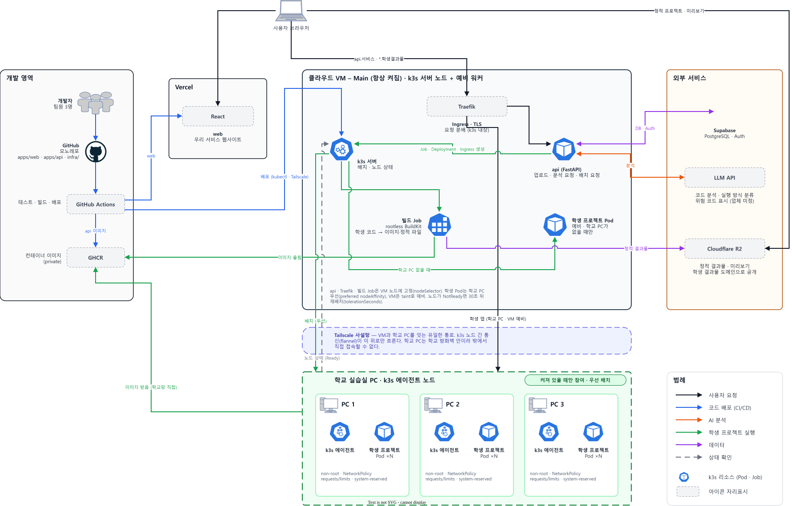

# ADR-002: 시스템 아키텍처 — 학생 프로젝트를 R2 또는 k3s 클러스터(학교 PC 우선, 클라우드 VM 예비)에서 실행한다

- **상태**: 제안됨
- **날짜**: 2026-10-26
- **결정자**: TBD (초안: @seren-wib, 팀 합의 전)
- **관련**: [`001-stack.md`](001-stack.md), [`design.md`](../design.md), [`hackathon.md`](../hackathon.md)

구성도 원본은 `002-system-architecture.drawio.svg` 하나다. draw.io(데스크톱 또는 VS Code 확장)로 열면 바로 수정할 수 있고, 압축하지 않은 XML이 들어 있어 텍스트로도 읽을 수 있다.

## 맥락

서비스는 학교 실습실에서 놀고 있는 PC를 묶어 학생 프로젝트를 대신 실행한다. 실행 위치와 연결 방식을 정해야 하는 이유는 네 가지다.

- 학교 PC는 학교 방화벽 안에 있어 밖에서 바로 접속할 수 없다.
- 학교 PC는 수업 시간에만 켜져 있고, 수업 중에는 사람이 쓴다.
- 학생 코드는 신뢰할 수 없는 코드다. 실행할 때만이 아니라 빌드할 때도 그렇고, 한 PC에 여러 학생의 코드가 같이 돈다.
- 배포 URL은 제출 마감(11.15 18:00)부터 심사(11.21)까지 살아 있어야 한다. 그 사이 학교 PC가 꺼져 있어도 시연이 되어야 한다.

## 결정

업로드된 프로젝트를 LLM이 분석해 정적 / 브라우저 실행 / 서버 필요로 분류하고 위험 코드를 표시한다. 빌드는 k3s 빌드 Job(rootless BuildKit)이 맡는다. 정적·브라우저 실행 프로젝트는 빌드 결과를 Cloudflare R2에 올려 학생 결과물 도메인으로 바로 공개한다. 서버 필요 프로젝트는 이미지를 GHCR에 올리고, k3s 서버가 Deployment와 Ingress를 만들어 켜져 있는 학교 PC에 우선 배치한다. 학교 PC가 하나도 없으면 클라우드 VM 노드에 배치한다. 요청은 VM의 Traefik(k3s 내장 Ingress)이 받아 Tailscale 사설망 위로 Pod에 전달한다. 우리 서비스의 api(FastAPI)도 같은 클러스터 안에서 VM 노드에 고정해 돌린다.

레포 구성(모노레포 하나)과 작업 방식(포크 → 원본에 PR)은 [`hackathon.md`](../hackathon.md)와 [`AGENTS.md`](../../AGENTS.md) §5에 이미 정해져 있어 이 ADR에서 다루지 않는다. 기술 선택과 폴더 구조는 [ADR-001](001-stack.md)에서 한다.

### 1. 서비스 흐름 요약

1. 학생이 웹사이트(web)에 프로젝트를 올린다.
2. api가 LLM API로 코드를 분석해 실행 방식을 분류하고, 위험한 코드를 표시한다.
3. api가 k3s에 빌드 Job을 만든다. Job은 rootless BuildKit으로 결과물을 만든다.
4. 분류 결과에 따라 다르게 처리한다.

| 실행 방식 | 처리 | 실행 위치 |
| --- | --- | --- |
| 정적 | 파일을 R2에 올려 학생 결과물 도메인으로 바로 공개한다 | R2 |
| 브라우저 실행 | 빌드 Job이 빌드한 결과를 R2에 올려 공개한다 | R2 |
| 서버 필요 | 빌드 Job이 이미지를 만들어 GHCR에 올리고, k3s 서버가 Deployment·Ingress로 배치한다 | 학교 PC 우선, 없으면 클라우드 VM |

5. 사용자 요청은 VM의 Traefik이 받아 Tailscale 위로 해당 Pod에 전달한다. 학교 PC가 꺼지면 30초 안에 다른 노드로 재배치한다.
6. 학교 PC도 VM 자리도 없으면 R2에 저장해 둔 정적 미리보기만 보여준다.

### 2. 영역과 구성 요소

기술 이름은 아직 확정 전이고, 기술 선택은 [ADR-001](001-stack.md)에서 한다. 구성도에서 아이콘과 이름 라벨을 따로 두었으므로 바뀌면 해당 상자만 고치면 된다.

| 영역 | 구성 요소 | 역할 |
| --- | --- | --- |
| 개발 영역 | 개발자 (팀원 3명) | 코드 작성, PR |
| | GitHub | 모노레포 `WOOWANGTHON_TEAM_18` (폴더 구조는 [ADR-001](001-stack.md)) |
| | GitHub Actions | 테스트, 빌드. web은 Vercel로, api 이미지는 GHCR로, 클러스터 배포는 Tailscale 위 `kubectl`로 |
| | GHCR | api 이미지와 학생 프로젝트 이미지 (private) |
| Vercel | web (React) | 우리 서비스 웹사이트 |
| 클라우드 VM – Main (항상 켜짐) · k3s 서버 노드 | k3s 서버 | 클러스터 관리, Pod 배치, 노드 상태 |
| | Traefik (k3s 내장) | Ingress, TLS, 요청 분배 (api, 학생 앱) |
| | api (FastAPI) Pod | 업로드 처리, 분석 요청, 빌드 Job·Deployment·Ingress 생성. VM 노드에 고정 |
| | 빌드 Job (rootless BuildKit) | 학생 코드 → 이미지(GHCR) 또는 정적 결과물(R2). VM 노드에 고정 |
| | 학생 프로젝트 Pod (예비) | 학교 PC가 하나도 없을 때만 |
| 외부 서비스 | Supabase | PostgreSQL(사용자, 프로젝트, 실행 기록), Auth(로그인) |
| | LLM API | 코드 분석, 실행 방식 분류, 위험 코드 표시 |
| | Cloudflare R2 | 정적 결과물, 미리보기. 학생 결과물 도메인으로 공개 |
| Tailscale 사설망 | — | VM과 학교 PC를 잇는 유일한 통로. k3s 노드 간 통신(flannel)이 이 위로만 흐른다 |
| 학교 실습실 PC · k3s 에이전트 노드 (켜져 있을 때만 참여) | k3s 에이전트 | 지시받은 Pod 실행, 노드 상태 보고 |
| | 학생 프로젝트 Pod ×N | 서버 필요 프로젝트. GHCR 이미지는 학교망에서 직접 받는다 |

#### 클러스터 구성과 배치 규칙

- VM은 k3s 서버이면서 예비 워커다. 학교 PC는 전부 에이전트 노드다.
- api, Traefik, 빌드 Job은 `nodeSelector`로 VM 노드에 고정한다.
- 학생 Pod는 학교 PC를 우선하는 `preferred nodeAffinity`를 걸고, VM 노드에는 taint를 둬서 학교 PC가 없을 때만 들어간다.
- 노드가 NotReady가 되면 `tolerationSeconds`를 30초로 줄여 바로 다른 노드로 재배치한다. 기본값 5분은 수업 끝나고 PC가 꺼지는 상황에 너무 길다.
- 학교 PC 켜짐 여부는 k3s 노드의 Ready 상태를 그대로 쓴다. api가 따로 감시하지 않는다.
- 학교 PC 노드마다 `system-reserved`로 CPU·메모리를 떼어 두고, 모든 학생 Pod에 requests/limits를 건다.

#### 빌드 격리

학생 Dockerfile의 `RUN`은 임의 코드 실행이다. 그래서 빌드를 VM 호스트의 Docker 데몬에서 돌리지 않고 k3s Job 안의 rootless BuildKit으로 돌린다. Job에도 학생 Pod와 같은 requests/limits와 NetworkPolicy(GHCR·패키지 저장소만 허용)를 건다. 결과물은 이미지면 GHCR로, 정적 파일이면 R2로 올린다.

#### Vercel과 R2의 차이

둘 다 정적 파일을 내보내지만 대상이 다르다.

- **Vercel**: 우리 팀이 만든 서비스 웹사이트(React)만 올린다. 프론트엔드 코드가 main에 머지되면 빌드해서 Vercel CDN에 배포한다. 학생 코드는 들어가지 않는다.
- **R2**: 학생 프로젝트 결과물을 넣는 파일 저장소다. 정적·브라우저 실행 프로젝트의 빌드 결과와, 서버 필요 프로젝트의 미리보기를 둔다. S3 호환 API라 `boto3`로 올릴 수 있고, 외부 전송(egress) 요금이 없다. 학생 결과물 도메인을 R2 커스텀 도메인으로 연결해 공개한다.

#### 학교 PC 한 대에 여러 프로젝트

구성도는 PC마다 학생 프로젝트 Pod를 하나씩 그렸지만, 실제로는 PC 한 대에 여러 개가 돈다. 학생 프로젝트 하나가 Pod 하나이고, k3s 서버가 각 PC의 남은 CPU·메모리를 보고 자리가 있는 PC에 배치한다. 작은 웹 서버는 128-512MB면 충분하므로, 16GB PC에서 학생 몫을 10GB로 잡으면 한 대에 20~40개가 들어간다.

### 3. 흐름 (구성도 색 기준)

| 색 | 흐름 | 경로 |
| --- | --- | --- |
| 검정 | 사용자 요청 | 브라우저 → web(Vercel) / 브라우저 → Traefik → api / 브라우저 → Traefik → (Tailscale) → 학생 Pod (학교 PC 또는 VM 예비) / 브라우저 → R2 (정적 프로젝트, 미리보기) |
| 파랑 | 코드 배포 (CI/CD) | 개발자 → GitHub → GitHub Actions → web(Vercel), GHCR(api 이미지), k3s 서버(배포) |
| 주황 | AI 분석 | api ↔ LLM API |
| 초록 | 학생 프로젝트 실행 | api → k3s 서버(Job·Deployment·Ingress 생성) / k3s 서버 → 빌드 Job → GHCR(이미지 올림) / k3s 서버 → (Tailscale) → 학교 PC(우선 배치) / k3s 서버 → VM 예비 Pod(학교 PC 없을 때) / 학교 PC → GHCR(이미지 받음, 학교망 직접) |
| 보라 | 데이터 | api ↔ Supabase / 빌드 Job → R2 |
| 회색 점선 | 상태 확인 | 학교 PC → k3s 서버 (노드 Ready) |

### 4. 정해야 할 것

| # | 항목 | 고민할 점 | 제안 |
| --- | --- | --- | --- |
| 1 | "정적 미리보기"의 정의 | 서버 필요 프로젝트의 미리보기가 화면 스크린샷인지, 백엔드 없이 프론트만 띄운 것인지. 스크린샷이면 누가 언제 찍는지 | 정해지면 구성도에 반영 |
| 2 | 학생 결과물 도메인 구성 | 서비스(`app.example.com`)와 학생 결과물(`example-usercontent.com`)은 분리한다. 정적(R2 커스텀 도메인)과 서버 필요(`<프로젝트>.` 와일드카드 → Traefik)를 한 도메인 아래 어떻게 나눌지, 도메인 구매와 DNS를 누가 맡을지 | Cloudflare DNS 하나로 관리. `static.`은 R2, `*.`는 VM Traefik |
| 3 | PC 사용자 몫 예약 값 | 수업 중에는 사람이 PC를 쓴다. 학생 프로젝트가 PC를 느리게 만들면 학교가 참여를 막을 수 있다 | `system-reserved`로 CPU 2코어·메모리 6GB부터 시작해 측정 후 조정 |
| 4 | Pod 자원 기본값 | requests/limits가 없으면 무한루프 하나가 같은 PC의 다른 프로젝트까지 죽인다 | 기본 requests 100m·128Mi, limits 500m·512Mi. 측정 후 조정 |
| 5 | 안 쓰는 프로젝트 내리기 | 아무도 보지 않는 프로젝트를 계속 켜 두면 자원 낭비다 | 마지막 접속 후 30분이 지나면 api가 replicas를 0으로, 다시 접속하면 1로 (재시작에 몇 초 걸림) |
| 6 | 격리 수준 | 한 PC에 서로 다른 학생의 코드가 같이 돈다. 컨테이너는 커널을 공유하므로 완전한 격리는 아니다 | non-root 실행, NetworkPolicy로 Pod 간 통신 차단, 호스트 폴더 마운트 금지. 빌드 Job도 같은 규칙. 이후 gVisor 같은 샌드박스 런타임으로 확장 가능 |
| 7 | 위험 코드 처리 | LLM이 위험 코드를 표시한 뒤 실행을 막는지, 경고만 하는지 | 팀 논의 |
| 8 | AI 역할 범위 | 분류와 위험 표시만 할지, 실행 계획(Dockerfile·빌드 명령·포트·환경변수)까지 제안하고 학생이 승인하게 할지. 주제 "AI는 동료가 될 수 있을까?"의 답이 이 흐름에 들어간다 | 실행 계획까지. [`SRS.md`](../SRS.md) "AI 동료의 역할 경계"와 함께 정한다 |
| 9 | VM 예비 노드 용량 | VM 크기와, 학교 PC가 없을 때 VM에 동시에 띄울 학생 Pod 수 상한 | 네임스페이스 ResourceQuota로 상한. 값은 VM 업체·크기 정한 뒤 |
| 10 | 심사 기간 운영 | 11.15~11.21은 학교 PC가 꺼져 있다고 가정하고 VM만으로 시연이 되어야 한다. Supabase 무료 플랜은 7일 동안 활동이 없으면 일시 정지된다(공식 문서로 확인 필요) | 시연용 프로젝트는 VM에 미리 띄워 둔다. api가 하루 한 번 DB를 건드리는 작업을 돌린다 |

### 5. 구성도 참고

- 학교 PC 쪽 화살표는 PC마다 긋지 않고 실습실 영역 테두리에 연결했다.
- Traefik → 학생 Pod 화살표는 학교 PC와 VM 예비 Pod 둘 다를 뜻한다. 구성도에는 실습실 쪽 하나만 그렸다.
- draw.io 내장 라이브러리에 아이콘이 없어 회색 점선 상자로 자리만 잡아 둔 구성 요소: GitHub Actions, GHCR, React, Traefik, Cloudflare R2, LLM API.

## 대안

| 대안 | 장점 | 버린 이유 |
| --- | --- | --- |
| 모든 프로젝트를 클라우드 VM에서 실행 | 구조가 단순하고 PC 켜짐 여부를 신경 쓰지 않아도 된다 | 학교 유휴 PC를 쓰는 것이 서비스의 핵심이다. 프로젝트 수만큼 VM 자원과 비용이 늘어난다 |
| 학교 PC에 공인 주소·포트포워딩으로 직접 접속 | VPN 없이 연결된다 | 학교 방화벽 안이라 밖에서 바로 접속할 수 없다 |
| PC마다 도커만 설치하고 직접 배치 | 쿠버네티스를 배우고 운영할 필요가 없다 | 자리가 남은 PC 고르기, 켜짐 감지, PC가 꺼졌을 때 재배치를 직접 만들어야 한다 |
| 모든 프로젝트를 학교 PC에서 실행 | 실행 경로가 하나다 | 서버가 필요 없는 프로젝트까지 PC 켜짐에 묶인다. 정적 파일은 R2에서 바로 보여주면 된다 |
| 학교 PC가 없으면 미리보기만 (초안) | VM 자원을 학생 프로젝트에 쓰지 않는다 | 심사 기간에 학교 PC가 꺼져 있으면 시연이 안 된다. VM을 예비 노드로 두면 같은 배치 규칙으로 해결된다 |
| 빌드 작업기를 VM 프로세스로 두고 `docker build` (초안) | 가장 단순하다 | 학생 Dockerfile의 `RUN`이 메인 VM에서 root Docker 데몬으로 실행된다. k3s Job + rootless BuildKit이면 자원 제한과 네트워크 제한을 Pod 규칙으로 같이 건다 |
| Nginx를 VM에 직접 설치해 요청 분배 (초안) | 익숙하다 | 학생 앱이 생길 때마다 upstream 설정을 손으로 갱신해야 한다. Traefik은 k3s에 내장돼 Ingress 리소스만 만들면 라우팅과 TLS가 따라온다 |
| api를 VM에서 docker compose로 따로 운영 | k8s 없이 익숙한 방식으로 돌린다 | Traefik 뒤에 들어가지 못해 TLS와 도메인을 따로 관리해야 하고, 클러스터를 조작할 kubeconfig를 밖에서 관리해야 한다. 클러스터 안에서 ServiceAccount로 권한을 주는 쪽이 설정이 적다 |

## 결과

- **쉬워지는 것**: 서버가 필요 없는 프로젝트는 학교 PC 상태와 상관없이 항상 보인다. 학교 PC가 전부 꺼져도 VM에서 시연이 된다. 배치, 재배치, 라우팅, TLS를 전부 k3s 리소스 하나(Deployment + Ingress)로 다루므로 api 코드가 단순하다. PC를 추가해도 설정이 거의 늘지 않는다.
- **어려워지는 것**: 팀이 k3s 리소스(Job, Deployment, Ingress, NetworkPolicy, affinity/taint)를 다뤄야 한다. 격리 값, PC 사용자 몫, 예비 노드 상한은 측정 뒤에 정해야 한다. 미정 항목은 결정 §4.
- **다시 볼 조건**: 학교가 실습실 PC 사용을 허가하지 않거나 시연 환경에서 학교 PC를 쓸 수 없으면, 같은 클러스터에서 VM 노드만으로 운영한다. 구조는 그대로고 노드만 줄어든다.
