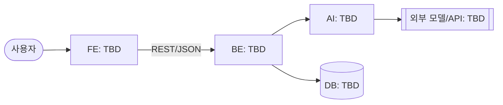

# 설계 — 아키텍처와 FE/BE/AI 계약

> **기술 설계·이해도 10점** 근거 문서. 무엇을 만드는지는 [`SRS.md`](SRS.md), 왜 이 기술인지는 [`adr/`](adr/README.md).
> FE·BE·AI가 병렬로 일하는 기준이 §3 계약이다. **API를 바꾸기 전에 이 문서를 먼저 고치고**, 같은 PR에 코드 변경을 싣는다.

## 1. 아키텍처



스택은 [`adr/001-stack.md`](adr/001-stack.md)에서 정한다. 정해지면 위 다이어그램의 TBD를 채운다.

## 2. 컴포넌트 책임

| 컴포넌트 | 책임 | 하지 않는 것 | 담당 |
| --- | --- | --- | --- |
| FE | | | |
| BE | | | |
| AI | | | |

"하지 않는 것"을 적어 두면 두 곳이 같은 일을 하거나 아무도 안 하는 일이 줄어든다.

## 3. API 계약

FE가 BE를, BE가 AI를 기다리지 않도록 **요청·응답 모양을 먼저 고정**한다. 구현 전에는 이 예시 응답을 그대로 돌려주는 목 서버로 개발한다 — 그 목은 `MOCK(<id>)` 마커와 [`ai-scope.md`](ai-scope.md) 등록 대상이다.

### `METHOD /path` — 한 줄 설명 (FR-xx)

요청:

```json
{}
```

응답 `200`:

```json
{}
```

오류: `400` 입력 오류 / `502` AI 호출 실패 — 오류 응답 모양은 §4.

<!-- 엔드포인트마다 위 블록을 복사 -->

## 4. 공통 규칙

- 오류 응답: `{ "error": { "code": "STRING", "message": "사람이 읽는 설명" } }`
- 시간: ISO 8601, UTC
- AI 호출 실패 시 사용자에게 보이는 동작: TBD (재시도 버튼? 사람에게 넘기기?) — 시연 중 실패에 대한 답이므로 반드시 정한다.

## 5. 데이터 모델

| 엔티티 | 필드 | 설명 |
| --- | --- | --- |
| | | |

## 6. 배포

| 컴포넌트 | 배포처 | URL | 환경 변수 |
| --- | --- | --- | --- |
| FE | | | |
| BE | | | |

비밀값은 배포처 환경 변수에만 둔다. 여기에는 **변수 이름만** 적는다.
