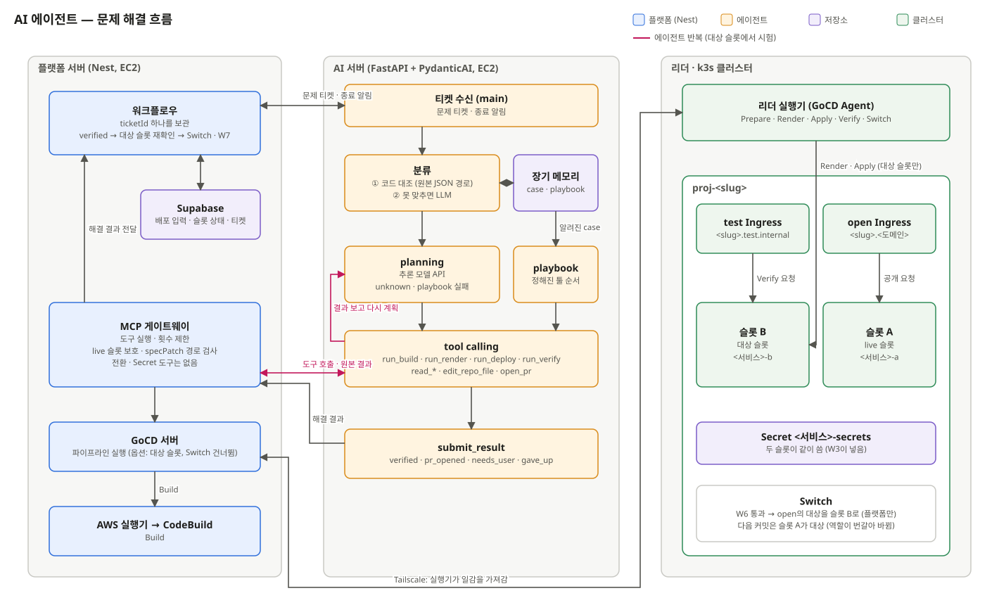

# AI 에이전트 — 설계

- **상태**: 초안
- **관련**: [배포 워크플로우](deploy-workflow.md) §6 · [배포 입력](deploy-handoff.md) · [ADR-009](../adr/009-deploy-runs-on-leader-gocd-agent.md) · [ADR-011](../adr/011-deploy-slots-a-b.md) · [ADR-012](../adr/012-agent-acts-through-platform-gateway.md) · [ADR-002](../adr/002-bot-account-for-fix-prs.md) (봇 계정 수정 PR)



## 범위

- **한다**: 문제 티켓을 받아 원인을 분류하고, MCP 게이트웨이의 도구로 대상 슬롯에서 Build · Render · Deploy · Verify를 실행 · 관찰하며 고친 뒤, 해결 결과를 플랫폼 서버에 돌려준다.
- **범위**: 사용자 코드를 직접 바꾸는 것을 빼고 배포 설정 전부다. spec, CodeBuild 빌드 설정(그 빌드에만), 대상 슬롯 운영을 에이전트가 조정한다. 코드 수정은 수정 PR로 제안하고 머지는 사용자가 한다.
- **하지 않는다**: live 전환(플랫폼이 한다), live 슬롯 · 다른 프로젝트 변경, Secret 값 읽기 · 쓰기, 플랫폼이 같이 쓰는 설정(CodeBuild 프로젝트 · buildspec · IAM, ResourceQuota · LimitRange · NetworkPolicy, 차트, 기본 Dockerfile) 변경, manifest(YAML) 작성. YAML은 플랫폼 코드(Render)가 spec으로 만든다.

## 설계

### 1. 흐름

```
플랫폼 서버                                AI 서버 (PydanticAI 에이전트)
문제 티켓 발행 ─────────────────────────▶ ① 분류: 코드 대조 (장기 메모리 case의 match)
                                          ② 못 맞추면 LLM 분류 (로컬 모델)
                                          ├─ 알려진 case → ③ playbook (정해진 툴 순서)
                                          │     실패 → ④ 실패 기반 planning (추론 모델 API)
                                          └─ unknown → ⑤ planning (추론 모델 API)
                                          도구 실행 → 결과(원본) 관찰 → 다시 계획 … (횟수 제한 안에서)
해결 결과 수신 ◀──────────────────────── submit_result
  verified → 대상 슬롯 재확인(run_verify) → Switch → W7
  pr_opened · needs_user → 대기
  gave_up → 보고
종료 알림 (success · superseded · stopped) ─▶ case 통계 갱신, 실행 종료
```

- 워크플로우는 티켓 하나(`ticketId`)를 보관한다. 새 티켓이 나오면 이전 티켓을 덮어쓰고, 새 티켓의 `previous`에 직전 티켓 id · 상태 · 요약 한 줄을 넣는다.
- 에이전트는 해결됐다고 판정하지 않는다. 판정은 플랫폼이 대상 슬롯 재확인과 W7 결과로 한다.
- 플랫폼 문제(CodeBuild API 오류, GHCR 받기 실패, live 슬롯 보호 중단 등)는 플랫폼 서버가 코드로 걸러 에이전트를 부르지 않는다.

**오류를 아는 방법.** 에이전트는 오류를 직접 감지하지 않고, k3s를 계속 조회하지도 않는다. 감지는 플랫폼이 하고, 에이전트는 티켓으로 시작한 뒤 필요한 정보를 도구로 읽는다.

| 단계 | 누가 · 어떻게 |
|---|---|
| 감지 (배포 중) | GoCD 스테이지가 한다. Build는 CodeBuild 결과, Apply는 대상 슬롯 Pod · 이벤트 watch(`CrashLoopBackOff` · `OOMKilled` · 쿼터 초과 `FailedCreate`는 제한 시간을 기다리지 않고 바로 실패), Verify는 Traefik 요청 결과 ([배포 워크플로우](deploy-workflow.md) §4 제한 시간) |
| 감지 (운영 중) | 플랫폼 서버가 리더 k3s API에 Pod · 이벤트 watch 연결을 유지한다. 로그는 계속 받지 않는다 |
| 알림 | 실패한 GoCD job의 `run_if: failed` task가 그 즉시 플랫폼 서버에 알린다 |
| 전달 | 플랫폼 서버가 그 순간의 원본 · 최근 10분 로그를 잡아 비밀값을 가리고 문제 티켓으로 보낸다 |
| 수집 | 에이전트가 티켓의 `stage` · `service`로 실패한 단계에서 바로 고치기 시작하고, 지금 상태는 관찰 도구(§3)로 그때그때 읽는다 |

티켓의 역할은 넷이다: 에이전트 실행을 여는 시작 신호, 재시작하면 사라지는 실패 순간의 증거 보관, 횟수 제한 · 해결 결과 · 종료 알림 · `previous`를 묶는 일의 단위(`ticketId`), 코드 분류(§8 `match`)의 입력. 에이전트가 아는 정보가 티켓이 전부라는 뜻은 아니다.

### 2. 도구가 닿는 길

```
AI 서버 (에이전트) → 플랫폼 서버 MCP 게이트웨이 → GoCD 서버 → AWS 실행기(Build) · 리더 실행기(Prepare ~ Switch)
                                              → k3s API 읽기 (Pod · 이벤트 · 로그)
                                              → 봇 계정 GitHub (fork 커밋, PR)
```

- 에이전트(AI 서버)에는 클러스터 · GoCD · 봇 계정 자격 증명이 없다. 도구는 모두 게이트웨이가 실행한다([ADR-012](../adr/012-agent-acts-through-platform-gateway.md)). 예외는 AI 서버 자신의 장기 메모리를 읽는 `read_memory` 하나다(클러스터 · GitHub에 닿지 않는다).
- 게이트웨이는 GoCD 파이프라인을 환경 변수 옵션으로 실행한다: 대상 슬롯, 시작 스테이지, `DRY_RUN_ONLY`, `SKIP_SWITCH=true`, 소스 커밋(봇 fork). 환경 변수에 비밀값은 넣지 않는다.
- 게이트웨이는 모든 실행 도구에서 `specPatch` 경로 검사와 live 슬롯 보호 검사를 한다.
- 티켓 접수 · 종료 알림 API, 게이트웨이 접속 · 토큰(티켓마다 하나), 도구마다의 인자 · 결과 모양과 거절 코드는 [API 계약](api.md) "AI 에이전트"에 있다.

### 3. 도구

**실행 (대상 슬롯만)**

| 도구 | 하는 일 | 입력 | 출력 | 티켓당 횟수 |
|---|---|---|---|---|
| `run_build` | Build (CodeBuild). 해시가 같으면 재사용 | `service`, `specPatch?`, `source?`, `buildOverrides?` | `BatchGetBuilds`의 `builds[0]` 원본, 실패 phase, 로그 마지막 200줄, 성공 시 이미지 digest | 2 |
| `run_render` | Render + `kubectl apply --dry-run=server`. 클러스터에 적용하지 않는다 | `specPatch?` | 통과 여부, 실패 시 k3s Status 원본 | 5 |
| `run_deploy` | Prepare(live 슬롯 보호 검사, 대상 슬롯 비우기) → Render → Apply → Ready 대기 | `specPatch?`, `source?` | Pod · 이벤트 원본, rollout 결과 | 2 |
| `run_verify` | Verify. 배포 입력에 있는 공개 서비스와 설정된 경로만 test Ingress로 Traefik에 요청하고, 내부 전용 서비스는 Pod Ready만 본다([배포 워크플로우](deploy-workflow.md) §4) | 없음 | 요청별 경로 · 상태 코드 · 응답 시간, 서비스별 Ready | 3 |

- `specPatch`는 시험용 수정안이다. 그 실행에만 적용하고 DB의 spec은 바꾸지 않는다. DB 저장은 플랫폼이 `verified`를 받은 뒤 한다.
- `source`는 수정 PR 확인용 봇 fork 커밋이다.
- `specPatch` 없이 다시 부르면 그대로 재실행이다 (일시적 실패용).
- `buildOverrides`는 그 빌드에만 쓰는 CodeBuild 설정이다. 게이트웨이가 `StartBuild`의 override로 넘기고, CodeBuild 프로젝트 설정(`UpdateProject`)은 바꾸지 않는다. 모든 학생 프로젝트가 프로젝트 하나를 같이 쓰기 때문이다.

| `buildOverrides` 칸 | CodeBuild 값 | 상한 (초기값) |
|---|---|---|
| `computeType` | `computeTypeOverride` | 기본보다 한 단계 위까지 |
| `timeoutMinutes` | `timeoutInMinutesOverride` | 30분 |
| `image` | `imageOverride` | 플랫폼이 정한 빌드 이미지 허용 목록 |
| `cache` | `cacheOverride` (켬 · 끔) | - |

buildspec · 서비스 역할(IAM) · 환경 변수 override는 받지 않는다. 빌드 명령을 바꿀 수 있으면 push 단계의 GHCR 토큰을 빼 갈 수 있다([배포 워크플로우](deploy-workflow.md) §8).

**관찰 (읽기만)**

| 도구 | 하는 일 | 출력 |
|---|---|---|
| `get_target_status` | 대상 슬롯의 Pod · 이벤트 · rollout 상태를 지금 시점으로 읽음 | k3s 원본 (`managedFields` 제외) |
| `read_pod_logs` | 대상 슬롯 Pod 로그 | 로그 줄. `previous: true`면 직전 컨테이너 |
| `read_build_logs` | CodeBuild 로그의 지정 구간 | 로그 줄 |
| `read_repo` | 티켓의 `commitSha` 시점 파일 · 폴더 목록 | 파일 내용 |
| `read_memory` | 장기 메모리 case 검색. **AI 서버 안의 도구다(게이트웨이를 거치지 않음)**. case와 통계를 AI 서버가 갖기 때문이다(§8) | case · playbook |

**대상 슬롯 운영**

| 도구 | 하는 일 | 티켓당 횟수 |
|---|---|---|
| `restart_target` | 대상 슬롯 Deployment 재시작 (Pod 다시 생성) | 3 |
| `scale_target` | 대상 슬롯 Deployment를 0 또는 1개로 | 3 |
| `wait_target_ready` | 대상 슬롯 Ready를 다시 기다림. 대기 시간은 최대 7분 | 3 |

**레포 수정**

| 도구 | 하는 일 | 제한 |
|---|---|---|
| `edit_repo_file` | 봇 fork 작업 브랜치에 파일 수정 commit. 그 커밋을 `source`로 실행 도구에 넘긴다 | 파일 5개 · 50줄, `.env` · `.github/` 금지 |
| `open_pr` | 학생 레포에 수정 PR | 티켓당 1개. 게이트웨이가 같은 `source`로 `run_verify` 통과를 확인한 뒤에만 연다 |

**끝내기**

| 도구 | 하는 일 |
|---|---|
| `submit_result` | 해결 결과 제출. 호출하면 에이전트 실행이 끝난다 |

전체 제한: 도구 20회, 에이전트 작업 15분(파이프라인 대기 제외), 같은 도구 · 같은 인자는 연속 2회까지(세 번째 호출 차단). 게이트웨이가 센다. 숫자는 초기값이다.

### 4. 행위 범위

| 행위 | 범위 |
|---|---|
| 진단 | 관찰 도구로 로그 · 이벤트 · 레포를 읽는다 |
| spec 수정 + 시험 | `build` · `runtime` 전체: 포트, 헬스체크, 빌드 · 설치 · 시작 명령, Node 버전, `context` · `dockerfile` · `outputDir`, `buildEnv`, `env`, `secretKeys` 목록, `links`, `ingressPath`, `stripPrefix`, `resources`(프로젝트 쿼터 안), `startupTimeoutSeconds` |
| `slug` · `name` 수정 | 첫 배포 전에만 (첫 배포 뒤 바꾸면 네임스페이스와 Secret을 찾지 못한다) |
| CodeBuild 빌드 설정 | 그 빌드에만, `buildOverrides` 상한 안 (§3) |
| 대상 슬롯 운영 | 재시작, 0 · 1개 조정, Ready 다시 기다리기 |
| 그대로 재실행 | 고칠 것이 없는 일시적 실패 (CodeBuild 준비 실패, 이미지 받기 시간 초과) |
| dry-run 먼저 | 이름 · 포트 · 쿼터 오류는 `run_render`로 먼저 확인한다 |
| 레포 수정 → PR | fork 커밋으로 `run_verify`까지 통과한 변경만 |
| 사용자 요청 | 비밀값이 틀림 · 빠짐, 학생 DB에 닿지 않음, 학생 DB 스키마 문제 |
| 플랫폼 문제 보고 | 이미지 공개 설정, 노드 자원 부족, 차트 · 기본 Dockerfile 문제 |

**주지 않는 행위**

| 대상 | 이유 |
|---|---|
| 사용자 코드 직접 수정 | 수정 PR로 제안하고 머지는 사용자가 한다 |
| live 전환(open Ingress) | 사용자 요청이 바뀌는 단계라 플랫폼이 대상 슬롯을 다시 확인한 뒤 한다 |
| live 슬롯 · 다른 프로젝트 | 사용자 서비스가 멈추거나 다른 학생에게 영향이 간다 |
| Secret 값 | 사용자 데이터다. 값이 틀리면 사용자에게 요청한다 |
| CodeBuild 프로젝트 설정 · buildspec · IAM · 환경 변수 override | 모든 프로젝트가 같이 쓰고, GHCR 토큰이 새어 나갈 수 있다 |
| ResourceQuota · LimitRange · NetworkPolicy · 차트 · 기본 Dockerfile | 모든 프로젝트가 같이 쓰는 플랫폼 설정이다 |
| Pod 안 명령 실행(`kubectl exec`) | 학생 컨테이너 안에서 임의 명령을 실행하는 권한이다 |

### 5. 입력: 문제 티켓

정해진 칸은 봉투뿐이고, CodeBuild · k3s 출력은 원본 그대로 넣는다. 원본은 플랫폼 서버가 실패 알림을 받은 순간에 읽은 스냅샷이다. 이후 상태는 에이전트가 관찰 도구로 다시 읽는다.

```json
{
  "ticketId": "t_0013",
  "commitSha": "a1b2c3d4e5f6a1b2c3d4e5f6a1b2c3d4e5f6a1b2",
  "stage": "apply",
  "service": "be",
  "targetSlot": "b",
  "deployInput": { "commitSha": "...", "deploy_condition": {}, "spec": {} },
  "errorMessage": "deployment \"be-b\" exceeded its progress deadline",
  "raw": {
    "codebuild": null,
    "k8s": { "pod": {}, "events": [], "status": null }
  },
  "logs": { "from": "2026-11-10T13:02:00Z", "to": "2026-11-10T13:12:00Z", "lines": [] },
  "previous": { "ticketId": "t_0012", "status": "needs_user", "summary": "DATABASE_URL 재입력 요청" }
}
```

| 칸 | 내용 |
|---|---|
| `stage` | `build` · `prepare` · `render` · `apply` |
| `service` | `spec.services[].name`. 서비스와 무관하면 `null` |
| `targetSlot` | `a` · `b` |
| `raw` | stage에 따라 두 모양만 받는다. `build`: `{ "codebuild": <원본>, "k8s": null }`. 그 밖: `{ "codebuild": null, "k8s": { "pod", "events", "status" } }` |
| `raw.codebuild` | `BatchGetBuilds`의 `builds[0]` 원본. `build`가 아니면 `null` |
| `raw.k8s.pod` | 실패한 Pod 하나의 원본. 없으면 `null`. `metadata.managedFields`와 적용 기록 annotation은 뺀다 |
| `raw.k8s.events` | `involvedObject`가 대상 슬롯 리소스인 이벤트 원본 (없으면 `[]`) |
| `raw.k8s.status` | `render`일 때 `kubectl apply --dry-run=server`가 돌려준 k3s Status 원본(필수), 그 밖에는 `null` |
| `errorMessage` | 사람이 읽는 오류 한 줄. `render`면 Status의 `message`를 그대로 넣는다 |
| `logs` | 오류 시각 10분 전부터, 최대 200줄. 재시작한 Pod는 직전 컨테이너 로그 |
| `previous` | 직전 티켓. 없으면 `null`. `status`는 `verified` · `pr_opened` · `needs_user` · `gave_up`(그 티켓의 해결 결과) 또는 `stopped`(결과 없이 끝남) |

모든 칸은 보내기 전에 외부 전송 필터로 비밀값처럼 보이는 문자열을 가린다.

### 6. 출력: 해결 결과

```json
{
  "type": "object",
  "required": ["ticketId", "commitSha", "status", "classification", "actions", "summary"],
  "additionalProperties": false,
  "properties": {
    "ticketId":  { "type": "string" },
    "commitSha": { "type": "string", "pattern": "^[0-9a-f]{40}$" },
    "status":    { "enum": ["verified", "pr_opened", "needs_user", "gave_up"] },
    "classification": {
      "type": "object",
      "required": ["method", "caseId", "path"],
      "properties": {
        "method": { "enum": ["code", "llm"] },
        "caseId": { "type": ["string", "null"] },
        "path":   { "enum": ["playbook", "replan_after_playbook", "plan"] }
      }
    },
    "actions": {
      "type": "array",
      "items": {
        "type": "object",
        "required": ["tool", "ok"],
        "properties": {
          "tool":   { "type": "string" },
          "args":   { "type": "object" },
          "ok":     { "type": "boolean" },
          "result": { "type": "string" }
        }
      }
    },
    "specPatch": {
      "type": ["array", "null"],
      "items": {
        "type": "object",
        "required": ["op", "path"],
        "properties": {
          "op":    { "enum": ["replace", "add", "remove"] },
          "path":  { "type": "string", "pattern": "^/spec/(services/[0-9]+/(build|runtime)/|services/[0-9]+/name$|project/slug$)" },
          "value": {}
        }
      }
    },
    "buildOverrides": {
      "type": ["object", "null"],
      "description": "verified를 낸 빌드에 쓴 CodeBuild override. 플랫폼은 Switch만 하므로 기록용이다",
      "properties": {
        "computeType":    { "type": "string" },
        "timeoutMinutes": { "type": "integer", "maximum": 30 },
        "image":          { "type": "string" },
        "cache":          { "type": "boolean" }
      }
    },
    "pr": {
      "type": ["object", "null"],
      "properties": {
        "url":          { "type": "string" },
        "files":        { "type": "array", "items": { "type": "string" }, "maxItems": 5 },
        "changedLines": { "type": "integer", "maximum": 50 }
      }
    },
    "userRequest": {
      "type": ["object", "null"],
      "properties": {
        "message":    { "type": "string" },
        "secretKeys": { "type": "array", "items": { "type": "string" } }
      }
    },
    "evidence": {
      "type": "array",
      "items": {
        "type": "object",
        "properties": {
          "ref":  { "type": "string" },
          "text": { "type": "string" }
        }
      }
    },
    "summary": { "type": "string" }
  }
}
```

| `status` | 필수 칸 | 플랫폼 서버가 하는 일 |
|---|---|---|
| `verified` | `specPatch` (재실행만 했으면 빈 배열) | `specPatch` 검증 → DB 저장 → 대상 슬롯 `run_verify` 재확인 → Switch → W7 |
| `pr_opened` | `pr` | 사용자 머지 대기. 머지되면 새 커밋으로 W0부터 |
| `needs_user` | `userRequest` | 사용자에게 요청 |
| `gave_up` | `summary` | 보고 |

- `JSON Patch`(RFC 6902) 경로는 `build` · `runtime` 전체와 `name` · `slug`를 허용한다. 게이트웨이는 `name` · `slug` 수정을 첫 배포 전에만 받는다.
- `summary`는 다음 티켓의 `previous.summary`로 쓴다.
- PydanticAI 에이전트의 출력 타입을 이 스키마의 Pydantic 모델로 두어, 모양이 틀린 결과는 에이전트 안에서 다시 만들게 한다.

### 7. 종료 알림

```json
{ "ticketId": "t_0013", "commitSha": "a1b2c3d4e5f6a1b2c3d4e5f6a1b2c3d4e5f6a1b2", "reason": "success" }
```

| `reason` | 언제 |
|---|---|
| `success` | 대상 슬롯 재확인 · Switch · W7까지 성공 |
| `superseded` | 처리 중에 사용자가 새 커밋을 push함 |
| `stopped` | 플랫폼이 중단함 (제한 시간 초과, 플랫폼 문제) |

에이전트는 `success`일 때 사용한 case의 `stats.solved`를 올린다.

### 8. 장기 메모리

**case 구조**

```json
{
  "caseId": "A1",
  "stage": "apply",
  "category": "spec",
  "title": "헬스체크 실패 (포트 · 경로 · 시작 시간)",
  "match": { "all": [
    { "path": "raw.k8s.events[*].reason", "equals": "Unhealthy" },
    { "path": "raw.k8s.events[*].message", "regex": "(Readiness|Startup|Liveness) probe failed" }
  ] },
  "playbook": [
    { "tool": "read_pod_logs", "args": { "lines": 100 } },
    { "tool": "run_render", "when": "로그의 listen 포트가 runtime.port와 다름", "args": { "specPatch": [{ "op": "replace", "path": "/spec/services/{i}/runtime/port", "value": "{listenPort}" }] } },
    { "tool": "run_deploy", "args": { "specPatch": "앞 단계와 같음" } },
    { "tool": "run_verify" }
  ],
  "stats": { "hits": 0, "solved": 0 }
}
```

- `match`는 티켓 원본의 JSON 경로로 쓴다. 중간 스키마가 없어서 원본 필드 이름만 따라가면 된다.
  - 조건 하나는 `{ "path", 시험 하나 }`이고 시험은 `equals` · `notEquals` · `regex` 중 하나다. 경로가 가리키는 값 하나라도 맞으면 참이다(`[*]`는 배열 전체, `[0]`은 한 칸, 없는 칸은 거짓). `regex`는 문자열 값에만 댄다.
  - 조건은 `{ "all": [...] }` · `{ "any": [...] }`로 묶는다. `all` 안의 조건은 서로 다른 원소에서 맞아도 된다(같은 이벤트인지 보지 않는다).
  - 코드 분류는 티켓의 `stage`와 같은 case만 파일 순서대로 대조해 처음 맞는 것을 고른다. 그래서 좁은 case를 넓은 case 앞에 둔다(`A3` OOMKilled는 `A2` CrashLoopBackOff 앞).
  - 초기 case 데이터는 [`AI/ai_server/agent/cases.json`](../../AI/ai_server/agent/cases.json)이다. `playbook`의 `when`과 `{i}` 같은 자리 표시는 에이전트에게 주는 설명이고 코드가 판정하지 않는다.
  - `stats`(`hits` · `solved`)는 AI 서버 메모리에만 있어 재시작하면 0부터다.
- planning으로 해결한 새 case는 바로 넣지 않는다. 사람이 확인한 뒤 넣는다.

**초기 case** (개인 · 소규모 팀의 Node 웹 프로젝트 기준 추정. 실패 주입 시험으로 고친다)

| case | 단계 | 오류 | 신호 | 처리 |
|---|---|---|---|---|
| `B1` | build | 락 파일 불일치 | `INSTALL` 실패, `ERR_PNPM_OUTDATED_LOCKFILE`, `npm ci` sync 오류 | 수정 PR (락 파일 갱신) |
| `B2` | build | Node 버전 불일치 | `engine "node" is incompatible`, `SyntaxError: Unexpected token` | `build.nodeVersion` |
| `B3` | build | 빌드 시점 env 누락 | `BUILD` 실패, `import.meta.env.VITE_*` undefined | `build.buildEnv` 또는 사용자 요청 |
| `B4` | build | 대소문자 · import 경로 | `Module not found`, `Cannot find module` | 수정 PR |
| `B5` | build | `COPY` 대상 없음 | `COPY failed`, `"/dist": not found` | `build.context` · `outputDir` · `dockerfile` |
| `P1` | prepare | 필수 Secret key 없음 | W3 상태 "빠짐" | 사용자 요청 |
| `P2` | prepare | 자원 합계 초과 | 검증 규칙 `resources` 합계 | `runtime.resources` |
| `P3` | prepare | `ingressPath` 충돌 | 검증 규칙 `ingressPath` | `runtime.ingressPath` |
| `R1` | render | 이름 규칙 위반 | `422 Invalid`, `FieldValueInvalid`, `DNS-1035` | 첫 배포 전이면 `name` 수정, 그 뒤면 사용자 요청 |
| `R2` | render | 포트 · probe 값 오류 | `422 Invalid`, field `...containerPort` | `runtime.port` · `health` |
| `R3` | render | 쿼터 초과 | `403 Forbidden`, `exceeded quota` | `runtime.resources` |
| `A1` | apply | 헬스체크 실패 | 이벤트 `Unhealthy` | `runtime.port` · `health.path` · `startupTimeoutSeconds` |
| `A2` | apply | 시작 직후 종료 | `CrashLoopBackOff`, `exitCode` ≠ 0 | 로그 패턴: env 누락 → `runtime.env`, DB 연결 실패 → 사용자 요청 |
| `A3` | apply | 메모리 초과 | `OOMKilled` (137) | `runtime.resources.memory` |
| `A4` | apply | Pod 생성 실패 (쿼터) | ReplicaSet 이벤트 `FailedCreate` + `exceeded quota` | `runtime.resources` |

에이전트를 부르지 않는 플랫폼 문제: CodeBuild API 오류(`AccountLimitExceededException` · `InvalidInputException` · `ResourceNotFoundException`), GHCR push 거부, `ImagePullBackOff` · `ErrImagePull`, `FailedScheduling`(노드 자원 부족), 차트 렌더 실패, 검사 규칙 거부, live 슬롯 보호 중단, 네임스페이스 · Secret 없음.

### 9. 모델

| 쓰는 곳 | 모델 |
|---|---|
| ② LLM 분류, 도구 고르기 | 로컬 Qwen3-8B (리더 vLLM, OpenAI 호환 API) |
| ④ · ⑤ planning | 추론 모델 API (모델 이름 미정, [배포 워크플로우](deploy-workflow.md) §7) |

PydanticAI에서 두 모델을 OpenAI 호환 provider로 붙이고, 추론 모델 API를 못 쓰면 로컬 모델로 넘긴다.

### 10. AI 서버 구현 (`AI/ai_server/agent/`)

| 단계 | 모델 | 하는 일 |
|---|---|---|
| ① 코드 분류 | 없음 | §8 `match`로 같은 stage의 case를 고른다 |
| ② LLM 분류 | 로컬 | 같은 stage의 case 목록(id · 제목)에서 하나를 고르거나 null. 목록에 없는 id는 모르는 것으로 본다 |
| ③ playbook | 로컬 | case의 playbook을 따라 도구를 부르고 해결 결과(§6의 status · `specPatch` · `pr` · `userRequest` · `evidence` · `summary`)를 낸다 |
| ④ 재계획 | 추론 API | ③이 `gave_up`이면 playbook · 지금까지의 도구 호출 · ③의 요약을 받아 다시 계획하고 실행한다 |
| ⑤ planning | 추론 API | ②가 null이면 처음부터 계획하고 실행한다 |

- **결과는 코드가 낸다.** 모델에게 `submit_result`를 주지 않는다. 모델의 출력(위 ③의 칸들)이 모양에 맞지 않으면 PydanticAI가 다시 만들게 하고(2번까지), 코드가 봉투(`ticketId` · `commitSha` · `classification` · `actions`)를 붙여 게이트웨이 `submit_result`를 한 번 부른다. `actions`는 모델이 말한 것이 아니라 게이트웨이에 실제로 한 호출의 기록이다(`ok`는 결과의 `ok`, 거절은 `ok: false`와 `rejected <code>`).
- **거절 코드.** `TOOL_LIMIT` · `TIME_LIMIT` · `LIVE_SLOT_PROTECTED`는 실행을 멈추고 이유와 할 일을 담은 `gave_up`을 낸다(재계획하지 않는다). `TICKET_CLOSED`는 토큰이 무효라 아무것도 내지 않는다. 그 밖의 거절은 코드와 메시지를 모델에게 돌려줘 인자를 고치게 한다.
- **모델 호출 실패**(연결 실패, 출력이 계속 틀림)는 `gave_up`과 그 사실을 적은 `summary`로 낸다. 그럴듯한 결과로 대신하지 않는다.
- **가림 필터**(FR-102): 추론 모델 API로 가는 요청의 지시문 · 프롬프트 · 도구 결과 · 이전 도구 인자에서 비밀값 같은 키의 값, Authorization 헤더 값, 주소 안의 비밀번호, 모양으로 아는 토큰(GitHub · OpenAI · AWS · Slack · Supabase · 게이트웨이 · JWT · 개인 키)을 `[REDACTED]`로 바꾼다. 로컬 모델은 클러스터 안이라 걸지 않는다. 게이트웨이로 내는 결과의 기록은 원본이다.
- **모델 연결**: 두 모델 모두 OpenAI 호환 API이고 env로 받는다(`LOCAL_MODEL_*` 필수, `PLANNER_MODEL_*` 선택). 추론 API가 없으면 ④ · ⑤도 로컬 모델이 하고, 있는데 호출이 실패하면 그 요청은 로컬 모델로 넘어간다.
- **모델로 보내는 글**은 `prompts.py` 한 곳에서 만든다.

**로컬 모델 16K 컨텍스트 예산** (`AI/ai_server/agent/budget.py`). vLLM `--max-model-len 16384`는 입력 + 출력의 합이라 입력은 약 10K 토큰을 목표로 한다.

| 어디서 | 무엇을 |
|---|---|
| 티켓을 받을 때 | 로그 한 줄 400자(넘으면 `…[truncated N chars]`), 로그 전체 24KB(넘으면 앞줄부터 버린다). `raw.codebuild` · `raw.k8s.pod` · `raw.k8s.events` · `raw.k8s.status`가 각각 6,000자를 넘으면 필요한 칸만 남긴다(Pod: 이름 · phase · 컨테이너 상태 · 직전 종료 · 재시작 횟수, builds[0]: buildStatus · phase별 상태와 메시지, Status: code · reason · message · causes, 이벤트: type · reason · message · 대상, 최근 50개). 코드 분류(①)는 자르기 전 원본으로 한다 |
| 프롬프트 | 티켓 대신 요약본을 넣는다: 단계 · 서비스 · 슬롯 · `errorMessage` · 직전 티켓 · 받을 때 자른 사실 · 배포 spec(4,000자까지) · 빌드의 실패 phase · Render Status · 컨테이너 상태 · 이벤트(reason · message, 같은 것은 한 번, 최근 10개) · 로그 발췌(오류 표시 줄의 앞뒤 2줄 + 마지막 20줄, 합쳐 최대 60줄, 줄마다 200자). 추론 모델에도 같은 요약본을 준다. 추론 API가 실패하면 그 요청이 로컬 모델로 넘어가기 때문이다. 더 필요한 것은 관찰 도구로 읽는다 |
| 게이트웨이 도구 결과 | 로그(`lines` · `logTail`)는 같은 발췌, 이벤트는 최근 10개, Pod · builds[0] · Status는 크면 필요한 칸만. 줄인 것은 결과의 `_truncated`에 적는다. 해결 결과의 `actions` 기록은 줄이기 전 원본에서 만든다 |
| 대화 기록 | 가장 최근 도구 결과만 전체로 두고, 그 이전 결과는 한 줄 요약(도구 · 짧은 값 칸 · 목록 길이)으로 바꾼다(PydanticAI history processor) |
| 모델 설정 | 로컬 도구 고르기 · 분류: 생각 모드 끔, `max_tokens` 2048. 로컬이 계획할 때(추론 API 없음 · 실패): 생각 모드 켬, `max_tokens` 4096 |

## 알려진 한계

- 학생 DB 자체의 문제(테이블 없음, migration 안 함)는 에이전트가 학생 DB에 닿지 못해 고칠 수 없다. `needs_user`로 넘긴다.
- 초기 case 목록과 신호는 추정이다. 실패 주입 시험 전이다.
- `render` case(`R1` ~ `R3`)는 `raw.k8s.status`(코드 · `message` · `details.causes`)로 대조한다. `prepare` case(`P1` ~ `P3`)는 Status가 없어 `errorMessage` 문장으로 대조하므로, 플랫폼 서버가 쓰는 실제 문장으로 정규식을 맞춰야 한다.
- CodeBuild API의 오류 이름 · phase 값은 AWS 문서와 대조하지 않았다.
- 로컬 8B 모델의 분류 · 도구 호출 품질은 검증하지 않았다. 실제 모델(로컬 · 추론 API)은 아직 한 번도 붙여 돌리지 않았다.
- 컨텍스트 예산은 글자 수로 어림했다(가장 큰 시험 티켓 · 도구 결과로 로컬 모델 입력이 도구 정의까지 합쳐 30,000자 이하). 실제 토큰 수는 vLLM에 붙인 뒤 응답의 `usage.prompt_tokens`로 재야 한다. 한글은 글자당 토큰이 더 많아 어림이 빗나갈 수 있다.
- 요약본과 발췌는 정보를 버린다. 오류 표시 단어가 없는 원인 줄은 발췌에서 빠질 수 있고, 지난 도구 결과는 한 줄만 남는다. 에이전트가 필요하면 관찰 도구로 다시 읽는다.
- 에이전트가 낸 `verified`가 정말 `run_verify` 통과 뒤인지 AI 서버는 따로 확인하지 않는다. 플랫폼이 대상 슬롯을 다시 확인한다(§1).
- 가림 필터는 정해진 모양만 가린다. 이름 없이 나온 임의의 비밀 문자열은 못 가린다.
