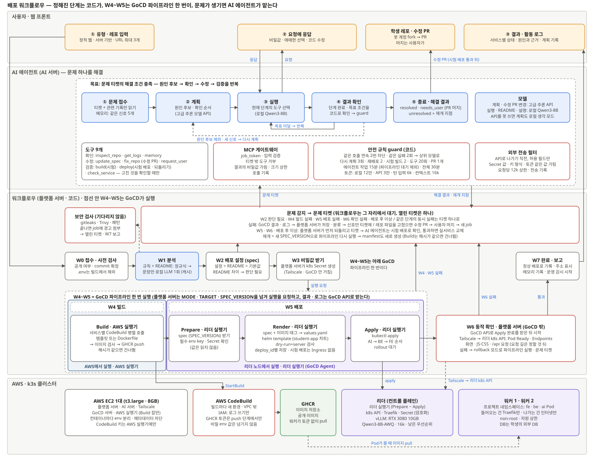

# 배포 워크플로우 — 설계

- **상태**: 합의됨 (2026-11-10. GoCD 파이프라인 · 플랫폼 서버의 앞 단계는 ADR-009 · 010, 슬롯 A · B는 ADR-011, AI 에이전트의 경계는 ADR-012로 확정. 시스템 정의서 · ai-scope에 반영함)
- **관련**: [시스템 정의서](../system-definition.md) §3 · §4.1 · [ADR-001](../adr/001-stack-and-deployment.md) (빌드 = CodeBuild) · [ADR-002](../adr/002-bot-account-for-fix-prs.md) (봇 계정 수정 PR) · [ADR-003](../adr/003-registry-ghcr.md) (GHCR) · [ADR-004](../adr/004-server-cluster-link-tailscale.md) (Tailscale) · [ADR-005](../adr/005-k3s-cluster-on-school-pcs.md) (k3s) · [ADR-009](../adr/009-deploy-runs-on-leader-gocd-agent.md) (GoCD 리더 실행기) · [ADR-010](../adr/010-repo-analysis-and-security-scan-in-platform-server.md) (레포 분석 · 보안 검사) · [배포 입력](deploy-handoff.md)



## 한 문장 요약

학생이 레포를 넣으면 **플랫폼 서버가 정해진 단계(W0~W7)를 코드로 진행**하고, 빌드 · 배포 · 동작 확인 · 전환(W4~W6)은 **GoCD 파이프라인을 한 번 실행**해서 처리하고, 동작 확인(W6)은 **리더 실행기가 Traefik을 거쳐** 한다. 배포는 서비스마다 둔 **슬롯 A · B 중 live가 아닌 슬롯**에 하고, 확인되면 공개 연결(open Ingress)만 그 슬롯으로 바꾼다. 중간에 **문제가 생겼을 때만 AI 에이전트**가 원인을 찾아 고치고 워크플로우로 돌려보낸다.

## 범위

- **한다**: 레포 접수부터 서비스가 떠서 확인될 때까지의 순서, 각 단계를 누가 어디서 하는지, 문제가 생겼을 때 AI 에이전트에 넘기고 돌려받는 약속, AI 모델을 쓰는 곳, AWS · 클러스터 배치.
- **하지 않는다**: AI 에이전트의 내부 설계([AI 에이전트 설계](AIagent.md)), Helm 차트의 세부 값(`design/cluster.md`), 화면 설계, 모니터링 지표.

## 처음 읽는 사람을 위한 용어

| 용어 | 뜻 |
|---|---|
| 워크플로우 | 플랫폼 서버가 **코드로** 정해진 순서대로 처리하는 배포 흐름. 단계 번호는 W0~W7 |
| 배포 입력 | W3이 끝난 뒤 W4에 넘기는 JSON. `commitSha` · `deploy_condition` · `spec`으로 이루어진다 ([배포 입력 설계](deploy-handoff.md)) |
| 배포 설정 (spec) | "무엇을, 어떻게 띄우고, 어떻게 연결할지"를 적은 설정. 코드가 만들고, AI 에이전트는 항목 하나씩만 고칠 수 있다 |
| GoCD 파이프라인 | 빌드 → 배포 → 동작 확인 → 전환을 순서대로 실행하는 CI/CD 도구의 실행 한 번. W4~W6과 전환이 이것이다 |
| GoCD 실행기 | GoCD의 일을 실제로 하는 프로그램(GoCD 공식 이름은 "GoCD Agent"). AI 에이전트와 헷갈리지 않게 "실행기"라고 부른다. AWS 실행기와 리더 실행기 두 곳에 둔다 |
| manifest | 배포 설정을 쿠버네티스가 읽는 YAML로 옮긴 것. 배포할 때마다 코드가 만든다 |
| 문제 티켓 | 워크플로우가 막혔을 때 AI 에이전트에 넘기는 문제 설명 (어디서, 무엇이, 어떤 신호로 실패했는지) |
| 해결 결과 | AI 에이전트가 돌려주는 결과: 해결됨 / 사용자 조치 필요 / 해결 못 함 + **다시 시작할 단계(재개 지점)** |
| 슬롯 | 서비스마다 두 개(A · B) 있는 배포 자리. 이름은 고정이다 (`<서비스>-a`, `<서비스>-b`) |
| live 슬롯 | open Ingress가 가리키는 슬롯. 사용자 요청을 받는다. 프로젝트마다 하나(A 또는 B)다 |
| 대상 슬롯 | 이번 배포를 올리는 슬롯. live가 아닌 쪽이다 |
| open Ingress | 공개 주소 `<slug>.<도메인>`의 요청을 live 슬롯의 Service로 보내는 규칙. 공개 서비스마다 하나(`open-<서비스>`)이고 라벨 `wanggane/ingress: open`이 붙는다 |
| test Ingress | 내부 주소 `<slug>.test.internal`의 요청을 대상 슬롯의 Service로 보내는 규칙. 경로 규칙은 open Ingress와 같다. 공개 서비스마다 하나(`test-<서비스>`, 라벨 `wanggane/ingress: test`) |
| 수정 PR | 학생 레포의 파일을 고쳐야 문제가 풀릴 때, AI 에이전트가 고치고 대상 슬롯에서 확인한 뒤 봇 계정으로 학생 레포에 올리는 PR ([ADR-002](../adr/002-bot-account-for-fix-prs.md)) |

## 설계

### 1. 전체 흐름

```
W0 접수 · 사전 검사 → W1 분석 → W2 배포 설정 → W3 비밀값 받기
   → [ GoCD 파이프라인 한 번 — Build → Prepare → Render → Apply → Verify → Switch ]
   → W7 완료 · 보고
```

**W4~W6과 전환은 따로 실행하는 단계가 아니다.** 플랫폼 서버가 파이프라인을 한 번 실행하면, 그 안의 스테이지가 차례로 돈다. W4 · W5 · W6은 "그 스테이지 묶음을 워크플로우에서 부르는 이름"일 뿐이다. 플랫폼 서버는 GoCD API로 파이프라인 · 스테이지 결과와 로그를 받고, 결과에 따라 W7 또는 문제 티켓으로 간다.

| 워크플로우 이름 | 파이프라인 스테이지 | 실행 위치 |
|---|---|---|
| W4 빌드 | Build | AWS 실행기 → CodeBuild |
| W5 배포 | Prepare → Render → Apply | 리더 실행기 |
| W6 동작 확인 | Verify | 리더 실행기 |
| 전환 | Switch | 리더 실행기 |
| (결과 받기) | (파이프라인 밖) | 플랫폼 서버가 GoCD API로 |

### 2. 단계별로 하는 일

| 단계 | 누가 | 하는 일 | 막히면 |
|---|---|---|---|
| **W0 접수 · 사전 검사** | 플랫폼 서버 | 레포가 공개인지, commit 확정, `.env`가 올라와 있으면 빌드에서 빼고 경고 | 비공개 · 없음 → 반려 (AI 안 씀) |
| **W1 분석** | 플랫폼 서버 + 로컬 LLM | 설정 파일을 규칙으로 읽어 프레임워크 · 포트 · env key · 서비스 연결을 찾음. README는 정규식으로 먼저 보고, **남은 문장 부분만 로컬 LLM이 한 번** 정리(결과는 캐시). 보안 검사(gitleaks · Trivy)는 기다리지 않고 따로 돈다 | 프레임워크를 못 알아보면 W2에서 "판단 필요" |
| **W2 배포 설정** | 플랫폼 서버 | 설정 파일 > README > 기본값 순서로 spec을 조립 | 빈칸 · 후보 여러 개 · README와 충돌 → **문제 티켓** |
| **W3 비밀값 받기** | 플랫폼 서버 | 빠진 필수 env 값을 사용자에게 바로 요청. 받은 값은 **플랫폼 서버가 Tailscale로 k3s API에 접속해 Secret으로 만든다.** GoCD를 거치지 않으므로 실행 기록에 남지 않는다. DB에는 key 이름과 상태만 저장 | 응답이 없으면 "사용자 조치 필요"로 마감 |
| **W4 빌드** | AWS 실행기 → CodeBuild | 배포 입력으로 서비스별 CodeBuild를 병렬 호출한다. 학생 Dockerfile(`build.dockerfile`) 또는 배포 입력 값(Dockerfile이 없을 때, 빌드 값 사용)으로 빌드 → 이미지 검사 → GHCR에 push. 빌드 입력 해시가 같으면 건너뜀. 이미지 검사는 규칙 검사만 한다: 이미지가 만들어졌는지, 크기 2GiB 이하인지 보고, root로 실행하는 이미지는 경고만 한다(새 도구 없음. 취약점 검사는 ADR-010대로 W1) | 빌드 실패 → **문제 티켓** |
| **W5 배포** | 리더 실행기 | Prepare: live 슬롯 보호 검사, 자원 합계 검사(필수 Secret key는 실행기가 Secret을 읽지 못해 BE가 배포 시작 때 확인한다: `409 NOT_READY`), 대상 슬롯 비우기(4절). Render: 대상 슬롯 manifest 생성(3절). Apply: AI → BE → FE 순서로 대상 슬롯에 적용하고 Ready를 기다린다. 기다리는 동안 대상 슬롯 Pod · 이벤트를 watch하다가 다시 기다려도 나아지지 않는 신호가 보이면 제한 시간 전에 바로 실패로 끝낸다(4절 "제한 시간") | 배포 실패 → live 슬롯은 그대로 → **문제 티켓** |
| **W6 동작 확인** | 리더 실행기 | 대상 슬롯의 Pod Ready(readinessProbe 통과)와 Service Endpoints를 확인(BE → AI 같은 내부 연결 포함)한다. 공개 서비스(`ingressPath`가 있는 서비스)가 있으면 test Ingress의 대상을 대상 슬롯으로 적용하고, Traefik에 Host `<slug>.test.internal`로 **그 서비스에 있는 경로만** 요청한다(4절 "동작 확인과 전환"). 검사한 항목이 모두 성공해야 통과다 | 실패 → open Ingress를 바꾸지 않음 (live 슬롯은 그대로) → **문제 티켓** |
| **전환** | 리더 실행기 | open Ingress의 대상을 대상 슬롯의 Service로 바꿔 적용. 첫 배포면 open Ingress를 만든다. 이번 배포에 없는 open Ingress · Middleware를 지운다 | 실패 → 플랫폼 문제(티켓 없이 실패로 마감). 같은 `open.yaml`로 다시 돌리면 끝난다 |
| **W7 완료 · 보고** | 플랫폼 서버 | DB의 `live_slot`을 대상 슬롯으로 바꾸고 이전 live 슬롯의 Deployment를 0개로 줄임, 사용자에게 주소 · 상태 · 경고 표시, 프로젝트 메모리에 기록, 운영 감시 시작 | - |
| (운영 중) | 플랫폼 서버 | 재시작 반복 · 메모리 초과를 감시. Tailscale로 리더 k3s API에 Pod · 이벤트 watch 연결을 유지해 바뀔 때마다 받는다(주기적으로 조회하지 않는다). 로그는 계속 받지 않고, 문제를 감지한 순간에 최근 10분만 읽는다 | 재시작 1회 → **장애 대응 job**의 문제 티켓 |

### 3. manifest는 언제 만드나

- **차트**(`Infra/charts/student-app`: Deployment · Service · ConfigMap · Ingress의 틀)는 개발 기간에 **한 번** 만든다. NetworkPolicy · ResourceQuota · LimitRange는 차트에 넣지 않는다. 플랫폼 서버가 네임스페이스를 만들 때 넣고, 실행기는 건드리지 못한다([클러스터 설계](cluster.md) §8).
- **실제 manifest**는 **배포할 때마다 Render 스테이지에서** 만든다. spec + 이미지 digest + 대상 슬롯 → `values.yaml` → `helm template` → k3s API의 server-side apply dry-run으로 검사 → DB의 대상 슬롯 줄에 저장.
- **Render 구현**(`Infra/pipeline/src/render.ts`, `src/cli/render.ts`): values(`renderValues`) → `helm template`을 두 번(`part: slot` = 대상 슬롯 앱 + test Ingress, `part: open` = Switch가 적용할 open Ingress. 공개 서비스가 없으면 open은 만들지 않는다) → 둘 다 객체마다 k3s API에 server-side apply dry-run(`PATCH ...?dryRun=All&fieldManager=student-app`). 결과는 `slot.yaml` · `open.yaml` · `render-report.json`이다. 실패는 플랫폼 문제(코드로 보고하고 AI 에이전트를 부르지 않는다: 차트 렌더 실패 `CHART_RENDER_FAILED`, API에 닿지 못함 · 시간 초과 10초 `K8S_TIMEOUT` · `K8S_UNREACHABLE`, 공간 없음 `SPACE_MISSING`(namespace 404), 실행기 권한 없음 `EXECUTOR_FORBIDDEN`(RBAC 403), 플랫폼 검사 규칙 거절 `POLICY_REJECTED`(`wanggane-*`, 차트 버그))와 학생 문제(k3s가 학생 값 때문에 거절했다. API가 준 Status JSON을 그대로 남긴다: 문제 티켓의 `raw.k8s.status`)로 나눈다. 쿼터 초과 403(`exceeded quota`)은 학생 자원 값으로 고칠 수 있어 학생 문제다. 코드 이름은 BE(#107)가 받을 목록이 정해지면 알림 task에서 맞춘다. Pod에는 `nodeSelector: wanggane/pool=student`, API 토큰 끔, Service 환경 변수 끔, `NET_RAW` 뺌, 복제본 1을 넣고, `secretHash`는 Pod 주석이라 비밀값이 바뀌면 Pod가 다시 뜬다. 비밀 env는 Secret `<서비스>-secrets`의 key로 하나씩 읽는다.
- **Prepare 구현**(`Infra/pipeline/src/prepare.ts`, `src/cli/prepare.ts`): ① live 슬롯 보호(라벨 `wanggane/ingress=open` Ingress를 모두 읽어 backend 슬롯이 대상과 같거나 섞였으면 플랫폼 문제 `LIVE_SLOT_PROTECTED`. 섞였으면 끊긴 전환이라 감지만 하고, 복구는 Switch · 상태 맞추기 몫) → ② 자원 합계 × 2(`checkQuota`. 넘으면 Status 없는 학생 문제, 티켓 `stage: prepare`, case `P2`. `errorMessage`는 `resources of both slots exceed the project quota: requests.cpu 5 > 4, …`) → ③ 대상 슬롯 비우기(라벨 `slot=<대상>`인 Deployment · Service · ConfigMap을 목록으로 읽어 하나씩 지운다. 실행기 권한에 `deletecollection`이 없다. Middleware · Secret · Ingress는 슬롯 라벨이 없어 남는다) → ④ 이번 배포의 공개 서비스에 없는 test Ingress 지우기. 결과는 `prepare-report.json`이다.
- **Apply 구현**(`Infra/pipeline/src/apply.ts`, `src/cli/apply.ts`): Render의 `slot.yaml`을 서비스마다(ConfigMap · Service · Deployment) AI → BE → FE 순서로 server-side apply하고, 그 서비스가 Ready가 될 때까지 3초마다 Deployment 상태와 대상 슬롯 Pod · 이벤트를 읽는다(한도 `startupTimeoutSeconds` + 120초, 최대 420초). 마지막에 test Ingress · Middleware를 적용한다(Verify가 그 길로 요청한다). 빠른 실패 신호(아래 표)를 보면 바로 끝내고, 실패한 Pod 원본과 대상 슬롯 리소스의 이벤트 원본(`managedFields` · 적용 기록 annotation 뺌)을 `apply-report.json`에 남긴다. `ImagePullBackOff` · `ErrImagePull`은 플랫폼 문제 `IMAGE_PULL_FAILED`, 그 밖의 신호와 시간 초과는 학생 문제(티켓 `stage: apply`, `raw.k8s.status`는 `null`)다. dry-run을 통과한 객체가 적용에서 거절되면(드물다) 플랫폼 문제 `APPLY_REFUSED`다.
- **Verify 구현**(`Infra/pipeline/src/verify.ts`, `src/cli/verify.ts`): ① 모든 서비스(AI → BE → FE)의 대상 슬롯 Pod Ready(조건 `Ready=True`)와 Service 엔드포인트(EndpointSlice에 ready 주소. EndpointSlice는 다른 컨트롤러가 조금 늦게 채우므로 5초 간격으로 3번까지 다시 본다) → ② 공개 서비스는 Traefik(env `TRAEFIK_URL`, 기본 `http://traefik.kube-system:80`. 실행기 Pod에서 Traefik Service로)에 Host `<slug>.test.internal`로 요청한다(4절 검사표. static은 페이지와 같은 호스트의 `<script src>` · `<link rel="stylesheet">`를 HTML에 나온 순서로 최대 10개). 요청 하나는 10초, 200이 아니면 5초 간격으로 3번까지. Ready가 아닌 서비스가 있으면 요청하지 않고, 요청은 처음 통과하지 못한 것에서 멈춘다. 결과는 `verify-report.json`(`{ ok, slot, ready: [{ service, ready }], requests: [{ service, path, status, ms, error }], failure }`. `ok` · `ready` · `requests`는 MCP `run_verify` 결과와 같은 모양)이다. 학생 문제는 티켓 `stage: verify`로, `errorMessage`에 통과하지 못한 검사 하나(요청은 `<서비스>: GET <경로> -> <상태>`, 답이 없으면 `-> error: timeout`. 예 `fe: GET /assets/index-abc.js -> 404`. Ready는 `<서비스>: not ready (<이유>)`(이유: `no Pod`, 컨테이너 대기 이유, Ready 조건의 reason), 엔드포인트가 비면 `<서비스>: no endpoints`. 에이전트 case V1 · V2가 이 문구로 신호를 잡는다)를 적고 `raw.k8s`에 그 서비스의 Pod(Ready가 아닌 것 먼저)와 대상 슬롯 이벤트를 넣는다(`status`는 `null`). Traefik에 닿지 못하면 플랫폼 문제 `TRAEFIK_UNREACHABLE`이다. test Ingress는 Apply가 이미 적용했다.
- **Switch 구현**(`Infra/pipeline/src/switch.ts`, `src/cli/switch.ts`): ① Render의 `open.yaml`(Ingress · Middleware)을 server-side apply → ② 라벨 `wanggane/ingress=open` 중 이번 `open.yaml`에 없는 Ingress 지우기(`open.yaml`이 없으면 모두. 공개 서비스가 있는데 `open.yaml`이 없으면 경로 오류 · 산출물 유실이므로 아무것도 바꾸지 않고 플랫폼 문제 `OPEN_MANIFEST_MISSING`) → ③ 지금 `stripPrefix: true`인 공개 서비스의 것이 아닌 Middleware 지우기. 이전 슬롯을 0개로 줄이는 일은 하지 않는다: 플랫폼 서버가 전환 성공을 받아 `live_slot`을 바꾼 뒤 줄인다(W7). Switch가 공개 주소를 바꾼 뒤 줄이기만 실패하면 Switch 전체가 실패로 보고되어, 공개 주소는 새 슬롯인데 `live_slot`은 옛 슬롯으로 남기 때문이다. 결과는 `switch-report.json`이다. 실패는 모두 플랫폼 문제(거절 `SWITCH_REFUSED` 또는 `platformRefusal`의 코드, 닿지 못함 `K8S_*`)다. 모든 단계가 다시 해도 결과가 같아, 전환이 중간에 끊기면 같은 실행의 Switch를 같은 `open.yaml`로 다시 돌린다(아래 "전환이 중간에 끊겼을 때"). 끝난 실행의 상태 맞추기는 F07이다.
- **Render · Apply는 kubectl이 아니라 k3s API를 직접 부른다**(`Infra/pipeline/src/kube.ts`. env: API 주소 `KUBE_API_URL`(`https://<리더>:6443`), 실행기 토큰과 클러스터 CA는 파일 경로 `KUBE_TOKEN_FILE` · `KUBE_CA_FILE`). kubectl은 실패하면 Status JSON이 아니라 "Error from server (...)" 문장만 내서, AI 에이전트에 넘길 k3s Status 원본이 남지 않기 때문이다. `helm template`은 그대로 부른다. 연결은 클러스터 CA로 인증서를 검증하고, 토큰은 로그 · 오류에 남기지 않는다.
- **stripPrefix**: `stripPrefix: true`인 서비스에는 Traefik Middleware `<서비스>-strip`(`stripPrefix.prefixes: [<ingressPath>]`)을 만들고 그 서비스의 Ingress에만 주석으로 건다. Traefik의 미들웨어는 Ingress 주석이라 그 Ingress의 모든 경로에 걸리므로, Ingress를 공개 서비스마다 나눈다. Middleware에도 slot 라벨이 없다(슬롯 비우기에 지워지면 live 주소가 깨진다). 이름 · 주석은 인프라 명세([클러스터 설계](cluster.md) §8 "차트가 내야 할 것", `Infra/student/app-example.yaml`)를 따른다: 서비스마다 하나 `<서비스>-strip`, 주석은 `<공간>-<서비스>-strip@kubernetescrd`이고 그 부분의 연달은 하이픈은 하나로 줄여 적는다(`proj-a--b` → `proj-a-b-…`. Traefik이 그렇게 찾으므로 그대로 적으면 Ingress 전체가 404).
- W2에서 미리 만들지 않는 이유: 이미지 digest는 Build 뒤에, 최종 spec은 AI 에이전트가 고친 뒤에 정해진다.
- 사람도 AI 에이전트도 manifest를 직접 쓰지 않는다. 그래서 결과가 항상 같은 틀에서 나온다.
- 파이프라인(`student-deploy`)은 매번 Build(해시가 같은 서비스는 기존 이미지 사용) → Render → Apply → W6 → 전환을 하고 옵션이 없다. AI 에이전트의 시험 실행은 **시험 전용 파이프라인 `student-trial`**(리더 실행기, Prepare → Render → Apply → Verify, Build · Switch 없음)을 옵션으로 실행한다: 시험 id `TRIAL_ID`와 돌릴 스테이지 `TRIAL_STAGES`(`render` · `prepare,render,apply` · `verify`). 범위 밖 스테이지는 job이 바로 끝내고, Switch CLI는 `TRIAL_ID`가 있으면 거절한다. 시험 실행은 실행 기록의 상태 · `live_slot` · W7을 바꾸지 않는다. 모양은 [API 계약](api.md) "파이프라인 ↔ 플랫폼 서버" 4번이다.

| manifest | 리소스 | 개수 |
|---|---|---|
| 슬롯 A | 서비스마다 Deployment · Service · ConfigMap (`<서비스>-a`) | 프로젝트당 1 |
| 슬롯 B | 같은 구성 (`<서비스>-b`) | 프로젝트당 1 |
| open | Ingress (공개 주소 → live 슬롯의 Service), stripPrefix면 Middleware | 공개 서비스마다 1 |
| test | Ingress (내부 주소 `<slug>.test.internal` → 대상 슬롯의 Service, 경로 규칙은 open과 같음) | 공개 서비스마다 1 |

재시작만 했을 때는 파이프라인을 실행하지 않고 플랫폼 서버가 k3s API로 Pod Ready만 확인한다.

### 4. 슬롯 A · B

운영 중인 배포가 있을 때 새 커밋은 live 슬롯이 아닌 다른 슬롯에 배포하고 확인한다. 확인이 끝나기 전에는 사용자 요청이 새 커밋으로 가지 않는다.

**구조**

```
프로젝트 (live_slot = A)
 ├── FE ── 슬롯 A, 슬롯 B
 ├── BE ── 슬롯 A, 슬롯 B
 └── AI ── 슬롯 A, 슬롯 B   (레포에 AI 서비스가 있을 때만)
```

| 무엇 | 어디에 | 개수 |
|---|---|---|
| 슬롯별 배포 입력 · manifest · 이미지 digest | DB `deploy_state` (기본 키: 프로젝트 + 슬롯) | 프로젝트당 2줄 |
| `live_slot` (A 또는 B) | DB 프로젝트 줄 | 프로젝트당 1 |
| 빌드 입력 해시 → 이미지 digest | DB `build_cache` | 서비스 × 빌드 입력 해시 |
| 슬롯 앱 (Deployment · Service · ConfigMap) | 클러스터 `proj-<slug>` | 서비스 × 슬롯 2 |
| open Ingress · test Ingress | 클러스터 `proj-<slug>` | 공개 서비스마다 1씩 |
| Secret `<서비스>-secrets` | 클러스터 `proj-<slug>` (W3이 넣는다) | 서비스당 1, 두 슬롯이 같이 쓴다 |

**슬롯과 라벨**

- 슬롯 리소스 이름은 `<서비스>-a` · `<서비스>-b`로 고정이다.
- Pod 라벨은 `app: <서비스>`, `slot: a | b`. 슬롯 Service의 selector도 같은 두 라벨을 쓴다.
- 서비스 사이 주소(`links`)는 같은 슬롯끼리 잇는다. 슬롯 B의 BE에는 `AI_URL=http://ai-b:<port>`를 넣는다.
- 일반 env(ConfigMap)는 spec으로 슬롯마다 만든다. 비밀값은 Secret 하나를 두 슬롯이 같이 쓴다.
- 확인 중에는 live 슬롯과 대상 슬롯의 Pod가 같이 떠서, 둘 다 네임스페이스 하나의 ResourceQuota([클러스터 설계](cluster.md) §6: Pod 10개, 요청 CPU 4 · 메모리 16Gi, 상한 CPU 8 · 메모리 32Gi)를 나눠 쓴다. 컨테이너 상한을 LimitRange 기본값(CPU 2 · 임시 저장소 8Gi)에 맡기면 서비스 3개 × 슬롯 2 = CPU 12 > 8, 임시 저장소 3 × 2 × 8Gi = 48Gi > 40Gi로 상한을 넘어 대상 슬롯의 마지막 Pod가 만들어지지 않는다. 그래서 Render가 `resources`가 `null`인 컨테이너에 요청 CPU 250m · 메모리 256Mi · 임시 저장소 1Gi, 상한 CPU 1 · 메모리 2Gi · 임시 저장소 4Gi를 직접 넣고(`resources`가 있으면 CPU · 메모리만 그 값이고 임시 저장소는 같은 기본값), Prepare가 대상 슬롯을 비우기 전에 자원 합계 × 2와 Pod 수 × 2가 ResourceQuota 안인지 확인한다([배포 입력](deploy-handoff.md) 검증 규칙. Status가 없는 prepare 문제라 티켓 `stage`는 `prepare`, case `P2`). 기본값으로 서비스 셋이 두 슬롯에 뜨면 상한 CPU 6/8, 임시 저장소 요청 6Gi/10Gi · 상한 24Gi/40Gi, Pod 6/10이다(2026-11-10, 로컬 k3s v1.34.1에 학생 공간 양식을 넣고 두 슬롯을 적용해 쿼터 사용량으로 확인).
- open Ingress는 live 슬롯의 Service 이름(`fe-a`, `be-a` 등)을 가리킨다. 전환은 open Ingress들의 이 이름을 바꿔 한 번의 적용으로 다시 적용하는 것이다. 객체가 서비스마다 하나라 아주 짧은 동안 FE와 BE가 다른 슬롯을 가리킬 수 있다(알려진 한계).

**동작 확인과 전환**

W6은 배포 입력에 있는 서비스와 설정된 경로만 검사한다. 정적 웹만 있는 프로젝트, 서버만 있는 프로젝트, 공개 서비스가 없는 프로젝트도 해당 항목만 검사해 통과할 수 있다.

| 서비스 | 검사 |
|---|---|
| 모든 서비스 | 대상 슬롯 Pod Ready(readinessProbe 통과)와 Service Endpoints |
| `ingressPath`가 있고 `kind: static` | `GET <ingressPath>` → 200. 응답 HTML의 `<script src>` · `<link rel="stylesheet" href>` 중 같은 호스트의 파일을 최대 10개 `GET` → 모두 200 |
| `ingressPath`가 있고 `kind: server`, `health.type: http` | 헬스체크 경로를 Traefik으로 `GET` → 200. 요청 경로는 `stripPrefix: false`면 `health.path`, `true`면 `ingressPath` + `health.path`. `stripPrefix: false`인데 `health.path`가 `ingressPath` 아래가 아니면 Traefik으로 닿지 않으므로 Pod Ready만 본다 |
| `ingressPath`가 있고 `health.type: tcp` | Pod Ready만 (HTTP 경로가 없다) |
| `ingressPath`가 `null` (내부 전용) | Pod Ready만 |

- 공개 서비스가 하나도 없으면 test · open Ingress를 만들지 않는다. W6은 Pod Ready만 보고, 전환은 DB `live_slot`만 바꾼다.

- W6은 test Ingress를 거쳐 Traefik으로 대상 슬롯에 요청한다. open Ingress와 경로 규칙(`ingressPath`, `stripPrefix`)이 같으므로, 통과하면 open Ingress의 대상만 바꿔도 같은 결과가 나온다.
- `<slug>.test.internal`은 공개 도메인이 아니므로 Cloudflare Tunnel이 넘기지 않는다. 밖에서는 닿지 않는다.
- 리더 실행기는 클러스터 안에서 Traefik Service로 요청한다. Traefik → 학생 Pod 경로는 네임스페이스 정책이 이미 허용한다.
- 전환 뒤 공개 주소 확인과 자동 되돌리기는 하지 않는다 (MVP).

**헬스체크**

- Render는 서비스마다 spec의 `runtime.health`를 `startupProbe`와 `readinessProbe`로 넣는다. readinessProbe가 없으면 쿠버네티스는 컨테이너 프로세스가 뜨는 순간 Ready로 보므로, 포트를 열지 않았거나 곧 죽을 앱도 Ready가 된다.
  - `startupProbe`: `periodSeconds: 5`, `failureThreshold: ceil(startupTimeoutSeconds / 5)`
  - `readinessProbe`: `periodSeconds: 5`, `failureThreshold: 3`
  - `http` → `httpGet`(경로 `health.path`, 포트 `port`), `tcp` → `tcpSocket`(포트 `port`)
- `ingressPath`가 `null`인 서비스(보통 AI)는 Traefik으로 요청할 수 없어 Pod Ready가 유일한 확인이다.

**빌드 (W4) 구현** (`Infra/pipeline/src/build.ts`, `Infra/build/`)

- `run`인 서비스마다 CodeBuild `StartBuild`를 동시에 부르고(`reuse`는 부르지 않는다), 10초마다 `BatchGetBuilds`로 끝날 때까지 본다. 하나가 실패해도 나머지를 끝까지 기다려 모두 알린다.
- 소스는 CodeBuild가 받지 않는다(`NO_SOURCE`). 모든 빌드가 같이 쓰는 `Infra/build/buildspec.yml`을 `buildspecOverride`로 넘기고, 그 buildspec이 학생 레포(commit)와 플랫폼 레포(정해진 commit, 기본 Dockerfile · `build.sh`)를 공개 git으로 받는다. 학생 레포의 buildspec은 쓰지 않는다.
- `build.sh`: 메타데이터 주소(`169.254.0.0/16`) 차단 → `docker build`(학생 Dockerfile, 또는 `framework`의 기본 Dockerfile + 빌드 값) → **이미지 검사**(크기 2GiB 이하, root로 실행하면 경고만) → Secrets Manager에서 토큰을 꺼내 `docker login`(표준 입력) → push → `IMAGE_DIGEST`를 내보낸다. 토큰은 학생 코드(`docker build`)가 끝난 뒤에만 꺼낸다.
- 기본 Dockerfile은 설치 · 빌드 명령을 서비스 폴더 `dir`(컨텍스트 기준)에서 돌리고, `outputDir`도 `dir` 기준으로 읽는다. `buildEnv`는 빌드 명령의 env로만 들어가고 실행 이미지에는 남지 않는다. 정적 서비스는 nginx(root가 아닌 사용자, 8080, 없는 경로는 `index.html`), 서버는 node 사용자로 `start`를 실행한다.
- 결과(`BuildReport`)는 이미지를 채운 배포 입력과 실패 목록이다. 실패는 `platform`(CodeBuild API 오류, 20분 넘게 끝나지 않음, digest 없음: AI 에이전트를 부르지 않는다)과 `build`(`builds[0]` 원본, 실패 phase, 로그 마지막 200줄)로 나눈다. `build.sh`가 플랫폼 쪽 실패(소스 받기 · GHCR 로그인 · push)에 남기는 `PLATFORM_ERROR <코드>` 줄로 로그에서도 가른다.

**제한 시간 (초기값)**

| 대상 | 제한 | 넘으면 |
|---|---|---|
| CodeBuild 빌드 하나 | 15분 (CodeBuild 프로젝트 `timeoutInMinutes`) | 빌드 실패 → 문제 티켓 |
| Apply 뒤 Pod Ready 대기 | 서비스마다 `startupTimeoutSeconds` + 120초(이미지 pull 몫), 최대 7분 (Apply가 Deployment 상태와 대상 슬롯 Pod · 이벤트를 3초마다 읽는다. 실행기 권한에 Pod 로그는 없다) | 배포 실패 → 문제 티켓. Pod 상태 이유(`ImagePullBackOff`, ResourceQuota 초과 `FailedCreate`, `CrashLoopBackOff`, `Pending`)와 이벤트를 티켓에 넣는다. 아래 신호는 제한 시간을 기다리지 않고 바로 실패로 끝낸다 |
| W6 Traefik 요청 하나 | 10초, 5초 간격 3번까지 | 확인 실패 → 문제 티켓 |
| 파이프라인 전체 | 30분 (GoCD job 제한 시간) | 파이프라인 실패 → 문제 티켓 |

**Apply의 빠른 실패.** Apply는 Ready를 기다리는 동안 대상 슬롯의 Pod · 이벤트를 watch한다. 아래 신호는 더 기다려도 나아지지 않으므로, 보이는 즉시 실패로 끝낸다. 그 밖에는 위 제한 시간까지 기다린다.

| 신호 | 어디서 보나 |
|---|---|
| `CrashLoopBackOff` | 컨테이너 대기 이유 (`startupProbe`가 끝내 실패해 재시작이 반복될 때도 여기로 온다) |
| `OOMKilled` | 컨테이너 직전 종료 이유 |
| ResourceQuota 초과 `FailedCreate` | ReplicaSet 이벤트 |
| `ImagePullBackOff` · `ErrImagePull` | 컨테이너 대기 이유 (플랫폼 문제로 보고) |

**흐름**

| 시점 | 대상 슬롯 | 하는 일 | live_slot |
|---|---|---|---|
| 첫 배포 | A | 슬롯 A에 배포 → W6 → open Ingress 생성 (A) | 없음 → A |
| 새 커밋 | B | 슬롯 B에 배포 → W6 → open Ingress를 B로 변경 → 슬롯 A Deployment 0개 | A → B |
| 그다음 커밋 | A | 슬롯 A 비우기 → 슬롯 A에 배포 → W6 → open Ingress를 A로 변경 → 슬롯 B Deployment 0개 | B → A |

- 대상 슬롯은 W4 시작 때 플랫폼 서버가 `live_slot`의 반대쪽으로 정한다. 첫 배포는 A다. 이 계산과 `deploy_condition.services`(빌드 입력 해시 · run/reuse) 채우기는 플랫폼 서버의 `DeployConditionService.prepare`(`BE/src/deploys/`)가 하고 아무것도 저장하지 않는다. 슬롯 줄은 Prepare가 바꾼다.
- **남은 Ingress 정리**: 공개 서비스가 빠지거나 내부 전용(`ingressPath: null`)으로 바뀌면 새 manifest에는 그 서비스의 Ingress가 없다. 그대로 두면 옛 경로가 이전 슬롯(곧 0개로 줄어든다)을 계속 가리키고, 다음 배포의 live 슬롯 보호가 backend 슬롯이 섞였다고 보고 중단한다. 그래서 라벨로 지운다: test 쪽은 test Ingress를 적용할 때(Verify 요청 전) 라벨 `wanggane/ingress=test` 중 이번 manifest에 없는 것을, open 쪽은 Switch가 open Ingress를 적용한 뒤 라벨 `wanggane/ingress=open` 중 이번 `open.yaml`에 없는 것을 지운다(공개 서비스가 없어 `open.yaml`이 없으면 open Ingress를 모두 지운다). Middleware는 Switch 뒤 지금 `stripPrefix: true`인 서비스의 것만 남긴다. W6이 실패하면 Switch를 하지 않으므로 open Ingress와 Middleware는 그대로다. 구현은 F04(test) · F05(open · Middleware).
- **live 슬롯 보호**: Prepare는 비우기 전에 라벨 `wanggane/ingress=open`으로 클러스터의 open Ingress를 모두 읽어 backend Service 이름의 슬롯(`-a` / `-b`)을 확인한다. 그 슬롯이 대상 슬롯과 같거나, backend들이 서로 다른 슬롯을 가리키면 비우지 않고 파이프라인을 중단한다. DB의 `live_slot`이 틀려도 live 슬롯은 지워지지 않는다. open Ingress가 없으면(첫 배포) 그대로 진행한다. 이 중단은 플랫폼 문제로 보고하고 AI 에이전트를 부르지 않는다.
- **슬롯 비우기**: 그 슬롯에 배포하기 직전에 `slot` 라벨이 그 슬롯인 Deployment · Service · ConfigMap을 모두 지우고, DB의 그 슬롯 줄을 새 배포 입력으로 통째로 바꾼다. Secret과 `build_cache`는 지우지 않는다.
- 전환 직후에는 이전 live 슬롯을 지우지 않고 Deployment만 0개로 줄인다.
- 대상 슬롯 배포나 W6이 실패하면 open Ingress를 바꾸지 않는다. live 슬롯은 그대로 서비스한다. 실패한 대상 슬롯은 다음 배포에서 비운다.
- 진행 중에 새 커밋이 오면 진행 중인 파이프라인을 취소하고 새 커밋으로 다시 시작한다. 단 전환(Switch)이 시작된 뒤에는 취소하지 않는다. 플랫폼 서버는 그 파이프라인과 W7이 끝나 `live_slot`이 실제 open Ingress와 같아진 뒤 새 실행을 시작한다. 새 실행의 대상 슬롯은 그때의 `live_slot`으로 다시 정한다.
- 전환 결과를 받지 못한 채 파이프라인이 끝나면(리더 재시작 등) 플랫폼 서버는 open Ingress의 backend 슬롯을 읽어 `live_slot`을 맞춘 뒤 다음 실행을 시작한다.
- **전환이 중간에 끊겼을 때**: open Ingress가 서비스마다 하나라 Switch가 일부만 바꾸고 끊기면 backend 슬롯이 섞인다. 이때는 `live_slot`을 정할 수 없고 다음 Prepare의 live 슬롯 보호도 중단하므로, 다음 실행보다 먼저 **전환을 끝까지 다시 한다**: 그 실행의 `open.yaml`(대상 슬롯, W6을 통과한 것)을 다시 적용해 open Ingress를 모두 대상 슬롯으로 맞추고, 그 뒤 `live_slot`을 대상 슬롯으로 바꾼다. 대상 슬롯이 W6을 통과했으므로 되돌리기보다 끝내기가 맞다. Switch는 같은 `open.yaml`을 다시 적용해도 결과가 같다(server-side apply). 구현은 F05(Switch 재실행) · F07(끝난 실행의 상태 맞추기).

### 5. 이미지는 어떻게 클러스터까지 가나

```
[지시: 이미지 주소 한 줄]
CodeBuild ─태그─▶ GoCD ─▶ 리더 실행기: server-side apply ─▶ 리더 k3s API ─▶ 워커에 배치

[이미지 자체]
CodeBuild ─push─▶ GHCR ─────────────────────────────────────────▶ 워커가 직접 pull
```

GoCD와 리더는 **이미지를 옮기지 않는다.** 이미지 주소만 manifest에 넣고, 워커가 GHCR에서 직접 받는다. GHCR 이미지는 공개라 토큰이 필요 없다(ADR-003).

### 6. 문제가 생기면: 문제 티켓과 AI 에이전트

1. 실패한 GoCD job은 실패할 때만 도는 task(`run_if: failed`)로 그 즉시 플랫폼 서버에 알린다. 플랫폼 서버가 GoCD API를 주기적으로 조회하지 않으므로 알기까지 기다림이 없다. 워크플로우는 그 단계에서 **멈추고** 상태를 저장한다(스레드가 기다리지 않는다).
2. 실패는 대상 슬롯에서만 난다. live 슬롯은 그대로 서비스하므로 되돌릴 것이 없다.
3. 플랫폼 문제(CodeBuild API 오류, 이미지 받기 실패, live 슬롯 보호 중단 등)는 코드로 걸러 AI 에이전트를 부르지 않고 보고한다. 코드 집합은 열려 있다: BE는 `^[A-Za-z][A-Za-z0-9_]{2,63}$` 모양이면 플랫폼 문제로 받아 실패로 마감하므로(알 수 없는 코드는 일반 문구), 파이프라인은 새 코드를 BE 수정 없이 추가할 수 있다. 알려진 코드는 `CODEBUILD_API_ERROR` · `AWS_CLI_FAILED` · `BUILD_NOT_FOUND` · `BUILD_WAIT_TIMEOUT` · `NO_IMAGE_DIGEST` · `CHART_RENDER_FAILED` · `SPACE_MISSING` · `EXECUTOR_FORBIDDEN` · `POLICY_REJECTED` · `APPLY_REFUSED` · `IMAGE_PULL_FAILED` · `K8S_TIMEOUT` · `K8S_UNREACHABLE` · `LIVE_SLOT_PROTECTED` · `UNEXPECTED_REFUSAL`(Prepare · Verify가 받은 그 밖의 거절) · `TRAEFIK_UNREACHABLE` · `SWITCH_REFUSED` · `OPEN_MANIFEST_MISSING`.
4. 그 밖에는 알림을 받은 순간 **문제 티켓**(봉투 + CodeBuild · k3s 출력 원본 + 오류 10분 전부터의 로그)을 만들어 AI 서버에 보낸다. 티켓은 실패 순간의 스냅샷이다(실패한 Pod는 재시작되면 원본이 사라진다). 에이전트는 티켓의 `stage` · `service`로 실패한 단계에서 바로 고치기 시작하고, 그 뒤에 필요한 정보는 관찰 도구로 직접 읽는다. 워크플로우는 티켓 하나(`ticketId`)를 보관하고, 새 티켓이 나오면 덮어쓴다.
5. AI 에이전트가 MCP 게이트웨이의 도구로 **대상 슬롯에서 직접** Build · Render · Deploy · Verify를 실행하고 결과를 보며 고친다. 실패한 단계부터 다시 하고, 앞 단계는 반복하지 않는다(예: Apply 실패를 `runtime`만 고쳐 다시 배포하면 빌드 입력 해시가 같아 기존 이미지를 쓴다). 에이전트는 사용자 코드를 직접 바꾸지 않는 범위에서 spec · 그 빌드의 CodeBuild 설정 · 대상 슬롯을 조정하고, YAML은 쓰지 않는다.
6. 에이전트가 **해결 결과**를 돌려준다. `verified`면 플랫폼이 `specPatch`를 검증해 실행 기록의 입력에 저장하고, **고친 입력으로 `student-deploy`를 처음부터 다시 실행**한다(같은 대상 슬롯). 빌드 입력 해시가 같으면 이미지를 재사용하므로 Build는 건너뛰고(`build_cache`는 Build가 통과할 때 기록한다), 다시 실행의 Verify가 대상 슬롯 재확인이 되며, 통과하면 Switch와 W7이 평소대로 돈다. 다시 실패하면 새 티켓을 만든다(실행 기록당 3개까지, 넘으면 `failed`). 끝나면 에이전트에 **종료 알림**을 보낸다. 모양은 [API 계약](api.md) "파이프라인 ↔ 플랫폼 서버" 5번이다.

도구, 입력 · 출력 스키마, 행위 범위, 횟수 제한, 장기 메모리는 [AI 에이전트 설계](AIagent.md)에 있다.

**고친 것을 어떻게 반영하나**

| 고친 곳 | 반영 |
|---|---|
| 배포 설정(spec)만 (예: 포트를 잘못 읽음, 헬스체크 경로) | 에이전트가 대상 슬롯에서 확인한 `specPatch`를 플랫폼이 저장하고 고친 입력으로 파이프라인을 다시 실행(빌드 재사용) → Switch · W7. PR 없음 |
| 레포 파일 (예: `vite.config`의 base 경로, Dockerfile, import 경로 대소문자) | ① 봇 계정 fork의 작업 브랜치에 고친 파일을 commit ② 그 commit으로 대상 슬롯에 빌드 · 배포하고 W6까지 확인한다. 전환은 하지 않는다 ③ 통과하면 학생 레포에 **수정 PR**을 올린다. 본문에는 원인, 근거(로그 줄), 바꾼 줄, 확인 결과를 적는다 ④ 해결 결과는 `pr_opened` ⑤ 사용자가 머지하면 새 commit으로 W0부터 돌고, 바뀌지 않은 서비스는 빌드를 건너뛴다 |

PR이 머지되기 전까지 live 슬롯은 그대로 돈다(첫 배포라면 머지를 기다린다). 학생 레포에 직접 push하지 않고, 머지는 항상 사용자가 한다.

**수정 PR 규칙**: 대상 슬롯 확인을 통과한 변경만 올린다. 문제 하나에 PR 하나. 파일 5개 · 변경 50줄 이하. `.env` · 비밀값 · `.github/` 파일은 건드리지 않는다. 바꾼 내용은 코드가 한 번 더 검사한다(금지 파일, 크기, 비밀값처럼 보이는 문자열). 레포가 fork를 막았으면 PR 대신 patch 텍스트를 보여 준다(ADR-002).

에이전트의 도구 호출은 AI 서버 자신의 장기 메모리를 읽는 `read_memory`를 빼고 모두 플랫폼 서버의 MCP 게이트웨이를 거친다. 에이전트에는 클러스터 · GoCD · 봇 계정 자격 증명이 없다([ADR-012](../adr/012-agent-acts-through-platform-gateway.md)). 횟수 제한은 게이트웨이가 센다([AI 에이전트 설계](AIagent.md) §3).

### 7. AI 모델을 쓰는 곳

**자주 부르는 일은 로컬 모델, 드물지만 어려운 판단은 고급 추론 모델 API, 결과가 매번 같아야 하는 일은 코드**로 나눈다.

| 쓰는 곳 | 모델 | 이유 |
|---|---|---|
| W1 README 정리 | 로컬 Qwen3-8B | job마다 부르고 단순 추출이다. 코드가 밖으로 나가지 않는다 |
| AI 에이전트 실행 (도구 고르기) | 로컬 Qwen3-8B | 호출 횟수가 가장 많다. 계획이 잡혀 있어 할 일이 좁다 |
| 결과 설명 문장 (활동 로그 · 보고) | 로컬 Qwen3-8B | 근거는 이미 구조화돼 있어 문장만 다듬는다 |
| AI 에이전트 계획 · 다시 계획 | 고급 추론 모델 API (OpenAI) | 문제 해결의 핵심 판단. 문제당 1~3번이라 비용이 작다 |
| 수정 PR의 파일 변경 만들기 | 고급 추론 모델 API | 학생 코드를 고치는 일이라 정확해야 한다. 문제당 한 번 |
| 상위 모델로 넘김 | 고급 추론 모델 API | 로컬 모델이 같은 실패를 2번 하거나 수정이 연속으로 거부될 때만 |
| 결과 판정 · 안전 규칙 · 오류 분류 · 보안 검사 · spec 조립 · manifest 생성 | 없음 (코드) | 결과가 매번 같아야 하고 검증할 수 있어야 한다 |

- **로컬 모델 실행**: 리더 PC(RTX 3080 10GB)의 vLLM, `Qwen/Qwen3-8B-AWQ`(공식 4bit). 모델은 32k까지 받지만 VRAM에 맞춰 `--max-model-len 16384`로 띄운다. 자원 상한 · 낮은 우선순위로 클러스터 제어를 방해하지 않게 한다.
- **API로 보내는 것**: 문제 요약, 오류 식별자, 핵심 로그, 관련 코드 조각만. Secret 값 · `.env` · 토큰처럼 보이는 문자열은 **외부 전송 필터**가 보내기 직전에 가린다.
- **API를 못 쓸 때**(키 없음 · 장애 · 예산 소진): 계획도 로컬 모델의 생각 모드로 한다. 그래서 API 없이도 데모는 돈다.

### 8. 어디에 무엇이 있나

| 위치 | 구성 |
|---|---|
| **AWS EC2 1대 (t3.large, 메모리 8GB)** | 플랫폼 서버, AI 서버, GoCD 서버, AWS 실행기, Tailscale. 컨테이너마다 env를 따로 준다 |
| 봇 GitHub 계정 | 학생 레포를 fork해 작업 브랜치에 고친 파일을 올리고 수정 PR을 연다 (ADR-002). 학생 레포에 쓰기 권한은 없다 |
| AWS CodeBuild | 빌드마다 새 환경, VPC 밖, IAM은 로그 쓰기 정도. GHCR push 토큰은 Secrets Manager에서 push 단계에만 꺼낸다. 비밀 env 값은 넘기지 않는다 |
| GHCR | 공개 이미지. 워커가 토큰 없이 받는다 |
| 리더 PC | k3s 제어, 리더 실행기(`student-deploy`의 Prepare ~ Switch와 AI 에이전트의 시험 실행 `student-trial` 전부), Traefik, Secret(암호화), vLLM |
| 워커 PC 2대 | 프로젝트 네임스페이스(fe · be · ai Pod). 들어오는 건 Traefik에서만, 나가는 건 인터넷만(학교망 · 클러스터 내부 차단). DB는 학생이 가져온 외부 DB |
| Supabase | 슬롯별 배포 입력 · manifest · 이미지 digest, `live_slot`, 빌드 캐시, 활동 로그, 프로젝트 메모리, env key 이름과 상태 (값은 저장하지 않음) |

**EC2를 한 대로 두는 조건**

- GoCD 서버(Java)가 1~2GB를 쓰고 다른 서버도 함께 있으므로 8GB로 잡는다. GoCD JVM 힙은 `-Xmx1g` 정도로 제한한다.
- EC2 인스턴스 역할은 모든 컨테이너가 같이 쓴다. 그래서 인스턴스 역할에는 권한을 주지 않고, 컨테이너가 EC2 메타데이터에 닿지 못하게 막는다(IMDSv2 hop limit 1). **CodeBuild 권한은 전용 IAM 키로 AWS 실행기 컨테이너에만** 준다. CodeBuild를 시작할 수 있으면 빌드 명령을 바꿔 GHCR 토큰을 빼 갈 수 있기 때문이다.
- GoCD 서버 포트는 인터넷에 열지 않고 Tailscale로만 받는다. 리더 실행기가 먼저 접속하는 방식이라 학교망에 들어오는 포트를 열지 않는다.

## 결정과 대안

| 결정 | 이유 | 버린 대안 |
| --- | --- | --- |
| 배포 순서는 코드(워크플로우), AI는 문제가 생겼을 때만 | 정상 경로가 매번 같고 빠르다. AI가 틀려도 정상 배포는 영향이 없다. 비용과 실패 지점이 줄어든다 | AI 에이전트가 처음부터 끝까지 배포를 진행 (느리고, 매번 결과가 다르고, 토큰이 많이 든다) |
| W4~W6과 전환은 GoCD 파이프라인 한 번 | 순서 · 재시도 · 로그 · 단계 표시를 검증된 도구에 맡긴다. 재개는 새 spec으로 다시 실행하면 끝난다 | 플랫폼 서버가 k3s Job을 직접 만들고 관리 (순서 · 재시도 · 로그를 직접 만들어야 한다) |
| W6 동작 확인은 리더 실행기가 test Ingress를 거쳐 (GoCD Verify 스테이지) | 대상 슬롯은 공개 주소가 없다. 클러스터 안에서 open Ingress와 같은 경로 규칙으로 요청하면 전환 뒤와 같은 결과를 미리 본다 | 플랫폼 서버(EC2)가 사설망 너머에서 확인 (공개 주소가 없는 대상 슬롯에 닿는 길을 따로 만들어야 한다) |
| 빌드는 AWS CodeBuild | 빌드마다 새 환경이라 학생 코드끼리 섞이지 않고, 학교 PC 자원을 쓰지 않는다. ADR-001과 같다 | 클러스터 안 격리 빌드 (빌드용 권한 · 설정이 필요하고 push 토큰이 클러스터에 있어야 한다), EC2에서 직접 빌드 (학생 코드가 EC2 권한에 닿는다) |
| manifest는 배포마다 Helm으로 생성 | 같은 틀에서만 나오므로 예측할 수 있다 | AI가 manifest를 작성 (검증이 어렵고 매번 다르다), 문자열 템플릿 직접 구현 |
| 새 커밋은 live가 아닌 슬롯에 배포하고, 실패하면 그 슬롯에서 AI가 고친다 | 사용자의 서비스가 시험 · 수정하는 동안에도 live 슬롯에서 돈다 | 같은 자리에 배포하고 실패하면 되돌린 뒤 AI가 고침 |
| 레포 파일을 고쳤으면 봇 계정으로 수정 PR | 사용자가 무엇이 왜 바뀌었는지 보고 직접 머지한다. 고친 내용이 레포에 남아 다음 배포부터 문제가 다시 생기지 않는다 | 플랫폼이 학생 레포에 직접 push (권한이 너무 크고 사용자가 모르게 바뀐다), 말로만 수정 요청 (사용자가 다시 찾아 고쳐야 한다), 고친 파일을 플랫폼 안에서만 덮어써서 빌드 (레포와 실제 배포가 달라진다) |
| 로컬 모델 + 고급 추론 API를 나눠 씀 | 호출이 많은 일은 무료 로컬, 판단이 어려운 일만 API. API가 없어도 돈다 | 전부 API (비용 · 데이터 외부 전송이 늘어남), 전부 로컬 (8B 모델로는 원인 추론이 약하다) |
| AWS는 EC2 한 대 | 비용. 9일 일정에서 관리할 서버가 줄어든다 | 플랫폼 · AI 서버와 GoCD를 따로 (권한 분리는 깔끔하지만 비용이 늘어난다) |
| 학생 DB는 외부 연결 | 9일 안에 플랫폼 DB · 볼륨 · 백업까지 만들기 어렵다 | 공유 MySQL + 학생 볼륨 (MVP 이후) |

## 장단점

**장점**

- **빠르고 예측할 수 있다.** 대부분의 배포는 AI를 부르지 않고 끝난다. 같은 입력이면 같은 결과가 나온다.
- **AI가 "동료"처럼 일하는 지점이 분명하다.** 사람이 하던 "로그 보고, 원인 추측하고, 설정 고치고, 다시 배포해 보는" 일을 AI 에이전트가 한다. 계획과 근거가 활동 로그에 남아 사용자가 확인할 수 있다.
- **시험 · 수정하는 동안 서비스가 멈추지 않는다.** 새 커밋은 대상 슬롯에서 확인하고 open Ingress만 바꾼다.
- **비밀값이 덜 퍼진다.** 빌드에 비밀값이 없고, GoCD도 비밀값을 모르고, 외부 API로 보내기 전에 한 번 더 가린다.
- **고친 내용이 PR로 남는다.** 사용자는 원인 · 근거 · 바꾼 줄 · 확인 결과를 보고 머지만 하면 된다.
- **부품을 바꾸기 쉽다.** 워크플로우와 AI 에이전트는 문제 티켓 · 해결 결과로만 이어져서, 한쪽을 바꿔도 다른 쪽은 그대로다.

**단점**

- **구성 요소가 많다.** GoCD, CodeBuild, vLLM, Tailscale, 봇 계정을 모두 9일 안에 연결해야 한다.
- **EC2 한 대가 단일 장애점이다.** 플랫폼 서버 · AI 서버 · GoCD가 함께 멈춘다.
- **AI가 고친 코드는 사용자가 PR을 머지해야 반영된다.** 머지 전까지는 live 슬롯이 그대로 돌고, 첫 배포라면 기다린다.
- **수정 PR은 작은 변경만 한다**(파일 5개 · 50줄). 큰 앱 로직 버그는 원인을 알려 주는 데서 끝난다.
- **로컬 8B 모델의 도구 호출 품질은 아직 검증하지 않았다.** 안 되면 실행도 API로 넘겨야 하고 비용이 는다.
- **CodeBuild는 빌드 분 단위로 과금되고, 시작에 수십 초가 더 걸린다.**
- **전환 뒤에는 확인하지 않는다.** test Ingress로 같은 경로 규칙을 미리 확인하는 것으로 대신한다.

## 시스템 정의서와 다른 점 (2026-11-11 반영)

이 설계를 쓸 때 [시스템 정의서 §4.1](../system-definition.md#41-user1-배포자-흐름)은 아래 "시스템 정의서 그때" 칸의 흐름이었다. LLM 행을 뺀 나머지는 2026-11-11 시스템 정의서 · ai-scope · SRS에 반영했다(#89). LLM 행은 아직 정하지 않았다.

| 항목 | 시스템 정의서 그때 | 이 설계 |
|---|---|---|
| AI를 쓰는 때 | 배포 전에 항상 AI 검토 | 정상 경로에는 AI가 없고(README 정리만), 문제가 생겼을 때 AI 에이전트 |
| 운영자 승인 | AI 검토 뒤 운영자가 승인해야 빌드 | 넣지 않는다 (2026-11-10 회의) |
| 수정 PR | 봇 계정이 배포 전 검토 결과로 PR (ADR-002) | 봇 계정 PR은 그대로. 배포 전 검토가 아니라 **실패를 고치고 대상 슬롯에서 확인한 뒤**에 AI 에이전트가 올린다 |
| 배포 실행 | 플랫폼 서버가 k3s API에 직접 지시 | GoCD 파이프라인 (리더 실행기). 동작 확인(W6)과 전환도 리더 실행기 |
| 학생 DB | 없음 / MySQL 선택, 학생 볼륨 | 학생의 외부 DB만 (MVP) |
| LLM | 업체 · 모델 미정 | 로컬 Qwen3-8B (vLLM) + 고급 추론 모델 API (OpenAI) |

## 마감 전에 보완할 것 (MVP 안)

| 항목 | 내용 |
|---|---|
| 로컬 모델 시험 | 리더에 vLLM을 띄우고 VRAM 사용량, 16k 컨텍스트, 도구 호출 품질을 확인. 안 되면 실행도 API로 |
| API 대체 경로 먼저 | vLLM 준비 전에도 데모가 돌도록 처음에는 API로 연결해 두고 로컬로 바꾼다 |
| CodeBuild 비용 확인 | 빌드 분 단가와 무료 사용량을 확인하고 동시 빌드를 2~3개로 제한 |
| Docker 빌드 캐시 | CodeBuild는 매번 새 환경이라 캐시가 없다. GHCR `--cache-from`과 S3 캐시 중 선택 |
| 실패 주입 시험 | 일부러 망가뜨린 레포(포트 틀림, base 경로 틀림, env 빠짐 등)로 AI 에이전트의 해결률을 재서 ai-scope에 숫자로 적는다 |
| 문서 반영 | 합의되면 시스템 정의서 §3 · §4.1, ai-scope, 새 ADR(GoCD 파이프라인, 워크플로우 + AI 에이전트, 로컬 LLM, 외부 DB) |

## MVP 이후 보완할 것

| 항목 | 내용 |
|---|---|
| EC2 분리 | 사용자가 늘면 GoCD를 다른 EC2로 옮긴다. 실행기가 먼저 접속하는 방식이라 옮기기 쉽다 |
| 공유 DB · 학생 볼륨 | 플랫폼이 MySQL을 띄워 주고 볼륨 · 백업까지 |
| 내부 연결 실제 요청 | BE → AI 연결을 Pod 상태가 아니라 실제 요청으로 확인 (`pods/exec` 권한 필요) |
| GoCD 탄력 실행기 | 배포가 몰리면 실행기를 작업마다 Pod로 띄운다 |
| 기다림 줄이기 | W2에서 판단이 필요한 서비스만 멈추고 나머지 서비스는 먼저 빌드 |
| 머지 자동 감지 | MVP는 플랫폼이 수정 PR 상태를 주기적으로 확인한다. 이후 GitHub webhook으로 머지 즉시 새 job |
| AI 에이전트 범위 넓히기 | 더 큰 코드 수정(크기 상한 완화), 자원 상한 조정 제안 |
| 로그 저장소 | 지금은 필요할 때 Pod 로그를 읽고 빌드 로그는 CodeBuild에서 가져온다. 사후 분석용 저장소는 이후 |

## 정할 것

1. ~~운영자 승인을 이 흐름에 넣을지, 넣는다면 어디에 둘지~~ → 넣지 않는다 (2026-11-10 회의)
2. 수정 PR이 고칠 수 있는 범위 (파일 5개 · 50줄 초기값, 금지 파일 목록)와, 첫 배포에서 머지 전에 대상 슬롯을 사용자에게 보여 줄지
3. ~~GoCD 서버 설치 · 운영 담당~~ → 플랫폼 서버 담당이 서버 설치 · 파이프라인 정의 · 플랫폼 서버와 잇는 task를 맡고, 리더 실행기와 그 권한은 인프라 담당 (2026-11-11, 태진)
4. 고급 추론 모델 API의 모델 이름과 월 예산, 데이터 보관 · 학습 설정
5. 숫자 초기값(문제당 예산, 시간 상한, 재배포 횟수)

## 알려진 한계

- stripPrefix Middleware는 서비스마다 하나를 두 슬롯이 같이 쓴다(인프라 명세). 그래서 `stripPrefix: true`인 서비스의 `ingressPath`를 바꾼 새 커밋(예: `/api` → `/v2`)을 대상 슬롯에 적용하는 순간 live open Ingress가 쓰는 Middleware의 떼기도 새 경로로 바뀐다. 확인(W6) 전에, 또 W6이 실패해도 live 요청이 잘못 전달될 수 있어 "확인 전에는 사용자 요청이 새 커밋으로 가지 않는다"(ADR-011 · FR-055)와 어긋난다. 슬롯별로 나누려면 인프라 명세(cluster.md §8) 변경을 먼저 합의한다.

- 전환은 공개 서비스마다 있는 open Ingress들을 한 번의 적용으로 바꾸지만 객체가 여럿이라 동시에 바뀌지 않는다. 아주 짧은 동안(Traefik이 바뀐 Ingress를 읽는 사이) FE는 새 슬롯, BE는 이전 슬롯으로 갈 수 있다. 이전 슬롯은 전환 뒤 W7에서 0개로 줄이므로 그 사이에는 둘 다 떠 있다.

- 수정 PR은 작은 변경만 다룬다. 큰 앱 로직 버그는 원인과 근거를 보여 주고 사용자에게 요청한다.
- 사용자가 수정 PR을 머지하지 않으면 문제는 그대로 남는다. live 슬롯은 그대로 돈다.
- 두 슬롯이 학생 DB 하나를 같이 쓴다. 대상 슬롯에서 DB 구조 변경(migration)이 돌면 live 슬롯이 실패할 수 있다. MVP는 DB를 슬롯별로 나누지 않고 보고서에 표시한다.
- 두 슬롯이 Secret 하나를 같이 쓴다. 사용자가 비밀값을 바꾸면 live 슬롯도 다음 재시작 때 새 값을 받는다. MVP는 비밀값 변경이 드물다고 본다.
- 전환 뒤 공개 주소 확인과 자동 되돌리기가 없다. open Ingress를 바꾼 뒤 문제가 생기면 운영자가 손으로 되돌린다. W7이 이전 슬롯의 Deployment를 0개로 줄였으므로 Ingress부터 바꾸면 요청이 실패한다. ① 이전 슬롯 Deployment를 원래 개수로 늘리고 ② Pod Ready와 Service Endpoints를 확인한 뒤 ③ open Ingress를 이전 슬롯으로 바꾸고 ④ DB `live_slot`을 이전 슬롯으로 바꾼다.
- 로컬 모델은 커뮤니티 평가가 아니라 우리가 직접 잰 결과만 발표에 쓴다. 지금은 미검증이다.
