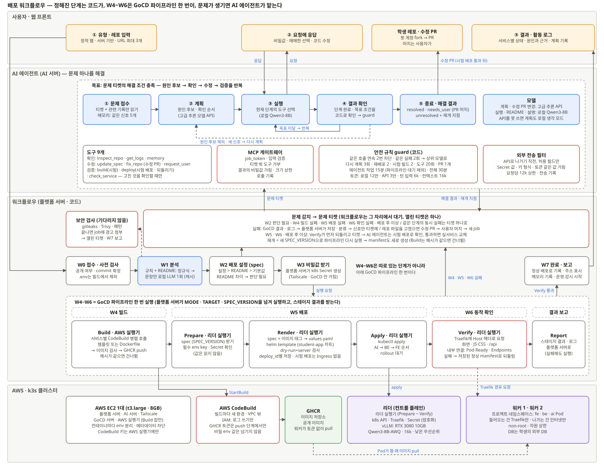

# 배포 워크플로우 — 설계

- **상태**: 초안 (팀 논의 전. 합의되면 시스템 정의서 · ADR · ai-scope에 반영한다)
- **관련**: [시스템 정의서](../system-definition.md) §3 · §4.1 · [ADR-001](../adr/001-stack-and-deployment.md) (빌드 = CodeBuild) · [ADR-002](../adr/002-bot-account-for-fix-prs.md) (봇 계정 수정 PR) · [ADR-003](../adr/003-registry-ghcr.md) (GHCR) · [ADR-004](../adr/004-server-cluster-link-tailscale.md) (Tailscale) · [ADR-005](../adr/005-k3s-cluster-on-school-pcs.md) (k3s)



## 한 문장 요약

학생이 레포를 넣으면 **플랫폼 서버가 정해진 단계(W0~W7)를 코드로 진행**하고, 빌드 · 배포 · 확인(W4~W6)은 **GoCD 파이프라인을 한 번 실행**해서 처리한다. 중간에 **문제가 생겼을 때만 AI 에이전트**가 원인을 찾아 고치고 워크플로우로 돌려보낸다.

## 범위

- **한다**: 레포 접수부터 서비스가 떠서 확인될 때까지의 순서, 각 단계를 누가 어디서 하는지, 문제가 생겼을 때 AI 에이전트에 넘기고 돌려받는 약속, AI 모델을 쓰는 곳, AWS · 클러스터 배치.
- **하지 않는다**: AI 에이전트의 도구 스키마와 프롬프트(구현 직전에 `design/agent.md`로), Helm 차트의 세부 값(`design/cluster.md`), 화면 설계, 모니터링 지표.

## 처음 읽는 사람을 위한 용어

| 용어 | 뜻 |
|---|---|
| 워크플로우 | 플랫폼 서버가 **코드로** 정해진 순서대로 처리하는 배포 흐름. 단계 번호는 W0~W7 |
| 배포 설정 (spec) | "무엇을, 어떻게 띄우고, 어떻게 연결할지"를 적은 설정. 코드가 만들고, AI 에이전트는 항목 하나씩만 고칠 수 있다 |
| GoCD 파이프라인 | 빌드 → 배포 → 확인을 순서대로 실행하는 CI/CD 도구의 실행 한 번. W4~W6이 이것이다 |
| GoCD 실행기 | GoCD의 일을 실제로 하는 프로그램(GoCD 공식 이름은 "GoCD Agent"). AI 에이전트와 헷갈리지 않게 "실행기"라고 부른다. AWS 실행기와 리더 실행기 두 곳에 둔다 |
| manifest | 배포 설정을 쿠버네티스가 읽는 YAML로 옮긴 것. 배포할 때마다 코드가 만든다 |
| 문제 티켓 | 워크플로우가 막혔을 때 AI 에이전트에 넘기는 문제 설명 (어디서, 무엇이, 어떤 신호로 실패했는지) |
| 해결 결과 | AI 에이전트가 돌려주는 결과: 해결됨 / 사용자 조치 필요 / 해결 못 함 + **다시 시작할 단계(재개 지점)** |
| 시험 배포 | 사용자가 접속하는 주소에 연결하지 않고 띄워 보는 배포. AI 에이전트가 고친 것을 확인할 때 쓴다 |
| 되돌리기 | 직전에 정상이던 배포로 돌아가는 것 |
| 수정 PR | 학생 레포의 파일을 고쳐야 문제가 풀릴 때, AI 에이전트가 고치고 시험 배포로 확인한 뒤 봇 계정으로 학생 레포에 올리는 PR ([ADR-002](../adr/002-bot-account-for-fix-prs.md)) |

## 설계

### 1. 전체 흐름

```
W0 접수 · 사전 검사 → W1 분석 → W2 배포 설정 → W3 비밀값 받기
   → [ W4~W6: GoCD 파이프라인 한 번 — Build → Prepare → Render → Apply → Verify → Report ]
   → W7 완료 · 보고
```

**W4~W6은 따로 실행하는 단계가 아니다.** 플랫폼 서버가 파이프라인을 한 번 실행하면, 그 안의 스테이지가 차례로 돈다. W4 · W5 · W6은 "그 스테이지 묶음을 워크플로우에서 부르는 이름"일 뿐이다.

| 워크플로우 이름 | 파이프라인 스테이지 | 실행 위치 |
|---|---|---|
| W4 빌드 | Build | AWS 실행기 → CodeBuild |
| W5 배포 | Prepare → Render → Apply | 리더 실행기 |
| W6 동작 확인 | Verify | 리더 실행기 |
| (결과 전달) | Report | 리더 실행기 |

### 2. 단계별로 하는 일

| 단계 | 누가 | 하는 일 | 막히면 |
|---|---|---|---|
| **W0 접수 · 사전 검사** | 플랫폼 서버 | 레포가 공개인지, commit 확정, `.env`가 올라와 있으면 빌드에서 빼고 경고 | 비공개 · 없음 → 반려 (AI 안 씀) |
| **W1 분석** | 플랫폼 서버 + 로컬 LLM | 설정 파일을 규칙으로 읽어 프레임워크 · 포트 · env key · 서비스 연결을 찾음. README는 정규식으로 먼저 보고, **남은 문장 부분만 로컬 LLM이 한 번** 정리(결과는 캐시). 보안 검사(gitleaks · Trivy)는 기다리지 않고 따로 돈다 | 프레임워크를 못 알아보면 W2에서 "판단 필요" |
| **W2 배포 설정** | 플랫폼 서버 | 설정 파일 > README > 기본값 순서로 spec을 조립 | 빈칸 · 후보 여러 개 · README와 충돌 → **문제 티켓** |
| **W3 비밀값 받기** | 플랫폼 서버 | 빠진 필수 env 값을 사용자에게 바로 요청. 받은 값은 **플랫폼 서버가 Tailscale로 k8s API에 접속해 Secret으로 만든다.** GoCD를 거치지 않으므로 실행 기록에 남지 않는다. DB에는 key 이름과 상태만 저장 | 응답이 없으면 "사용자 조치 필요"로 마감 |
| **W4 빌드** | AWS 실행기 → CodeBuild | 서비스별로 CodeBuild를 병렬 호출. 플랫폼 템플릿(Dockerfile이 없을 때) 또는 학생 Dockerfile로 빌드 → 이미지 검사 → GHCR에 push. 빌드 입력 해시가 같으면 건너뜀 | 빌드 실패 → **문제 티켓** |
| **W5 배포** | 리더 실행기 | Prepare: spec을 받고 필수 Secret key 확인. Render: manifest 생성(3절). Apply: AI → BE → FE 순서로 적용 | 배포 실패 → 되돌리기 → **문제 티켓** |
| **W6 동작 확인** | 리더 실행기 | Traefik에 Host 헤더를 넣어 화면 · JS·CSS · `/api`를 요청. BE → AI 같은 내부 연결은 Pod Ready와 Service Endpoints로 확인 | 실패 → 되돌리기 → **문제 티켓** |
| **W7 완료 · 보고** | 플랫폼 서버 | 이번 배포를 "마지막 정상 배포"로 기록, 사용자에게 주소 · 상태 · 경고 표시, 프로젝트 메모리에 기록, 운영 감시 시작 | - |
| (운영 중) | 플랫폼 서버 | 재시작 반복 · 메모리 초과를 감시 | 재시작 1회 → 되돌리기 → **장애 대응 job**의 문제 티켓 |

### 3. manifest는 언제 만드나

- **차트**(`Infra/charts/student-app`, 만들 예정: Deployment · Service · Ingress · NetworkPolicy의 틀)는 개발 기간에 **한 번** 만든다.
- **실제 manifest**는 **배포할 때마다 Render 스테이지에서** 만든다. spec + 이미지 태그 → `values.yaml` → `helm template` → `kubectl apply --dry-run=server`로 검사 → 배포 번호(`deploy_id`)별로 저장.
- W2에서 미리 만들지 않는 이유: 이미지 태그는 Build 뒤에, 최종 spec은 AI 에이전트가 고친 뒤에 정해진다.
- 사람도 AI 에이전트도 manifest를 직접 쓰지 않는다. 그래서 결과가 항상 같은 틀에서 나온다.

| 실행 모드 | Build | Render | 언제 |
|---|---|---|---|
| `full` | 실행 (해시가 같으면 건너뜀) | 새로 만듦 | 처음, 새 commit, AI 에이전트가 고친 뒤 재개 |
| `full` + 시험 배포 | 실행 | Ingress 없이, 이름에 `candidate` | AI 에이전트가 고친 것을 확인할 때 |
| `promote` | 건너뜀 | 시험 배포에서 확인된 값으로 실서비스용 | 시험 배포가 통과했을 때 |
| `rollback` | 건너뜀 | 만들지 않음, 저장된 정상 manifest 적용 | 운영 중 이상 |
| `verify_only` | 건너뜀 | 만들지 않음 | 재시작만 했을 때 |

### 4. 이미지는 어떻게 클러스터까지 가나

```
[지시: 이미지 주소 한 줄]
CodeBuild ─태그─▶ GoCD ─▶ 리더 실행기: kubectl apply ─▶ 리더 k8s API ─▶ 워커에 배치

[이미지 자체]
CodeBuild ─push─▶ GHCR ─────────────────────────────────────────▶ 워커가 직접 pull
```

GoCD와 리더는 **이미지를 옮기지 않는다.** 이미지 주소만 manifest에 넣고, 워커가 GHCR에서 직접 받는다. GHCR 이미지는 공개라 토큰이 필요 없다(ADR-003).

### 5. 문제가 생기면: 문제 티켓과 AI 에이전트

1. 워크플로우가 그 단계에서 **멈추고** job 상태를 저장한다(스레드가 기다리지 않는다).
2. 이미 정상으로 돌던 버전이 있으면 **먼저 되돌린다.** 사용자의 서비스는 계속 돈다.
3. 플랫폼 서버가 로그를 저장하고 코드로 분류한 뒤(오류 종류, 오류 식별자, 핵심 로그 20줄) **문제 티켓**을 만들어 저장하고 AI 서버를 부른다.
4. AI 에이전트가 **계획**(원인 후보와 확인 순서) → **실행**(도구 사용) → **결과 확인**(코드가 판정)을 반복한다. 고친 것은 **시험 배포**로 확인한다.
5. 고친 곳에 따라 반영한다(아래 표). 레포 파일을 고쳤으면 **학생 레포에 수정 PR**을 올린다.
6. **해결 결과**를 플랫폼 서버 콜백으로 돌려준다. 워크플로우는 **재개 지점부터 새 spec으로 파이프라인을 다시 실행**한다.

**고친 것을 어떻게 반영하나**

| 고친 곳 | 반영 |
|---|---|
| 배포 설정(spec)만 (예: 포트를 잘못 읽음, 헬스체크 경로) | 레포는 그대로 두고 새 spec으로 파이프라인을 다시 실행한다. PR 없음 |
| 레포 파일 (예: `vite.config`의 base 경로, Dockerfile, import 경로 대소문자) | ① 봇 계정 fork의 작업 브랜치에 고친 파일을 commit ② 그 commit으로 시험 빌드 · 시험 배포 ③ 통과하면 학생 레포에 **수정 PR**을 올린다. 본문에는 원인, 근거(로그 줄), 바꾼 줄, 시험 배포 결과를 적는다 ④ 해결 결과는 "사용자 조치 필요(PR 머지)" ⑤ 사용자가 머지하면 새 commit으로 새 job이 돌고, 바뀌지 않은 서비스는 빌드를 건너뛴다 |

PR이 머지되기 전까지 실서비스는 직전 정상 버전으로 돈다(첫 배포라면 머지를 기다린다). 학생 레포에 직접 push하지 않고, 머지는 항상 사용자가 한다.

**수정 PR 규칙**: 시험 배포를 통과한 변경만 올린다. 문제 하나에 PR 하나. 파일 5개 · 변경 50줄 이하. `.env` · 비밀값 · `.github/` 파일은 건드리지 않는다. 바꾼 내용은 코드가 한 번 더 검사한다(금지 파일, 크기, 비밀값처럼 보이는 문자열). 레포가 fork를 막았으면 PR 대신 patch 텍스트를 보여 준다(ADR-002).

AI 에이전트가 할 수 있는 것은 정해진 도구 9개뿐이다: 레포 보기, 로그 보기, 메모리 보기, spec 항목 고치기, **레포 파일 고치기(작업 브랜치 → 수정 PR)**, 사용자에게 요청, 시험 빌드, 시험 배포 · 되돌리기, 서비스 확인. 모든 호출은 플랫폼 서버의 관문(MCP 게이트웨이)을 거친다.

**무한 반복을 막는 장치**: 같은 호출 연속 2번 차단, 다시 계획 3회, 문제당 재배포 2회 · 시험 빌드 2회 · 도구 20회 · 수정 PR 1개, 에이전트 작업 15분(파이프라인 대기 제외) · 전체 30분, 같은 단계가 해결 뒤 다시 실패하면 2회째에는 AI 에이전트를 부르지 않고 보고한다. 숫자는 모두 초기값이다.

### 6. AI 모델을 쓰는 곳

**자주 부르는 일은 로컬 모델, 드물지만 어려운 판단은 고급 추론 모델 API, 결과가 매번 같아야 하는 일은 코드**로 나눈다.

| 쓰는 곳 | 모델 | 이유 |
|---|---|---|
| W1 README 정리 | 로컬 Qwen3-8B | job마다 부르고 단순 추출이다. 코드가 밖으로 나가지 않는다 |
| AI 에이전트 실행 (도구 고르기) | 로컬 Qwen3-8B | 호출 횟수가 가장 많다. 계획이 잡혀 있어 할 일이 좁다 |
| 결과 설명 문장 (활동 로그 · 보고) | 로컬 Qwen3-8B | 근거는 이미 구조화돼 있어 문장만 다듬는다 |
| AI 에이전트 계획 · 다시 계획 | 고급 추론 모델 API (OpenAI) | 문제 해결의 핵심 판단. 문제당 1~3번이라 비용이 작다 |
| 수정 PR의 파일 변경 만들기 | 고급 추론 모델 API | 학생 코드를 고치는 일이라 정확해야 한다. 문제당 한 번 |
| 상위 모델로 넘김 | 고급 추론 모델 API | 로컬 모델이 같은 실패를 2번 하거나 수정이 연속으로 거부될 때만 |
| 결과 판정 · 안전 규칙 · 오류 분류 · 보안 검사 · spec 조립 · manifest 생성 | 없음 (코드) | 결과가 매번 같아야 하고 검증할 수 있어야 한다 |

- **로컬 모델 실행**: 리더 PC(RTX 3080 10GB)의 vLLM, `Qwen/Qwen3-8B-AWQ`(공식 4bit). 모델은 32k까지 받지만 VRAM에 맞춰 `--max-model-len 16384`로 띄운다. 자원 상한 · 낮은 우선순위로 클러스터 제어를 방해하지 않게 한다.
- **API로 보내는 것**: 문제 요약, 오류 식별자, 핵심 로그, 관련 코드 조각만. Secret 값 · `.env` · 토큰처럼 보이는 문자열은 **외부 전송 필터**가 보내기 직전에 가린다.
- **API를 못 쓸 때**(키 없음 · 장애 · 예산 소진): 계획도 로컬 모델의 생각 모드로 한다. 그래서 API 없이도 데모는 돈다.

### 7. 어디에 무엇이 있나

| 위치 | 구성 |
|---|---|
| **AWS EC2 1대 (t3.large, 메모리 8GB)** | 플랫폼 서버, AI 서버, GoCD 서버, AWS 실행기, Tailscale. 컨테이너마다 env를 따로 준다 |
| 봇 GitHub 계정 | 학생 레포를 fork해 작업 브랜치에 고친 파일을 올리고 수정 PR을 연다 (ADR-002). 학생 레포에 쓰기 권한은 없다 |
| AWS CodeBuild | 빌드마다 새 환경, VPC 밖, IAM은 로그 쓰기 정도. GHCR push 토큰은 Secrets Manager에서 push 단계에만 꺼낸다. 비밀 env 값은 넘기지 않는다 |
| GHCR | 공개 이미지. 워커가 토큰 없이 받는다 |
| 리더 PC | k3s 제어, 리더 실행기, Traefik, Secret(암호화), vLLM |
| 워커 PC 2대 | 프로젝트 네임스페이스(fe · be · ai Pod). 들어오는 건 Traefik에서만, 나가는 건 인터넷만(학교망 · 클러스터 내부 차단). DB는 학생이 가져온 외부 DB |
| Supabase | spec, 활동 로그, 프로젝트 메모리, env key 이름과 상태 (값은 저장하지 않음) |

**EC2를 한 대로 두는 조건**

- GoCD 서버(Java)가 1~2GB를 쓰고 다른 서버도 함께 있으므로 8GB로 잡는다. GoCD JVM 힙은 `-Xmx1g` 정도로 제한한다.
- EC2 인스턴스 역할은 모든 컨테이너가 같이 쓴다. 그래서 인스턴스 역할에는 권한을 주지 않고, 컨테이너가 EC2 메타데이터에 닿지 못하게 막는다(IMDSv2 hop limit 1). **CodeBuild 권한은 전용 IAM 키로 AWS 실행기 컨테이너에만** 준다. CodeBuild를 시작할 수 있으면 빌드 명령을 바꿔 GHCR 토큰을 빼 갈 수 있기 때문이다.
- GoCD 서버 포트는 인터넷에 열지 않고 Tailscale로만 받는다. 리더 실행기가 먼저 접속하는 방식이라 학교망에 들어오는 포트를 열지 않는다.

## 결정과 대안

| 결정 | 이유 | 버린 대안 |
| --- | --- | --- |
| 배포 순서는 코드(워크플로우), AI는 문제가 생겼을 때만 | 정상 경로가 매번 같고 빠르다. AI가 틀려도 정상 배포는 영향이 없다. 비용과 실패 지점이 줄어든다 | AI 에이전트가 처음부터 끝까지 배포를 진행 (느리고, 매번 결과가 다르고, 토큰이 많이 든다) |
| W4~W6은 GoCD 파이프라인 한 번 | 순서 · 재시도 · 로그 · 단계 표시를 검증된 도구에 맡긴다. 재개는 새 spec으로 다시 실행하면 끝난다 | 플랫폼 서버가 k8s Job을 직접 만들고 관리 (순서 · 재시도 · 로그를 직접 만들어야 한다) |
| 빌드는 AWS CodeBuild | 빌드마다 새 환경이라 학생 코드끼리 섞이지 않고, 학교 PC 자원을 쓰지 않는다. ADR-001과 같다 | 클러스터 안 격리 빌드 (빌드용 권한 · 설정이 필요하고 push 토큰이 클러스터에 있어야 한다), EC2에서 직접 빌드 (학생 코드가 EC2 권한에 닿는다) |
| manifest는 배포마다 Helm으로 생성 | 같은 틀에서만 나오므로 예측할 수 있다. 되돌리기는 저장한 manifest를 다시 적용하면 된다 | AI가 manifest를 작성 (검증이 어렵고 매번 다르다), 문자열 템플릿 직접 구현 |
| 실패하면 먼저 되돌리고 AI가 고친다 | 사용자의 서비스가 고치는 동안에도 돈다 | 실패한 상태로 두고 AI가 고칠 때까지 기다림 |
| 레포 파일을 고쳤으면 봇 계정으로 수정 PR | 사용자가 무엇이 왜 바뀌었는지 보고 직접 머지한다. 고친 내용이 레포에 남아 다음 배포부터 문제가 다시 생기지 않는다 | 플랫폼이 학생 레포에 직접 push (권한이 너무 크고 사용자가 모르게 바뀐다), 말로만 수정 요청 (사용자가 다시 찾아 고쳐야 한다), 고친 파일을 플랫폼 안에서만 덮어써서 빌드 (레포와 실제 배포가 달라진다) |
| 로컬 모델 + 고급 추론 API를 나눠 씀 | 호출이 많은 일은 무료 로컬, 판단이 어려운 일만 API. API가 없어도 돈다 | 전부 API (비용 · 데이터 외부 전송이 늘어남), 전부 로컬 (8B 모델로는 원인 추론이 약하다) |
| AWS는 EC2 한 대 | 비용. 9일 일정에서 관리할 서버가 줄어든다 | 플랫폼 · AI 서버와 GoCD를 따로 (권한 분리는 깔끔하지만 비용이 늘어난다) |
| 학생 DB는 외부 연결 | 9일 안에 플랫폼 DB · 볼륨 · 백업까지 만들기 어렵다 | 공유 MySQL + 학생 볼륨 (MVP 이후) |

## 장단점

**장점**

- **빠르고 예측할 수 있다.** 대부분의 배포는 AI를 부르지 않고 끝난다. 같은 입력이면 같은 결과가 나온다.
- **AI가 "동료"처럼 일하는 지점이 분명하다.** 사람이 하던 "로그 보고, 원인 추측하고, 설정 고치고, 다시 배포해 보는" 일을 AI 에이전트가 한다. 계획과 근거가 활동 로그에 남아 사용자가 확인할 수 있다.
- **고치는 동안 서비스가 멈추지 않는다.** 되돌린 뒤 시험 배포로 확인하고 교체한다.
- **비밀값이 덜 퍼진다.** 빌드에 비밀값이 없고, GoCD도 비밀값을 모르고, 외부 API로 보내기 전에 한 번 더 가린다.
- **고친 내용이 PR로 남는다.** 사용자는 원인 · 근거 · 바꾼 줄 · 시험 배포 결과를 보고 머지만 하면 된다.
- **부품을 바꾸기 쉽다.** 워크플로우와 AI 에이전트는 문제 티켓 · 해결 결과로만 이어져서, 한쪽을 바꿔도 다른 쪽은 그대로다.

**단점**

- **구성 요소가 많다.** GoCD, CodeBuild, vLLM, Tailscale, 봇 계정을 모두 9일 안에 연결해야 한다.
- **EC2 한 대가 단일 장애점이다.** 플랫폼 서버 · AI 서버 · GoCD가 함께 멈춘다.
- **AI가 고친 코드는 사용자가 PR을 머지해야 반영된다.** 머지 전까지는 직전 정상 버전이 돌고, 첫 배포라면 기다린다.
- **수정 PR은 작은 변경만 한다**(파일 5개 · 50줄). 큰 앱 로직 버그는 원인을 알려 주는 데서 끝난다.
- **로컬 8B 모델의 도구 호출 품질은 아직 검증하지 않았다.** 안 되면 실행도 API로 넘겨야 하고 비용이 는다.
- **CodeBuild는 빌드 분 단위로 과금되고, 시작에 수십 초가 더 걸린다.**

## 시스템 정의서와 다른 점 (합의가 필요한 것)

이 설계는 [시스템 정의서 §4.1](../system-definition.md#41-user1-배포자-흐름)의 지금 흐름과 다르다. 합의되면 시스템 정의서 · ADR · ai-scope를 따로 PR로 고친다.

| 항목 | 시스템 정의서 지금 | 이 설계 |
|---|---|---|
| AI를 쓰는 때 | 배포 전에 항상 AI 검토 | 정상 경로에는 AI가 없고(README 정리만), 문제가 생겼을 때 AI 에이전트 |
| 운영자 승인 | AI 검토 뒤 운영자가 승인해야 빌드 | **빠져 있다.** 넣는다면 W2와 W3 사이에 선택 단계로 둘 수 있다 (정할 것 1) |
| 수정 PR | 봇 계정이 배포 전 검토 결과로 PR (ADR-002) | 봇 계정 PR은 그대로. 배포 전 검토가 아니라 **실패를 고치고 시험 배포로 확인한 뒤**에 AI 에이전트가 올린다 |
| 배포 실행 | 플랫폼 서버가 k8s API에 직접 지시 | GoCD 파이프라인 (리더 실행기) |
| 학생 DB | 없음 / MySQL 선택, 학생 볼륨 | 학생의 외부 DB만 (MVP) |
| LLM | 업체 · 모델 미정 | 로컬 Qwen3-8B (vLLM) + 고급 추론 모델 API (OpenAI) |

## 마감 전에 보완할 것 (MVP 안)

| 항목 | 내용 |
|---|---|
| 로컬 모델 시험 | 리더에 vLLM을 띄우고 VRAM 사용량, 16k 컨텍스트, 도구 호출 품질을 확인. 안 되면 실행도 API로 |
| API 대체 경로 먼저 | vLLM 준비 전에도 데모가 돌도록 처음에는 API로 연결해 두고 로컬로 바꾼다 |
| CodeBuild 비용 확인 | 빌드 분 단가와 무료 사용량을 확인하고 동시 빌드를 2~3개로 제한 |
| Docker 빌드 캐시 | CodeBuild는 매번 새 환경이라 캐시가 없다. GHCR `--cache-from`과 S3 캐시 중 선택 |
| 실패 주입 시험 | 일부러 망가뜨린 레포(포트 틀림, base 경로 틀림, env 빠짐 등)로 AI 에이전트의 해결률을 재서 ai-scope에 숫자로 적는다 |
| 문서 반영 | 합의되면 시스템 정의서 §3 · §4.1, ai-scope, 새 ADR(GoCD 파이프라인, 워크플로우 + AI 에이전트, 로컬 LLM, 외부 DB) |

## MVP 이후 보완할 것

| 항목 | 내용 |
|---|---|
| EC2 분리 | 사용자가 늘면 GoCD를 다른 EC2로 옮긴다. 실행기가 먼저 접속하는 방식이라 옮기기 쉽다 |
| 공유 DB · 학생 볼륨 | 플랫폼이 MySQL을 띄워 주고 볼륨 · 백업까지 |
| 내부 연결 실제 요청 | BE → AI 연결을 Pod 상태가 아니라 실제 요청으로 확인 (`pods/exec` 권한 필요) |
| GoCD 탄력 실행기 | 배포가 몰리면 실행기를 작업마다 Pod로 띄운다 |
| 기다림 줄이기 | W2에서 판단이 필요한 서비스만 멈추고 나머지 서비스는 먼저 빌드 |
| 머지 자동 감지 | MVP는 플랫폼이 수정 PR 상태를 주기적으로 확인한다. 이후 GitHub webhook으로 머지 즉시 새 job |
| AI 에이전트 범위 넓히기 | 더 큰 코드 수정(크기 상한 완화), 자원 상한 조정 제안 |
| 로그 저장소 | 지금은 필요할 때 Pod 로그를 읽고 빌드 로그는 CodeBuild에서 가져온다. 사후 분석용 저장소는 이후 |

## 정할 것

1. 운영자 승인을 이 흐름에 넣을지, 넣는다면 어디에 둘지
2. 수정 PR이 고칠 수 있는 범위 (파일 5개 · 50줄 초기값, 금지 파일 목록)와, 첫 배포에서 머지 전에 시험 배포 주소를 사용자에게 보여 줄지
3. GoCD 서버 설치 · 운영 담당 (제안: 파이프라인 정의와 함께 플랫폼 서버 담당, 리더 실행기와 권한은 인프라 담당)
4. 고급 추론 모델 API의 모델 이름과 월 예산, 데이터 보관 · 학습 설정
5. 숫자 초기값(문제당 예산, 시간 상한, 재배포 횟수)

## 알려진 한계

- 수정 PR은 작은 변경만 다룬다. 큰 앱 로직 버그는 원인과 근거를 보여 주고 사용자에게 요청한다.
- 사용자가 수정 PR을 머지하지 않으면 문제는 그대로 남는다. 실서비스는 직전 정상 버전으로 돈다.
- DB 구조 변경(migration)이 있었던 배포는 되돌려도 옛 버전이 새 DB에서 실패할 수 있다. MVP는 DB 되돌리기를 하지 않고 보고서에 표시한다.
- 로컬 모델은 커뮤니티 평가가 아니라 우리가 직접 잰 결과만 발표에 쓴다. 지금은 미검증이다.
