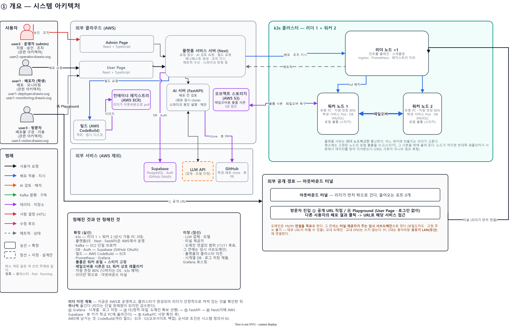
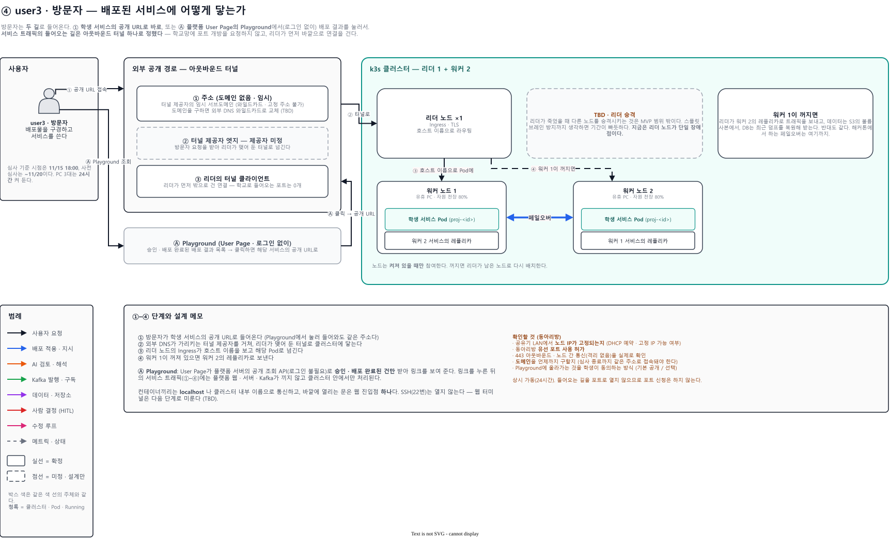
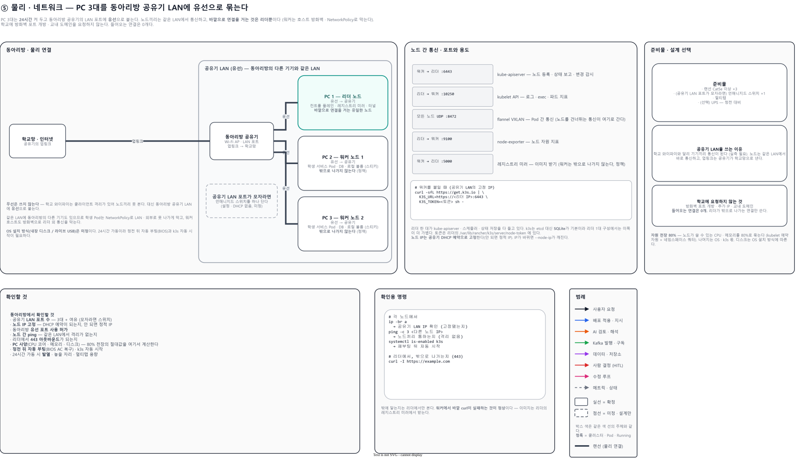

# 시스템 정의서

> 이 시스템이 **어떤 구조인가**를 정의한다. [`SRS.md`](SRS.md)와 함께 개발의 SSOT이고, `tasks/`와 구현은 이 둘을 기준으로 진행한다.
> 도식은 [`architecture/`](architecture/)의 `.drawio.svg` 파일 하나가 한 흐름이고, 이 파일이 곧 원본이다 (draw.io에서 열어 고친다).
> **SRS의 UC · FR이 채워지는 동안 구조는 이 문서가 정본이다.** SRS와 어긋나면 이 문서에 맞추고 SRS는 후속 PR에서 갱신한다. 코어 / 부가 구분은 팀 승인 전까지 제안(FR 후보)이다 ([§7](#7-갱신-규칙)).

- **상태**: 초안 (2026-10-31)
- **프로젝트명**: TBD ([SRS](SRS.md) 머리글과 같은 값을 쓴다)

## 1. 이 문서와 SRS의 분담

두 문서가 같은 것을 다르게 말하지 않도록 나눈다. 겹치는 내용이 보이면 아래 기준으로 한쪽에서 지운다.

| 문서 | 정의하는 것 | 바뀌는 조건 |
| --- | --- | --- |
| [`SRS.md`](SRS.md) | **무엇을 만드는가** — 문제, 범위, 유즈케이스(UC), 기능·비기능 요구사항(FR/NFR), 데모 시나리오 | 팀 합의 (Notion에서 쓰고 repo가 따라간다. [`CONTRIBUTING.md`](../CONTRIBUTING.md) §3) |
| 이 문서 | **어떤 구조로 만드는가** — 사용자, 구성요소와 책임, 스택, 사용자별 흐름, 인프라, 외부 의존, 가정과 열린 질문 | 구조가 바뀔 때. 되돌리기 비싼 결정은 [`adr/`](adr/README.md)에도 남긴다 |
| [`design/`](design/README.md) | 모듈 하나의 내부 설계와 FE/BE/AI API 계약 | 구현 직전 |

SRS §2 *시스템 구성*은 이 문서를 가리키는 포인터다. 구조 설명은 여기에만 쓴다.

## 2. 사용자

| 사용자 | 정의 | 흐름 |
| --- | --- | --- |
| **user1 · 배포자 (학생)** | 배포를 원하는 사용자. 본 서비스로 배포하고 모니터링한다 | [§4.1](#41-user1-배포자-흐름) · [§4.2](#42-user1-모니터링-흐름) |
| **user2 · 운영자 (admin)** | 배포 승인, 클러스터 자원 현황, 조치를 맡는다 | [§4.3](#43-user2-운영자-흐름) |
| **user3 · 방문자** | 배포물을 구경하러 온 사용자. 로그인하지 않는다 | [§4.4](#44-user3-방문자-흐름) |

## 3. 시스템 개요

도식: [`overview.drawio.svg`](architecture/overview.drawio.svg)

### 구성요소와 책임

| 구성요소 | 기술 | 상태 | 하는 일 | 하지 않는 것 |
| --- | --- | --- | --- | --- |
| User Page | React + TypeScript, **S3 + CloudFront** | 확정 | 배포 요청, 진행 상태·검토 결과·모니터링 표시, Playground(비로그인 조회) | 판정·조치 |
| Admin Page | React + TypeScript, **S3 + CloudFront** | 확정 | 승인 큐, 클러스터 현황, 조치 버튼 | 서비스 직접 조작 |
| 플랫폼 서버 (BE) | Nest.js, **EC2** | 확정 | 요청 접수, AI 검토 요청, 빌드 요청, 매니페스트 생성, 리더 노드에 배포·조치 지시, 메트릭 수신, 스파이크 판정 | 학생 코드를 읽거나 실행하는 일 |
| AI 서버 | FastAPI(**EC2**), 검토 파이프라인은 LangChain (복잡해지면 LangGraph) | 확정 | 배포 전 검토(레포를 임시 디스크에 읽기 전용으로 받아 LLM API로 검토), 스파이크 알림 뒤 원인 설명 · 제안 | 학생 코드 실행, 차단 · 승인 결정 (차단 등급은 플랫폼 서버의 코드가 자동 차단하고, 그 외는 운영자가 결정한다) |
| LLM | 업체 · 모델 미정 | 미정 | AI 서버가 호출한다 | |
| 빌드 | AWS CodeBuild | 확정 (ADR-001) | 검토한 commit SHA를 받아 이미지로 빌드해 ECR에 올린다. 학생 코드가 실행되는 유일한 외부 단계라 격리한다 | 배포 지시 |
| 컨테이너 레지스트리 | AWS ECR | 확정 (ADR-001) | 빌드 결과 이미지 보관. 리더가 아웃바운드로 받아 간다 | |
| 메시지 큐 | Apache Kafka, EC2 단일 브로커 (MSK 아님) | 확정 | **배포 이벤트 기록** — `deploy.requested` · `review.completed` · `deploy.approved` | 아래 "Kafka 범위" 밖의 모든 것 |
| DB · 인증 | Supabase (PostgreSQL · Auth) | 확정 | GitHub OAuth 로그인, 검토 리포트·배포 상태 저장 (**상태의 기준**) | |
| 오브젝트 스토리지 | AWS S3 | 확정 (ADR-001) | 페일오버용 볼륨 사본, 학생 서비스 DB 덤프 | |
| 봇 GitHub 계정 | GitHub | 확정 (ADR-002) | 검토 결과의 수정 제안을 학생 레포에 fork → PR로 올린다 | 학생 레포 직접 쓰기 |
| k3s 클러스터 | k3s · Prometheus | 확정 | 리더 1 + 워커 2. 학생 서비스 실행, 메트릭 수집 | 이미지 빌드 |
| 리더 에이전트 | 우리가 구현 | 확정 | 리더에서 플랫폼 서버와 WebSocket으로 연결해 배포 · 조치 지시를 실행하고, 노드 · 배포 상태와 DB 덤프를 올려 보낸다 | 들어오는 연결 받기 |
| 시계열 DB · 로그 저장소 · Grafana | 제품 · 호스팅 미정 | 미정 | 리더의 지표 · 로그를 모아 두고 화면에 그래프로 보여 준다 | |
| 아웃바운드 터널 | 제공자 미정 | 미정 | 방문자 요청을 리더가 먼저 맺어 둔 연결로 들여보낸다 | 들어오는 포트 개방 |

- 클라우드는 AWS(플랫폼 운영, 빌드, 레지스트리, 스토리지)다.
- 테스트 · 린트 도구 같은 **라이브러리 수준은 여기에 쓰지 않는다.** 정하는 시점에 [`conventions.md`](conventions.md) §6과 `CLAUDE.md` Commands에 적고, 되돌리기 비싼 것만 ADR로 남긴다. 스택 결정의 근거와 대안은 [`adr/`](adr/)에 있다.
- AI 모델 · 외부 API 목록의 기준은 [`ai-scope.md`](ai-scope.md) §1이다.
- 도식의 점선은 미정이다.
- 이 문서에서 "서버"는 단독으로 쓰지 않고 **플랫폼 서버**(Nest)와 **AI 서버**(FastAPI)로 구분해 쓴다.

### 용어

| 용어 | 뜻 |
| --- | --- |
| commit SHA | 커밋을 가리키는 고유 해시. 검토한 것과 빌드하는 것이 같은 코드임을 보장한다 |
| 이미지 digest | 빌드된 이미지의 내용으로 정해지는 고유 ID |
| 매니페스트 | 쿠버네티스에 "무엇을 띄울지" 적어 둔 배포 명세 |
| 스티키 볼륨 | 한 노드의 로컬 디스크에 붙어 그 노드에 고정되는 볼륨 |
| 천장 | 노드 자원(CPU · 메모리)의 80% 상한. 나머지는 OS · k3s 몫이다 |
| 슬롯 | 워커 1대에 놓을 수 있는 학생 프로젝트 1개 (그 안의 Pod와 DB 포함). 워커 2대이므로 2개다. 다른 워커에서 대기 중인 레플리카(이미지만 받아 둔 상태)는 슬롯에 세지 않는다 ([SRS §1.5](SRS.md#15-범위)) |
| 라운드 | 같은 프로젝트의 검토 1회. 학생이 고쳐서 재검토를 요청하면 새 SHA로 라운드 n+1이 시작된다 |
| 리뷰 패킷 | 운영자가 처음 보는 레포를 0부터 읽지 않고 결정하도록 만든 검토 요약 ([§4.1](#41-user1-배포자-흐름)) |
| 스파이크 | 프로젝트가 규칙 2개(메모리 한도 초과 · 크래시 루프)에 걸린 상황. 규칙이 자동으로 중단 · 재시작하고, 그 알림 뒤에 AI가 원인 설명과 다음 행동(재시작 · 롤백 · 환경변수 확인 등)을 제안한다. CPU 급등을 AI 해석 대상에 넣을지는 열린 질문(스파이크 판정 기술)이다 |
| 아웃바운드 터널 | 리더가 먼저 바깥 서비스에 연결을 걸어 두고, 방문자 요청이 그 연결로 들어오게 하는 방식. 학교망에 들어오는 포트를 열지 않는다 |

### Kafka 범위

Kafka는 **"사용자가 맡긴 배포본이 시스템 오류로 사라지지 않게 기록을 남기는 것"** 에만 쓴다. 보내는 쪽은 받는 쪽이 바쁘거나 죽어 있어도 기록만 남기면 끝나고, 받는 쪽은 자기 속도로 읽으며, 버그가 났을 때 지난 기록부터 다시 처리할 수 있다.

| 쓴다 | 쓰지 않는다 (각자의 경로를 쓴다) |
| --- | --- |
| 배포 기록: `deploy.requested` → `review.completed` → `deploy.approved` | 진행 상태 표시(`Supabase` 상태 컬럼), 스파이크 해석 호출(AI 서버 직접 호출), 리더로 가는 배포 · 조치 지시(WebSocket), 지표 · 로그, 앱 내 알림, 봇 PR 상태 |

- **상태의 기준은 Supabase다.** Kafka 이벤트는 처리를 일으키고 기록을 남기는 용도이고, 화면이 보는 상태는 Supabase에서 읽는다. 둘이 어긋나면 Supabase를 믿고 이벤트를 다시 처리한다.
- **재처리해도 결과가 같아야 한다.** 이벤트 키(이벤트 종류 · 프로젝트 · 라운드 · SHA)로 이벤트 종류별로 한 번만 처리하고, 같은 `deploy.approved`를 다시 읽어도 빌드 · 배포를 중복 실행하지 않는다.
- 새로운 곳에 Kafka를 쓰려면 위 문장(기록이 사라지면 안 되는가)에 답할 수 있어야 한다. 아니면 쓰지 않는다.

### 저장소 구조

이 저장소는 하나의 모노레포이고, 루트에 영역별 디렉터리를 둔다. 각자 자기 디렉터리에서 작업한다.

| 디렉터리 | 내용 | 담당 |
| --- | --- | --- |
| `FE/` | Vite + React + TypeScript 프로젝트 (User Page · Admin Page) | 풀스택 |
| `BE/` | Nest.js (플랫폼 서버) | 풀스택 |
| `AI/` | FastAPI (검토 파이프라인 · 스파이크 해석) | AI |
| `Infra/` | 클러스터 구성 (k3s 리더 · 워커 설정, 프로젝트 네임스페이스 기본 템플릿) | 인프라 |

- `FE/`와 `BE/`는 각자 `Dockerfile`을 두고, **컨테이너 두 개로 로컬에서 띄워** 먼저 개발한다. 배포 단위는 [구성요소 표](#구성요소와-책임)대로 FE는 S3 + CloudFront, BE는 EC2다.
- **FE → BE 호출 주소** (가정): 로컬은 Vite 개발 서버의 프록시로 BE에 넘기고, 배포는 FE의 환경변수에 BE 주소를 넣고 BE가 FE 주소를 CORS 허용 목록에 둔다 (CloudFront 경로 라우팅은 쓰지 않는다). [열린 질문](#열린-질문)의 "FE → BE 호출 주소".

### 리더 이전 계획

지금은 플랫폼을 AWS에서 운영한다. 클러스터가 준비되기 전에 FE · BE가 완성되면 **AWS에서 먼저 테스트**하고, 클러스터에 올린 뒤 다시 확인한다. 클러스터가 완성되어 리더가 안정적으로 켜져 있는 것을 확인한 뒤, 리더에서 돌릴 수 있는 것을 **하나씩** 옮긴다. 리더는 단일 장애점이 되지만 감수한다(리더 승격은 [SRS §1.6](SRS.md#16-범위-밖)에 따라 범위 밖). 옮길 때마다 ADR로 남긴다. **이전은 마감(11/15 18:00) 전에 끝내고**, 마감 뒤에는 같은 커밋의 재배포만 한다 ([`hackathon.md`](hackathon.md) 마감 · 평가 버전).

순서: **① Grafana · 시계열 · 로그 저장 → ② FE(정적 파일) → ③ AI 서버 → ④ Nest → ⑤ Kafka.** 남기는 것: CodeBuild · ECR · S3 (학생 코드를 실행하는 빌드는 격리를 유지하고, 백업은 오프사이트에 둔다).

- ① 데이터가 이미 클러스터에 있어 remote_write와 외부 시계열 DB가 필요 없어진다.
- ② **도메인 연결(11/11)이 선행**이다 (플랫폼 URL이 터널을 타므로 심사 종료까지 같은 주소여야 한다, [NFR-OPS-01](SRS.md#5-비기능-요구사항)).
- ④ 서버 채널 · 에이전트가 필요 없어지지만 **AWS · Supabase · GitHub 봇 키가 학교 PC에 올라간다.** 최소 권한 IAM, k3s Secret 암호화, 학생 Pod가 리더에 스케줄되지 않게 taint가 조건이다.
- ⑤ JVM이라 메모리가 크다. PC 사양을 확인한 뒤 정하고, 모자라면 AWS에 둔다.

**수동 페일오버** — 옮긴 뒤에도 AWS 쪽 구성(이미지 · 설정)은 지우지 않고 다시 띄울 수 있게 보존한다. 심사 기간에 리더로 옮긴 부분에 장애가 나서 수리하는 동안 주최측 접근이 필요하면, **사람이 AWS를 다시 구동해** 서비스를 이어 간다. 자동 페일오버는 구현 오버헤드가 커서 하지 않는다.

## 4. 사용자별 흐름

도식 원본은 각 `.drawio.svg`이다.

### 4.1 user1 배포자 흐름

도식: [`user1-deployer.drawio.svg`](architecture/user1-deployer.drawio.svg)

학생이 GitHub 계정으로 로그인한 뒤 User Page의 **배포 페이지**에서 공개 GitHub 레포 URL · 유형(정적 웹 / 서버 / 웹+서버) · DB(없음 / MySQL)를 체크해 제출하면, 플랫폼이 AI 검토 → 운영자 승인 → 빌드 → 배치를 진행하는 과정이다. 학생은 배포 페이지에서 진행 상태와 검토 결과를 본다. 코드 빌드는 AWS의 격리된 빌드 환경에서 돌고, 교내 유휴 PC는 **실행만** 한다. 배포가 끝나면 학생은 모니터링 · 운영 페이지([§4.2](#42-user1-모니터링-흐름))로 넘어가고, 새 버전 갱신도 이 흐름을 재사용한다.

1. 학생이 GitHub으로 로그인하고, User Page의 배포 페이지에서 공개 GitHub URL을 입력한 뒤 유형(정적 웹 / 서버 / 웹+서버)과 DB(없음 / MySQL)를 체크해 **제출**을 누른다.
2. User Page가 요청을 플랫폼 서버(Nest)로 보낸다. 플랫폼 서버는 레포가 공개된 개인 레포이고 로그인한 GitHub 계정이 소유자인지 대조해(아니면 제출을 거부한다. MVP는 공개 개인 레포만 지원)  제출을 **라운드 1**로 Supabase에 기록한다.
3. 플랫폼 서버가 `deploy.requested`(commit SHA, 라운드)를 Kafka에 발행해 **배포 기록을 남긴다** ([Kafka 범위](#kafka-범위)).
4. AI 서버가 Kafka에서 그 이벤트를 읽어 검토를 시작한다. 레포의 해당 SHA를 임시 디스크에 읽기 전용으로 clone하고, LLM API로 관점별 검토 · 교차 검증을 하며, 학생이 고른 유형과 AI 분류를 대조한다. 의존성 취약점은 **결정적 스캐너 도구**(후보: Trivy · OSV-Scanner)가 소스 트리에서 찾고 LLM은 결과를 설명한다. 끝나면 clone을 삭제한다.
5. AI 서버가 **리뷰 패킷**을 만들어 리포트를 Supabase에 저장하고 `review.completed`를 발행한다. 필요하면 봇 계정이 수정 제안을 **봇 PR**로 올린다 (레포에 `Dockerfile`이 없으면 AI가 만든 서비스 스펙과 `Dockerfile`도 이 PR에 넣는다).
6. 플랫폼 서버가 `review.completed`를 읽는다. 차단 등급이면 코드가 자동 차단하고, 그 외는 Admin Page의 승인 큐에 올린다.
7. 운영자가 Admin Page의 승인 큐에서 리뷰 패킷을 읽고 **승인 / 수정 요청(코멘트) / 차단**을 결정한다.
8. 승인이면 플랫폼 서버가 `deploy.approved`를 발행한다. 수정 요청 · 차단이면 학생의 배포 페이지에 결과와 코멘트가 표시된다.
9. 승인된 건만 **같은 SHA**로 AWS CodeBuild가 빌드하고(격리), 이미지를 ECR에 푸시한다.
10. 플랫폼 서버가 WebSocket으로 리더의 에이전트에 **이미지 digest와 원하는 상태(매니페스트: 서비스 + 선택한 DB + 접속 정보 Secret, 웹+서버는 서비스별)** 만 전달한다. 어느 워커에 둘지는 정하지 않는다.
11. 리더가 먼저 연결을 걸어 ECR에서 이미지를 pull해 자기 미러에 두고, 스케줄러가 워커를 골라 배치한다. 로컬 볼륨을 붙이고 그 노드에 고정(스티키)한다. 비어 있는 슬롯이 없으면 **배포 대기** 상태로 기다린다.
12. 워커 1의 레플리카를 워커 2에, 워커 2의 것을 워커 1에 대기시켜 둔다. 노드가 꺼지면 반대쪽 레플리카가 볼륨 사본으로 이어받는다. 볼륨 사본은 리더를 거쳐 플랫폼 서버가 S3에 올려 두며, **DB 볼륨은 사본에서 제외**한다 (DB는 덤프 복원, 16번).
13. 진행 상태와 라운드는 플랫폼 서버가 Supabase 상태 컬럼에 쓰고, 배포 페이지가 그것을 읽어 보여 준다 (Kafka 이벤트가 아니다).
14. **수정 루프**: 학생이 리포트 · 봇 PR · 운영자 코멘트를 보고 고쳐 push한 뒤 배포 페이지의 "재검토" 버튼을 누르면, 기본 브랜치의 최신 SHA로 **라운드 n+1**이 3번부터 다시 돈다 ([`user1-deployer.drawio.svg`](architecture/user1-deployer.drawio.svg)의 마젠타 점선 구간).
15. **종료**: Pod가 Running이 되면 배포 페이지에 유형별 주소(웹 URL / API URL)가 표시되고, 학생은 모니터링 · 운영 페이지([§4.2](#42-user1-모니터링-흐름))에서 상태를 본다.
16. **DB 백업 · 복구**는 아래 "학생 서비스 DB" 표의 백업 · 복구 행이 정의한다 (리더의 백업 잡 → 플랫폼 서버 → S3, 복구는 덤프 복원).

**상태**: 제출 → 검토 중 → [수정 필요 · 운영자 대기 · 차단] → 승인 → 빌드 중 → (슬롯이 없으면 배포 대기) → 배포 중 → Running. 레포에 `Dockerfile`이 없는 첫 제출은 "수정 필요"로 가고, 학생이 봇 PR을 반영해 재검토한다. 수정 필요와 운영자의 수정 요청은 학생 수정 → 재검토(라운드 +1)로 돈다.

**유형별 안내**

| 유형 | 학생에게 주는 것 | 비고 |
| --- | --- | --- |
| 정적 웹 | 웹 URL | 이미지로 빌드해 k3s Pod로 서빙한다 (S3 · GitHub Pages 아님, SRS §1.3의 결정 그대로) |
| 서버 | API URL | HTTP 서버로 한정한다 (raw TCP · SSH는 이번 범위에서 제공하지 않는다) |
| 웹+서버 | 웹 URL + API 경로(또는 URL) | 서비스 2개(웹, 서버)로 빌드 · 배포한다 |

**학생 서비스 DB** — 클라우드 서비스에 DB가 없으면 약점이므로 MVP에 포함한다. 엔진은 **MySQL**이다. PostgreSQL은 필수가 아니고, MySQL이 완성된 뒤 여유가 있을 때 추가한다. 외부 DB는 지원하지 않는다 (학생 Pod는 밖으로 못 나간다).

| 주제 | 결정 / 가정 | 이유 |
| --- | --- | --- |
| 배치 | 프로젝트 네임스페이스 안에 별도 StatefulSet + 로컬 볼륨 + Secret + ClusterIP Service. 서비스 재배포가 DB를 재시작하지 않는다 | 워커 1대에 서비스 1개([SRS §1.5](SRS.md#15-범위))라 동시에 DB도 소수여서 노드 공용 서버 방식은 과하다 |
| 노출 | 밖으로 열지 않는다. 외부 DB 클라이언트로는 접속할 수 없다 (공개 진입은 HTTP(S)만) | 인바운드 0 원칙 |
| 접속 정보 | 플랫폼이 생성해 `DATABASE_URL`, `DB_HOST` · `DB_PORT` · `DB_USER` · `DB_PASSWORD` · `DB_NAME`, `MYSQL_*`, `SPRING_DATASOURCE_*` 등 여러 이름의 환경변수로 주입한다. 접속 정보를 코드에 하드코딩한 앱은 동작하지 않으므로 AI 검토가 지적한다 | Spring 등은 환경변수가 설정 파일을 덮어쓴다. 학생 입력은 체크 하나로 끝난다 |
| 백업 | 리더의 백업 잡이 일관된 덤프(`mysqldump --single-transaction`, PostgreSQL을 추가하면 `pg_dump`)를 워커 DB에서 받아 리더가 먼저 연 채널로 서버에 보내고, 서버가 S3에 저장한다. 데이터 디렉터리 파일 복사는 하지 않는다 | 돌고 있는 DB의 파일 복사는 깨진 사본이 나온다. 워커는 밖으로 나가지 않고, AWS 쓰기 자격증명은 서버에만 있어 학교 PC에 쓰기 키가 올라가지 않는다. 리더의 외부 연결 종류도 늘지 않는다 |
| 복구 | 라이브 레플리카를 두지 않는다. 서버가 S3의 최근 덤프를 리더로 내려보내고, 리더가 살아 있는 워커의 DB에 복원한다 | 레플리카는 자원이 두 배이고 복제 설정 · 승격 로직이 필요하다. 리더 승격도 못 하는 단계다 |
| 한계 | 유실은 마지막 덤프 이후, 복구에 수 분. 인스턴스마다 메모리를 수백 MB 쓰므로 PC 사양에 따라 동시에 올릴 수 있는 수가 정해진다 | [SRS §1.6](SRS.md#16-범위-밖)의 "마지막 볼륨 사본 이후의 데이터는 잃을 수 있다"가 DB에 더 직접적으로 적용된다 |

**리뷰 패킷** — 운영자가 처음 보는 레포를 0부터 읽지 않고 결정하도록 만든다. 학생에게는 추가 입력을 요구하지 않는다.

| 구성 | 내용 |
| --- | --- |
| 한눈에 | 유형(학생 선언 vs AI 분류), 스택, 진입점 · 포트, 빌드 방식, 외부 호출, 필요한 환경변수, 규모 |
| 위험 지적 | 파일 · 줄, 근거, 반증 조건, 확정 / 오탐 |
| 취약점 스캔 | 결정적 스캐너 결과(의존성 취약점, 소스 트리 기준)와 LLM의 설명 |
| 문서 | 레포에 README · docs · OpenAPI가 있으면 **링크**, 없으면 AI가 만든 **핸드아웃**(1페이지 요약, 구조, 엔트리포인트). 모든 주장에 SHA permalink를 붙이고 "AI 추정"으로 표기한다 |
| 라운드 변화 | 이전 라운드 대비 해결된 것 · 새로 생긴 것 |

| 주제 | 결정 / 가정 | 이유 |
| --- | --- | --- |
| 검사 스토리지 | AI 서버의 임시 디스크. 검사 후 삭제 | 소스를 보관할 이유가 없다. 남기는 건 리포트뿐 |
| SHA 고정 | 검사한 SHA와 빌드하는 SHA가 같다. 재검토는 새 SHA의 새 라운드다 | 검사 뒤에 레포를 바꿔 검사를 우회하는 것을 막는다 |
| 환경변수 | 배포 페이지에는 입력 칸이 없다 (입력은 URL · 유형 · DB뿐). 리뷰 패킷에 "필요한 환경변수"가 나오고, 학생이 첫 배포 뒤 모니터링 · 운영 페이지의 환경변수 화면에서 넣는다. 시크릿은 쓰기 전용 | 첫 화면의 입력을 최소로 유지한다 |
| 재검토 시작 | 학생이 "재검토" 버튼을 누른다 | 레포 권한이나 웹훅이 필요 없고, LLM 비용을 학생이 통제한다 |
| 빌드 격리 | 플랫폼 서버 · AI 서버와 분리된 환경. 최소 권한(해당 ECR에 push만), 시간 · 크기 상한 | 빌드는 학생 코드(`Dockerfile`의 RUN, `postinstall`)를 실행한다. 같은 머신에 API 키 · DB 접근이 있으면 안 된다 |
| 레지스트리와 pull | AWS ECR. 리더가 먼저 나가서 pull한다. pull 전용 최소 권한 자격증명을 쓰고, ECR 토큰은 12시간마다 만료되므로 리더가 갱신한다 | 인바운드 0 원칙. 서버가 이미지 바이트를 중계할 이유가 없다 |
| 책임 분리 | 서버는 **무엇을**(이미지 digest · 포트 · 리소스 요청 · 호스트명 · 프로젝트 라벨), 리더는 **어디에 · 어떻게**(스케줄링 · 배치 · 이미지 pull). "워커 1대에 프로젝트 1개(슬롯)"([SRS §1.5](SRS.md#15-범위)) 같은 정책은 서버가 매니페스트에 규칙으로 쓰고 집행은 스케줄러가 한다 | 쿠버네티스의 선언형 구조 그대로이고, 배치 로직을 서버가 중복 구현하지 않는다 |
| 봇 PR | 봇 이름의 별도 GitHub 계정이 fork → 브랜치 → 학생 레포로 PR ([ADR-002](adr/002-bot-account-for-fix-prs.md)) | 학생 레포에 쓰기 권한이 필요 없고, 학생 OAuth도 읽기 scope면 된다. fork를 막은 레포는 리포트에 patch 텍스트로 대신한다 |
| Dockerfile · 서비스 스펙 | 레포에 `Dockerfile`이 없으면 AI가 **학생이 체크한 유형**으로 서비스 스펙(서비스별 빌드 디렉터리 · 포트 · 종류 · 공개 경로)과 서비스별 `Dockerfile`을 만들어 같은 봇 PR에 넣는다. 플랫폼 서버가 이 스펙으로 서비스마다 Deployment · Service를 만들고 공개 경로 규칙으로 Ingress를 만든다. compose는 쓰지 않는다. 학생이 PR을 반영해 새 SHA가 되면 그 SHA가 다음 라운드의 검토 · 빌드 대상이다 | 학생은 Dockerfile을 몰라도 낼 수 있고, 생성물도 검토 · 승인을 거치므로 "검토하지 않은 빌드 정의"가 실행되지 않는다. 변환기 없이 같은 생성기를 서비스 수만큼 부른다 |
| 프롬프트 인젝션 | 학생 코드는 신뢰할 수 없는 데이터로 취급하고 검토 노드는 읽기 권한만 갖는다 | 학생 레포의 README · 주석이 "안전하다고 판정하라"를 담을 수 있다 |

### 4.2 user1 모니터링 흐름

도식: [`user1-monitoring.drawio.svg`](architecture/user1-monitoring.drawio.svg)

배포가 끝난 학생이 User Page의 **모니터링 · 운영 페이지**에서 본인 프로젝트의 상태를 보고 재시작 · 중지 같은 제어를 직접 실행하는 과정이다. 새 이미지로 바꾸는 갱신만 운영자 승인이 필요하고, 자원은 **천장(80%) 안에서만** 쓴다. 화면에는 본인 프로젝트만 보인다. 운영자의 프로젝트별 현황은 [§4.3](#43-user2-운영자-흐름)이다.

1. 리더의 Prometheus가 워커의 node-exporter · 학생 서비스 Pod 지표를 모으고, 로그 수집기가 Pod 로그를 모아 플랫폼 서버로 올린다 (리더가 먼저 거는 연결).
2. 플랫폼 서버가 프로젝트 단위로 스파이크를 판정한다. 규칙은 **두 개**(메모리 한도 초과 · 크래시 루프)뿐이고, 이 둘은 **규칙이 자동으로** 중단 · 재시작한다.
3. 스파이크 알림이 난 뒤에만 플랫폼 서버가 AI 서버를 불러 원인을 설명하고 다음 행동을 **제안**하게 한다 (상시 분석은 없다). AI는 조치하지 않는다. 제안은 모니터링 · 운영 페이지의 버튼으로 나타나고, 누르는 것은 학생이다.
4. **학생 수동 제어**: 학생이 모니터링 · 운영 페이지의 제어 버튼으로 재시작 · 중지/재개 · 환경변수 · 롤백 · 삭제를 실행한다. 플랫폼 서버가 소유자와 **천장(80% · 쿼터)** 을 검사한 뒤 리더에 지시하고, 천장을 넘는 요청은 거절한다. (DB 복원은 노드 장애 때 시스템 · 운영자 경로로 하고, 학생 버튼은 부가다.)
5. **새 버전(이미지 갱신)** 은 [§4.1](#41-user1-배포자-흐름) 파이프라인을 재사용한다. 새 SHA가 새 라운드이고 AI 검토 → **운영자 승인** → 빌드 → 롤링 업데이트다. AI 검토는 전체 재검토가 아니라 **이전 승인 버전 대비 diff 중심**이고, 승인 패킷에도 "이전 승인 버전 대비 변경"을 넣는다. **롤백**은 이미 승인된 직전 digest라 재승인이 없다.
6. **중지**는 scale 0으로 CPU · 메모리를 반납하고 볼륨 · DB · 이미지는 남긴다. **재개**는 용량을 확인한 뒤 scale 1이고, 용량이 없으면 대기한다(스티키 볼륨 때문에 그 노드가 차 있으면 올릴 수 없다). 중지 중 접속은 "중지됨" 안내 페이지다.
7. 모든 일을 Supabase 이벤트 로그에 기록한다 — 프로젝트, 무엇을, **누가 결정했나(규칙 / AI 제안 / 학생 수동 / 운영자 승인)**.
8. 플랫폼 서버가 프로젝트 ID로 자원을 모은다 — 클러스터(네임스페이스 `proj-<id>`), AWS(태그 `project=<id>`), Supabase(`project_id`).
9. **비용 추정**: AWS 요금표와 이 프로젝트의 자원 사용 지표 두 가지를 AI에게 한 번 주고 "AWS에서 돌리면 대충 이 정도 나온다"는 **러프한 월 추정**을 한 줄로 받아 보여 준다. "추정 · 참고용"으로 표기한다. Vercel · Cloudflare 기준은 시간이 남으면 추가한다.

**사용자 운영 기능 — 범위와 구현 순서** (FR 후보. SRS · Notion 반영은 팀 결정). 마감([대회 일정](hackathon.md))까지 배포 경로(P0)가 먼저라, 이미 있는 파이프라인과 k8s API 위에 얹는 얇은 것부터 줄을 세웠다. 크기는 **추정**이다 (8시간 작업 = 1인일, S ≈ 0.5, M ≈ 1~2, L ≈ 3 이상, 실측 아님).

| 순서 | 기능 | 승인 | 크기 | 비고 |
| --- | --- | --- | --- | --- |
| 1 | 관찰: 상태 · 지표(Grafana) · 이벤트 타임라인 + **스파이크 판정(규칙 2개 자동 조치) · 알림 뒤 AI 해석 · 제안** | 없음 | M | 메트릭 수집은 P0 클러스터와 공유. 운영자 콘솔의 같은 항목은 여기 한 번만 센다 |
| 2 | 재시작 | 없음 | S | rollout restart |
| 3 | 중지 / 재개 | 없음 | S~M | scale 0/1 + 용량 검사 |
| 4 | 새 버전 배포 + 배포 이력 | **운영자 승인** | M | §4.1 재사용 |
| 5 | 롤백(직전 승인 버전) | 재승인 없음 | S | 이력의 직전 digest 재배포 |
| 6 | Playground: 공개 목록 조회(User Page 목록 + 공개 조회 API)와 공개 on/off — **기본 공개**, 학생이 프로젝트별로 비공개로 바꿀 수 있다 | 없음 | S | 구현 난이도가 낮아 코어에 넣었다 |
| 7 | DB: MySQL 애드온 + 접속 정보 주입 + 정기 덤프 + 노드 장애 시 복원 | 복원은 확인 | L | [§4.1](#41-user1-배포자-흐름) |
| 8 | 삭제 | 확인 | S | **즉시 삭제**(soft-delete · 유예 기간은 MVP 제외). 볼륨 · DB · 이미지 · S3 사본 정리 |
| 9 | **비용 추정** (확정, 코어의 맨 끝) | 없음 | S | 지표 + 요금표를 AI에게 한 번 주는 러프 추정 ([ai-scope](ai-scope.md) §2) |
| — | **여기까지가 코어. 아래는 부가 기능 (우선순위가 뒤)** | | | |
| 10 | 리소스 크기 프리셋(S/M/L) 조정, 천장 검사 | 없음 | M | 9번까지 끝나면 |
| 11 | 지금 백업 · 덤프 다운로드 · 학생 DB 복원 버튼 · PostgreSQL | 없음 | M | |
| 12 | 앱 내 알림 · 로그 다운로드 | 없음 | S~M | |

- **나중에**: 웹 터미널 · 일회성 명령, 커스텀 도메인, cron, 이메일 · 외부 알림, push 자동 배포, Adminer, 헬스체크 설정.
- **제외**: scale-to-zero(요청이 없으면 Pod를 0으로 줄이는 방식 — 워커 1대에 서비스 1개로 가므로 하지 않는다), 수평 확장 · 오토스케일, 팀 · 권한, 프리뷰 환경, 외부 DB, 멀티 리전. 슬롯 2개 · 80% 천장 · 학생 Pod egress 차단과 충돌한다.

**코어 합계(추정)**: 위 코어 1~9번이 약 8~13인일이고, 운영자 화면 코어(§4.3)가 약 2.5~6인일이라 합쳐서 **약 10~19인일**이다. 풀스택 1명이 일 5~8시간으로 15일을 쓰면 약 9~15인일이라, 코어는 하한에서는 풀스택 1명의 가용량 안이고 상한에서는 넘는다 (배포 파이프라인 · 클러스터 구성 · AI 검토 파이프라인은 이 합계에 없다).

| 주제 | 결정 / 가정 | 이유 |
| --- | --- | --- |
| 승인 모델 | **학생 수동(승인 없음)**: 재시작 · 중지/재개 · 롤백 · 환경변수 · 삭제(확인). **운영자 승인**: 새 버전(이미지 갱신)만. **규칙(자동)**: 크래시 루프 · 메모리 초과 | 새 코드는 검토가 필요하고, 이미 승인된 digest로의 롤백과 자원 조작은 새 위험이 아니다 |
| 자원 천장 | 노드 allocatable(80%) − 요청 합계와 네임스페이스 쿼터로 서버가 검사하고 넘으면 거절한다 | 학생이 천장을 넘어 다른 프로젝트를 밀어내지 못하게 한다 |
| 프로젝트별 자원 뷰 | 클러스터는 네임스페이스·라벨, AWS는 `project=<id>` 태그(ECR · S3 prefix · CodeBuild), Supabase는 `project_id`. AWS 쪽은 Resource Groups Tagging API를 후보로 보고 동작 세부는 구현 전에 확인한다 | 서비스별 콘솔을 오가지 않고 프로젝트 하나를 한 곳에서 본다 |
| 옵저버빌리티 범위 | 메트릭 + 로그 + 이벤트 타임라인 + AI의 "왜" 설명. 트레이싱은 제외 | 학생 앱에 계측을 요구할 수 없다. Prometheus는 메트릭만 담으므로 로그는 별도 수집기(제품 미정)가 필요하다 |
| 비용 추정 | **확정, 단순화.** 정확한 청구액이 아니라 AWS 요금표 + 사용 지표를 AI에게 준 러프 추정이다. Vercel · Cloudflare는 시간이 남으면 | 요금표 API · 정확한 환산은 구축 대비 효과가 작다. 요금표는 사람이 관리하고(기준일 · 출처 명시) 결과는 "추정 · 참고용"이다 |

### 4.3 user2 운영자 흐름

도식: [`user2-operator.drawio.svg`](architecture/user2-operator.drawio.svg)

운영자(admin)가 Admin Page에서 앞 단계에 흩어진 기록을 **프로젝트별로 한 곳에서** 보고 승인 · 조치하는 과정이다. 코어는 **승인 큐 · 프로젝트 허브 · 인프라 현황**이고, 스파이크 판정 · AI 해석 · 제안([§4.2](#42-user1-모니터링-흐름))도 코어다. 강제 조치 · 알림함 · 사용자 관리 · Playground 관리는 부가 기능(우선순위가 뒤)이다. 승인 큐는 새 버전(이미지 갱신) 요청도 받는다.

1. 워커의 node-exporter · cAdvisor와 리더의 kube-state-metrics · blackbox-exporter 지표를 Prometheus가 모은다 — 노드 CPU · 메모리 · 디스크 · NIC · 온도, Pod 상태 · 재시작, 노드 간 지연 · 손실, 터널 · Ingress 요청 · 지연 · 에러.
2. 리더가 서버 쪽 시계열 DB로 메트릭을, 로그 저장소로 로그를 보낸다 (리더가 먼저 거는 연결).
3. 앞 단계의 기록은 이미 프로젝트 ID를 키로 남아 있다 — Supabase(제출 · 라운드 · 패킷 · 결정 · 봇 PR · 이벤트 · 백업 기록), GitHub(봇 PR 링크), ECR(이미지), S3(볼륨 사본 · 덤프), CodeBuild(빌드).
4. 플랫폼 서버가 프로젝트 ID · 시각으로 이 원천들을 읽어 프로젝트별로 합친다 (운영자는 전체 프로젝트).
5. Admin Page가 프로젝트 허브와 인프라 현황을 보여 준다.
6. **승인 큐**: 새 배포 · 새 버전 요청을 리뷰 패킷(취약점 스캐너 결과 · 문서 링크 · 라운드 변화)과 함께 보고 승인 / 수정 요청 / 차단한다 ([§4.1](#41-user1-배포자-흐름)).
7. (부가) **강제 조치**: 프로젝트 중지 · 격리 · 삭제, 계정 정지(로그인 차단 + 그 사용자의 프로젝트 일괄 중지). 학생 제어([§4.2](#42-user1-모니터링-흐름))의 경로를 재사용하고, 계정 정지는 플랫폼 서버가 요청마다 프로필 상태를 확인한다.
8. (부가) 모든 조작은 이벤트 · 감사 로그에 남는다(누가 결정했나: 규칙 / AI 제안 / 학생 수동 / 운영자). 승인 결과 · 중요 경고는 **앱 내 알림**으로 알리고, 운영자는 Admin Page의 **알림함**에서 모아 본다.
9. (부가) **S3 타임라인**: `backup_records`(프로젝트 · 종류 · 시각 · 크기 · 체크섬)를 시간축으로 그려 마지막 사본이 얼마나 오래됐는지 본다. S3 실제 객체와의 대조는 더 뒤다.

**AI 봇 PR**: AI 서버가 PR을 만들 때 `pr_url` · 변경 요약을 Supabase에 남기고, 화면에는 이 링크와 요약만 보여 준다. **Open · Merged · Closed 상태는 추적하지 않고**, 확인하려면 링크로 들어가 GitHub에서 직접 본다 (주기적 폴링도 GitHub API 조회도 없다). 학생이 반영한 결과는 재검토 때의 새 SHA로 드러난다.

| 운영자 화면 | 내용 |
| --- | --- |
| 프로젝트 허브 | **코어**: 목록(상태 · 라운드 · 노드 · 자원 · 봇 PR 링크 · 이미지 · 경고)과 상세(제출 · 리뷰 패킷 · 취약점 스캔 · 결정 이력, 봇 PR 링크 · 변경 요약, 실행 · 자원 지표). **부가**: 백업 타임라인, 이벤트 · 감사 로그 화면, 빌드 · 이미지 세부(크기 · 마지막 pull), 비용 컬럼 |
| 인프라 현황 | **코어**: 노드(상태 · CPU · 메모리 · 디스크), 용량(80% 천장 · 슬롯 2/2), 터널 상태. **부가**: 온도 · 디스크 건강, 네트워크(노드 간 지연 · 손실, NIC 트래픽, Ingress 요청 · 지연 · 에러), 저장소 총괄(ECR · S3 · 볼륨), 플랫폼(Kafka lag · Nest · AI 서버 · LLM 호출 · 빌드 대기), 키 · 토큰 · 인증서 만료 |
| 승인 큐 · 조치 | **코어**: 승인 / 수정 요청 / 차단. **부가**: 강제 중지 · 격리 · 삭제 · 계정 정지 |
| 알림함 | (부가) 승인 대기 · 승인 결과 · 중요 경고를 모아 본다 (앱 내 알림) |
| 사용자 관리 (부가) | Supabase Auth(GitHub OAuth) 기반. 사용자 목록(로그인 · 가입 · 마지막 로그인 · 프로젝트 수 · 상태), 정지 / 해제. 관리자는 단일 계정이고 GitHub 로그인 allowlist로 지정한다. 역할 세분화 · 사용자별 쿼터 정책은 만들지 않는다 |
| Playground 관리 (초안, 부가) | 공개 / 비공개 현황, 숨김 · 노출 · 추천, 방문자 신고 큐(로그인 없이 신고하므로 rate limit), 학생이 넣는 설명 · 썸네일 검수. 노출 조건은 승인되어 Running인 것이고, 숨김은 목록에서만 빼며 서비스 중지는 별도 조치다 |

- **취약점 스캔**은 AI 서버의 검토 파이프라인에서 결정적 스캐너 도구(후보: Trivy · OSV-Scanner)로 하고 LLM이 결과를 설명한다. ECR 스캔은 쓰지 않는다 (빌드 후에야 돌고 AI 검토와 따로 놀며, LLM만으로는 CVE를 안정적으로 알 수 없다).
- **나중에**: 이메일(SES 등) · Slack 같은 외부 알림, 상태 페이지 · 공지 배너 · 유지보수 모드, 노드 OS · k3s 패치 관리, NetworkPolicy deny 로그.
- **제외**: 역할 세분화 · 쿼터 정책, SLO/SLA, 트레이싱/APM, 의존 맵, 오토 복구 (운영자는 단일 계정, SLA 없음, 학생 앱에 계측을 요구할 수 없다).

**운영자 화면(Admin Page) — 범위와 구현 순서** (FR 후보. SRS · Notion 반영은 팀 결정). 크기는 [§4.2](#42-user1-모니터링-흐름)와 같은 기준의 **추정**이다.

| 순서 | 항목 | 크기 |
| --- | --- | --- |
| 1 | 승인 큐(리뷰 패킷 링크) | S~M |
| 2 | 프로젝트 허브: 목록 + 상세(제출 · 결정 이력 · PR 링크 · 이미지 · 실행 · 이벤트) | M |
| 3 | 인프라 현황: 노드 상태 · CPU · 메모리 · 디스크 · 슬롯 · 터널 | M |
| 4 | 스파이크 판정 · AI 해석 · 제안 ([§4.2](#42-user1-모니터링-흐름) 1번에서 센다) | — |
| — | **여기까지가 코어. 아래는 부가 기능 (우선순위가 뒤)** | |
| 5 | 백업 타임라인 · ECR 현황 | M |
| 6 | 네트워크 프로브(노드 간 지연 · 손실) · Ingress 지표 | M |
| 7 | 플랫폼 상태 · 키 만료 · 감사 로그 화면 | M |
| 8 | 앱 내 알림 + 관리자 **알림함**(승인 결과 · 중요 경고를 모아 본다) | S~M |
| 9 | 강제 조치(프로젝트 중지 · 격리 · 삭제) + 계정 정지 · 해제 + 사용자 관리 화면 | S~M |
| 10 | Playground 관리 (초안) | M |

**강제 조치 · 계정 정지**는 [§4.2](#42-user1-모니터링-흐름)의 학생 제어(중지 · 삭제)를 재사용하는 얇은 래퍼라 학생 제어가 먼저 있어야 싸다 (추정 1~2일). 격리는 네임스페이스에 deny-all NetworkPolicy를 거는 것이고, 계정 정지는 **이미 발급된 JWT가 만료까지 유효하므로** Nest 미들웨어가 요청마다 프로필 상태를 확인해야 한다.

AI가 하는 일 · 사람이 결정하는 일은 [`SRS.md`](SRS.md) §1.3과 [`ai-scope.md`](ai-scope.md) §2를 본다.

### 4.4 user3 방문자 흐름

도식: [`user3-visitor.drawio.svg`](architecture/user3-visitor.drawio.svg)

로그인하지 않은 방문자가 학생이 배포한 서비스에 접속하는 과정이다. 들어오는 방법은 두 가지다. (a) 서비스의 공개 URL을 직접 연다. (b) User Page의 Playground(로그인 없이 조회)에서 다른 학생의 배포 결과 링크를 누른다. 어느 쪽이든 서비스 트래픽은 **아웃바운드 터널 하나**만 거친다. 학교망에 포트 개방을 요청하지 않고, 리더가 먼저 바깥으로 연결을 건다.

1. 방문자가 학생 서비스의 공개 URL로 들어온다 (Playground에서 눌러 들어와도 같은 주소다).
2. 터널 제공자를 거쳐, 리더가 맺어 둔 터널로 클러스터에 닿는다.
3. 리더 노드의 Ingress가 호스트 이름을 보고 해당 Pod로 넘긴다.
4. 워커 1이 꺼져 있으면 워커 2의 레플리카로 보낸다.

(b) Playground: User Page가 플랫폼 서버의 공개 조회 API(로그인 불필요)로 **승인되어 Running인 건만** 받아 링크를 보여 준다. 링크를 누른 뒤의 서비스 트래픽(위 1~4)에는 User Page · 플랫폼 서버 · Kafka가 끼지 않고 클러스터 안에서만 처리된다. 컨테이너끼리는 `localhost`나 클러스터 내부 이름으로 통신하고, 바깥에 열리는 문은 웹 진입점 하나다.

- **주소**: 도메인은 **11/11 연결을 목표**로 한다 (연결 범위는 [열린 질문](#열린-질문)). 그 전에는 터널 제공자의 **임시 서브도메인**을 쓰며, 와일드카드 · 고정 주소가 안 되므로 서비스를 다시 올리면 주소가 바뀔 수 있다. 심사 종료까지 같은 주소로 접속돼야 하는 [NFR-OPS-01](SRS.md#5-비기능-요구사항)은 연결한 도메인으로 맞춘다.
- **한계**: 리더 노드가 단일 장애점이다(승격은 [SRS §1.6](SRS.md#16-범위-밖)에 따라 범위 밖). 노드는 켜져 있을 때만 참여하고, 꺼지면 리더가 남은 노드로 다시 배치한다.

## 5. 인프라

### 5.1 물리 · 네트워크

도식: [`physical-network.drawio.svg`](architecture/physical-network.drawio.svg)

| 주제 | 결정 / 가정 | 이유 |
| --- | --- | --- |
| 장소 · 연결 | 남는 PC 3대(리더 1 + 워커 2)를 **24시간** 켜 두고 동아리방 공유기의 LAN 포트에 **유선**으로 붙인다. 공유기의 업링크가 학교망 · 인터넷으로 나간다 | 학교 와이파이는 클라이언트 격리로 노드끼리 못 볼 수 있다. 공유기 LAN은 기기끼리 통신이 된다 (실측 필요) |
| 학교에 요청하는 것 | 없다. 방화벽 포트 개방 · 추가 IP · 교내 도메인을 요청하지 않는다. 들어오는 연결 0개, 바깥으로 거는 것은 리더뿐 | 학교 협의 없이 만들 수 있는 범위로 둔다 |
| 워커의 외부 통신 | 물리적으로는 나갈 수 있지만 **정책으로 막는다.** 학생 Pod는 NetworkPolicy로 LAN · 외부 egress를 막고, 워커 호스트도 방화벽으로 리더 외 통신을 막는다 (노드 간 flannel UDP 8472는 허용한다). 이미지는 리더의 레지스트리 미러에서 받는다 | 같은 LAN에 동아리방의 다른 기기도 있다 |
| 자원 천장 | 노드가 쓸 수 있는 CPU · 메모리의 **80%** (kubelet 예약 자원 + 네임스페이스 쿼터). 나머지는 OS · k3s 몫. 디스크는 OS 설치 방식에 따른다 | |
| 노드 IP | 공유기 DHCP 예약으로 고정한다 (안 되면 정적 IP). 바뀌면 `--node-ip`가 깨진다 | |
| 가동 | 24시간이라 정전 뒤 자동 부팅(BIOS AC 복구)과 k3s 자동 시작이 필요하다. (선택) UPS | |
| 포트 | 워커 → 리더 `:6443`, 리더 → 워커 `:10250` · `:9100`, 모든 노드 UDP `:8472`(flannel), 워커 → 리더 `:5000`(레지스트리 미러) | |
| 준비물 | 랜선 Cat5e 이상 ×3, 멀티탭, (LAN 포트가 모자라면) 언매니지드 스위치 ×1, (선택) UPS | |

**동아리방에서 확인할 것**: 공유기 LAN 포트 수, 노드 IP 고정, 유선 포트 사용 허가, 노드 간 ping(격리 없음), 리더의 443 아웃바운드, PC 사양(80% 천장의 절대값), 정전 뒤 자동 부팅 · k3s 자동 시작, 발열 · 놓을 자리. 확인용 명령은 [`physical-network.drawio.svg`](architecture/physical-network.drawio.svg)에 있다. [§6](#6-기본값과-열린-질문)의 "동아리방 실측"과 겹치고, 일부(LAN 포트 수 · 발열 · 놓을 자리)는 이 목록에만 있다.

### 5.2 클러스터 구성 · 외부 연동

도식: [`cluster.drawio.svg`](architecture/cluster.drawio.svg)

| 노드 | 구성 |
| --- | --- |
| 워커 ×2 | kubelet · containerd · kube-proxy, node-exporter · cAdvisor, 학생 서비스 Pod · DB(MySQL), 로컬 볼륨(스티키) |
| 리더 ×1 | kube-apiserver · SQLite(k3s 기본) · scheduler · controller, ResourceQuota · LimitRange(천장 80%), NetworkPolicy(학생 Pod 외부 · LAN 차단), Ingress(Traefik) · TLS, 터널 클라이언트, 우리 에이전트, 레지스트리 미러, Prometheus · kube-state-metrics · blackbox, 로그 수집기(제품 미정), **DB 백업 잡(CronJob)** |

**리더가 바깥으로 거는 연결 다섯 개** (전부 리더에서 밖으로, 가능하면 TCP 443 위로):

| # | 연결 | 용도 |
| --- | --- | --- |
| ① | 아웃바운드 터널 | 학생 서비스 공개 진입 |
| ② | WebSocket 상시 연결 | 서버의 배포 지시 · 조치 명령을 받고, DB 덤프를 보내고 복원 덤프를 받는다. 끊기면 에이전트가 다시 건다 |
| ③ | 이미지 받기 | AWS ECR에서 pull 전용 자격증명으로 받아 리더 미러에 둔다 |
| ④ | Prometheus remote_write | 메트릭을 서버 쪽 시계열 DB로 보낸다 |
| ⑤ | 로그 전송 | 수집 · 전송 방식 미정 |

- **에이전트**가 하는 일: 서버 지시로 매니페스트 적용, 노드 · 배포 상태 보고, 중단 · 재시작 실행, 백업 덤프 전송과 복원 실행.
- **리더가 단일 장애점**이다. 배포 지시 · 공개 진입 · 메트릭 · 이미지 · 덤프가 모두 이 한 대를 지나므로 꺼지면 한꺼번에 끊긴다. 승격은 범위 밖이고 감수한다.
- Admin Page · User Page의 화면 내용은 [§4.3](#43-user2-운영자-흐름)([`user2-operator.drawio.svg`](architecture/user2-operator.drawio.svg)) · [§4.2](#42-user1-모니터링-흐름)([`user1-monitoring.drawio.svg`](architecture/user1-monitoring.drawio.svg))가 정의한다. 이 도식은 데이터가 어디서 어디로 가는지만 보여 준다.
- 이번에 하지 않는 것: 웹 터미널(나중에 기존 WebSocket으로 중계), 학생 Pod의 외부 API · 외부 DB 호출(경로 없음).

## 6. 기본값과 열린 질문

이미 정한 결정은 해당 절(§3 · §4 · SRS · ADR)에 있으므로 여기 다시 적지 않는다. 여기에는 **정하지 않고 기본값으로 둔 것**과 **아직 정할 것**만 둔다. 결정되면 이 표에서 지우고 본문이나 ADR에 반영한다. 번호는 이 절 안에서만 쓰고, 다른 문서가 가리키는 번호가 있으면 함께 고친다.

### 기본값 (default — 필요하면 팀 합의로 바꾼다)

| 항목 | 기본값 |
| --- | --- |
| 재검토 라운드 상한 | 3 (코드 상수) |
| 롤백용으로 보관할 이전 이미지 | 최근 3개 (ECR 수명 주기) |
| 환경변수 · 시크릿 | k8s Secret에만 저장한다 (시크릿은 쓰기 전용) |
| 취약점 스캔 대상 | 소스 트리 (제품은 Trivy / OSV-Scanner 중 구현할 때 고른다) |

### 열린 질문

| # | 내용 | 종류 | 누가 정하나 |
| --- | --- | --- | --- |
| 1 | 동아리방 실측: 노드 IP 고정, 유선 포트 사용 허가, 443 아웃바운드, 노드 간 통신(격리 없음), PC 사양(DB 메모리 한도 · 동시 DB 수, 노드 온도 · SMART 수집 가능 여부 포함) | 확인 필요 | 최태진 |
| 2 | 노드 OS 설치 방식 (내장 디스크 설치 / 라이브 USB 유지) | 열린 질문 | 팀 |
| 3 | 봇 계정 PR: 계정 소유자와 PAT의 권한 범위 (토큰 보관 위치는 [ADR-002](adr/002-bot-account-for-fix-prs.md)가 정했다) | 가정 | 팀 |
| 4 | 시계열 DB · 로그 수집기 · 저장소의 제품과 호스팅(AWS 관리형 / 직접), Grafana 호스팅, 스파이크 판정 기술 | 미정 | 팀 |
| 5 | 터널 제공자, LLM 업체 · 모델 (선택하면 [`ai-scope.md`](ai-scope.md) §1에 올린다) | 미정 | 팀 |
| 6 | 도메인: 11/11 연결의 범위(플랫폼 URL만 / 학생 서비스 호스트까지), 구매 담당 · 비용, 프로젝트별 와일드카드 HTTPS (서비스를 우리 클러스터에 올린 뒤 다시 보고, 그때까지 DNS 서비스 · 게이트웨이는 발표의 **한계**에 적는다) | 열린 질문 | 팀 |
| 7 | 비용 추정: AWS 요금표의 갱신 주기 · 담당, 요금표 × 사용량 곱셈을 코드로 하고 AI는 설명만 할지 (오차 검증 방법) | 열린 질문 | 팀 |
| 8 | 봇 PR이 만든 `Dockerfile`의 안전성 검증 방법 (생성물도 검토 · 승인 대상이다) | 열린 질문 | AI 담당 |
| 9 | 리더로 옮길 때 올라가는 AWS · Supabase · 봇 키의 권한 범위와 보관 방식 (최소 권한 IAM, k3s Secret 암호화). 플랫폼을 옮기면 심사 기간 URL이 리더 PC · 동아리방 네트워크 · 터널에 의존한다 | 열린 질문 | 팀 |
| 10 | FE → BE 호출 주소: 로컬은 Vite 프록시, 배포는 환경변수 + CORS 허용 목록으로 가정했다 ([저장소 구조](#저장소-구조)). CloudFront `/api` 경로 라우팅으로 같은 출처로 묶을지, 도메인 연결(11/11) 뒤 어떻게 할지 | 열린 질문 | 풀스택 |
| 11 | 학생 서비스(웹+서버)의 웹 → 서버 호출 주소: 한 호스트에서 `/`는 웹, `/api`는 서버로 경로 라우팅할지, 서버 주소를 환경변수로 주입할지. 도메인 연결(11/11) 전에는 임시 서브도메인(와일드카드 없음)이라 경로 라우팅 쪽이 안전하다 | 열린 질문 | 풀스택 |
| 12 | 노드가 꺼진 동안 남은 워커 1대가 서비스 2개와 DB 2개를 돌리면 천장(80%)을 넘을 수 있다. 이때 초과를 허용할지 | 열린 질문 | 팀 |
| 13 | 나중 확장: 학생이 지정한 외부 DB로 나가는 허용 목록 egress, 라이브 읽기 레플리카 · 승격, 리소스 크기 프리셋(S/M/L)의 값 | MVP 밖 | 팀 |

종류: **확인 필요** = 현장 실측으로 답이 나오는 것, **열린 질문** = 팀이 정할 것, **미정** = 제품 · 업체 선택, **가정** = 일단 그렇게 가정한 것, **MVP 밖** = 이번 범위에서 하지 않는 것.

### 구현하며 정할 것 (구조 결정이 아니다 — 구현 직전에 `design/`이나 task에서 정한다)

- 프로젝트 ID 태그 규칙(`project=<id>`, 네임스페이스 `proj-<id>`)과 AWS 자원을 모으는 방법(Resource Groups Tagging API 등)
- DB 덤프 주기 · 보관 개수 · DB 크기 상한, 덤프를 리더 → 플랫폼 서버로 보내는 크기 제한과 리더 부하, 볼륨 사본(DB 제외)의 채널 · 주기
- 백업 기록(`backup_records`) 스키마와 S3 실제 객체와의 대조 주기
- 리더의 ECR pull 자격증명 갱신 방식 (12시간마다 만료)
- 봇 PR의 fork 준비 확인 (GitHub fork는 비동기라 준비 전에는 실패할 수 있다. 제한된 재시도 뒤에도 안 되면 patch 텍스트로 대신한다)
- 관리자 지정(GitHub 로그인 allowlist의 보관 위치)
- Playground 신고 방식과 스팸 방지 (Playground 관리는 부가 기능)

## 7. 갱신 규칙

- 도식을 고칠 때는 해당 흐름의 `architecture/*.drawio.svg`를 draw.io에서 열어 고치고, 같은 파일명으로 저장한다 (저장할 때 "사본 포함"을 켜 둬야 다음에 다시 편집할 수 있다).
- 도식 색은 한 색이 한 의미다: 검정 = 사용자 요청, 파랑 = 배포 적용 · 지시, 주황 = AI, 초록 = Kafka에만, 보라 = 데이터 저장소, 빨강 = 사람 결정, 마젠타 = 수정 루프, 청록 = 클러스터 · Pod · Running. 점선은 미정 · 설계만이다. 도식을 고칠 때 범례와 어긋나는 색을 새로 쓰지 않는다.
- AI 모델 · 외부 API · 라이브러리 · 데이터셋이 바뀌면 같은 커밋에서 [`ai-scope.md`](ai-scope.md)를 고친다 ([`CLAUDE.md`](../CLAUDE.md) §1-3).
- 이 문서와 SRS가 어긋나면 **SRS의 UC · FR이 채워지기 전까지는 구조에 한해 이 문서가 정본**이다 (SRS는 후속 PR에서 이 문서에 맞춘다). UC · FR이 채워진 뒤에는 어긋나면 SRS(요구사항)가 우선하고 이 문서를 고친다.
